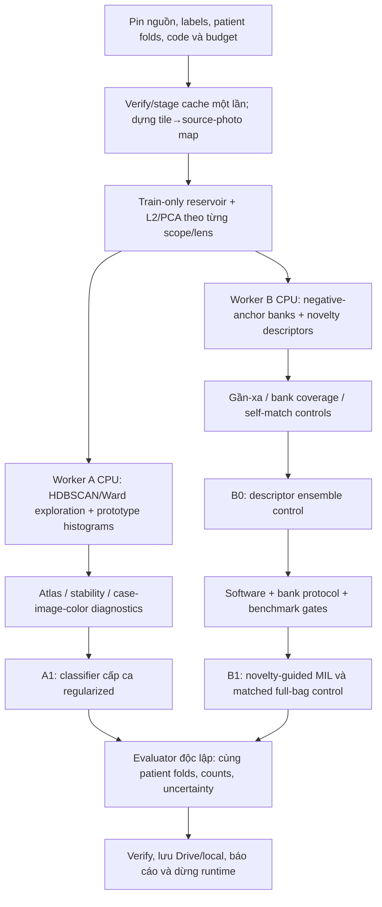
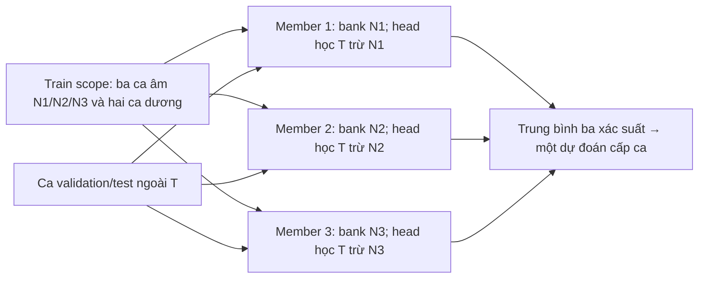

# Kế hoạch thực thi song song hai nhánh từ patch đến phân loại cấp ca

> v1.0 · 11/10/2026 · Asia/Saigon · kế hoạch cho lần chạy tiếp theo.
> Lần lập kế hoạch này không tạo Colab, không triển khai source, không chạy classifier mới và không gọi subagents. Theo yêu cầu người dùng, gọi subagents khi bắt đầu lần thực thi tiếp theo.

## 1. Hai mục tiêu và phạm vi bàn giao

| Nhánh | Câu hỏi cần trả lời | Sản phẩm chính | Mục tiêu dự đoán |
|---|---|---|---|
| **A — nhiều nhóm trung gian** | Có các nhóm feature ổn định nào? Tỷ lệ và đặc trưng nhóm trong một ca có giúp phân loại không? | Atlas nhiều mức, truy hồi ảnh, mô tả từng ca, classifier tuyến tính regularized | Nhãn ca ung thư / không ung thư |
| **B — tham chiếu không ung thư** | Những vùng ít giống các ca không ung thư đã thấy có hữu ích không? Hay chủ yếu phản ánh màu, ảnh chụp hoặc artefact? | Ngân hàng tham chiếu, bản đồ/ranking novelty, descriptor control và novelty-guided MIL với full-bag control | Nhãn ca ung thư / không ung thư |

Cả hai nhánh tiến triển đồng thời từ một nền dữ liệu dùng chung. Không bắt B chờ A xác định xong tên các cụm. Bank B chỉ dùng nguồn không ung thư của training scope, không dùng centers A fit trên hỗn hợp ca làm bank âm.

Số cụm patch và hai lớp bệnh là hai vấn đề khác nhau. Cụm có thể chứa mô tuyến, mô đệm, viêm, nhiều hình thái ung thư hoặc biến thiên chụp/nhuộm; cần kiểm ảnh để diễn giải. Cụm trộn nhãn ca chưa chứng minh cụm vô ích. Patch không ung thư trong ca ung thư là thành phần hợp lệ, không tự động là nhiễu.

Phạm vi bao gồm phát triển/test, atlas, controls, evaluation và bàn giao. Các study neural chỉ mở sau cổng kiểm chứng và benchmark; trạng thái bị dừng ở cổng nào phải được ghi đúng. Không coi việc viết kế hoạch là hai phương án đã chạy.

## 2. Dữ kiện đã có và kết quả chưa có

| Hạng mục | Đã xác nhận ngày 11/10/2026 |
|---|---|
| Nhãn | Có CARCINÔM → ca 1; chỉ tăng sản lành/kèm viêm → ca 0. Giữ Glade gốc. Mỗi ca là một người khác nhau theo xác nhận người dùng |
| Feature | v001 frozen ResNet50 ImageNet V1, 2.048D float32; không stain-normalize; không cập nhật CNN qua cache |
| Primary cohort | common16: 9 ca không ung thư / 7 ca ung thư, đủ ba lens, 146.506 references |
| Supplemental cohort | all18: 10/8, 148.990 references, có lens thiếu; chồng lấp common16, không là test độc lập |
| Baseline | E0–E4 đã hoàn tất 45 fits, 80 OOF predictions và 711 checkpoint commits; E4 pooled AUROC 0,476, TP 0/7 tại threshold 0,5 |
| Atlas v003 | 36 cấu hình trên 9.104 balanced samples; KMeans gán đầy đủ 146.506 rows; 48 shards đã verify |
| Truy hồi | 30 PNG nguồn khớp SHA/member; DBSCAN 10× cụm nhỏ 100 patch từ hai ảnh của cùng một ca (44+56 trên mẫu) |
| Giới hạn | Chưa có patch tumor ground truth, original crop geometry/registration chưa verify; chưa có morphology validation hoặc cluster stability đầy đủ |
| Runtime | Phiên CPU atlas đã dừng sau official Drive flush; không có runtime được tạo bởi kế hoạch này |

Primary IDs phải resolve và kiểm lại trước run:

```text
feature_id = 7301faeb7b193fb077451a9f2da44bbb609b69d3d7647261df73c351590cbe04
governance_id = 7665c85d068e73ba29202e1920f061029d52dc8c2d9393f9fe744a80d14d22af
common_bundle_id = 6e412d65e429ad19c3bcec645a19d7ee06fe75e560ef67149233f14d4175b0ff
common_split_id = 1feba2fd0694aa691682ead89121927062680f04351b6c0d4feaf6e2594c5501
all_bundle_id = 3dcf6aa5092118a1d654998e670680fdfff27f94780700fff533cb39a111647a
```

Đã xem baseline OOF và atlas full16, nên nghiên cứu cải tiến tiếp theo là **exploratory trên cohort đã dùng**. Nested CV hạn chế leakage trong tính toán mới, không biến cohort này thành một xác nhận độc lập chưa từng xem. Không đòi thêm ca mới để thực hiện kế hoạch, không cam kết accuracy cao.

Tham chiếu kết quả thực: [báo cáo atlas](../../Results/training_preflight/clustering_comparison_full/BAO_CAO_GOM_NHOM.md), [verify v003](../../Results/training_preflight/clustering_comparison_full/verification_full_v003.json), [chẩn đoán baseline](../../Results/training_preflight/diagnosis/BAO_CAO_CHAN_DOAN_BASELINE_MIL.md).

## 3. Kiến trúc tổng thể và chạy song song



- Một CPU runtime: hai child workers A/B, mỗi worker một numerical thread, queue và RAM có giới hạn. Root là owner Colab duy nhất.
- Chia sẻ staged cache/preprocessing **read-only**; root/helper dùng chung sở hữu việc publish transforms. Mỗi artifact chỉ có một writer.
- A/B có output roots, job IDs và locks riêng; không cùng sửa status hoặc checkpoint của nhau.
- Không chạy hai HDBSCAN nặng cùng lúc. Shared scheduler cấp một slot cho PCA/density jobs, slot còn lại có thể làm histogram/ranking/tests nhẹ.
- Khi B1 cần T4, ưu tiên tận dụng runtime T4 sẵn có hợp lệ. Nếu chỉ có CPU, commit/flush/dừng CPU rồi mở T4 theo quyền của lần thực thi; tránh hai runtime nhàn rỗi.
- A1 hoặc B0 CPU có thể chạy khi một fit B1 dùng GPU. **Một GPU fit tại một thời điểm**; không tạo hai encoder/trainer tranh T4. Hai nhánh vẫn chạy song song về tiến độ.
- Nếu sau này thêm prototype MIL cho A, các GPU fits cũng đi qua cùng queue. Phần mở rộng này chưa nằm trong study chính v1.0.

## 4. Subagents trong lần thực thi tiếp theo

Dùng tối đa bốn slot: root + ba subagents; cấu hình Luna/max theo lựa chọn người dùng khi công cụ hỗ trợ. Không tự sinh thêm agents hoặc chats mới.

| Vai trò | Công việc | Quyền và ranh giới |
|---|---|---|
| Root — integration/runtime owner | Protocol, shared module, scheduler, gh/CI, điều khiển Colab, publish/cleanup | Duy nhất tạo/mount/exec/stop runtime và quyết định nghiệm thu |
| Agent A — atlas/descriptor | Nhóm nhiều mức, histogram, classifier A, stability và tests | Worktree/module nhánh A riêng; không sửa trainer B/shared source nếu chưa bàn giao |
| Agent B — reference/novelty | Bank/member exclusion, scores, B0/B1 adapter, controls và tests | Worktree/module nhánh B riêng; không chạy Colab hoặc đổi labels |
| Agent QA — adversarial review | Leakage, source lineage, protocol equivalence, resume, label/chart interpretation, độc lập verify | Đọc receipts/local mirror; không SSH, không chạy encoder/training thứ hai |

Trước phân công: kiểm artifacts/worktrees, ưu tiên reuse worktree phù hợp. Base phải có trainer baseline đã nghiệm thu (PR #6/local release), không phát triển trên bản thiếu trainer hoặc uncommitted code không rõ nguồn. Dùng treehouse create/lock/review khi cần worktree riêng; root tích hợp có kiểm diff, không merge/push dữ liệu bệnh nhân.

Bàn giao agents bằng task hợp đồng rõ input IDs, file ownership, outputs, tests, status và blockers. Root chuyển code chung; không để hai agents cùng chỉnh cùng file. Agent không tự promote runtime/code trước integration gates. Kết thúc stage phải dừng monitors/processes thuộc công việc; không dừng workload khác.

## 5. Nền dữ liệu dùng chung — P0 đến P3

| Bước | Đầu vào và xử lý | Đầu ra bắt buộc | Kiểm tra |
|---|---|---|---|
| P0 · preflight | Bundle/features/governance/folds/code → public verifier, class counts, budget, Drive write-read | resolved_config, environment, input_manifest, resource snapshot | Nhãn, IDs, objective lens, source hashes, scope đúng; không active writer xung đột |
| P1 · stage | Copy features/case cache cần dùng vào /content một lần, checksum | SSD cache read-only + stage receipt | Source immutability, feature order/dim/count, không thiếu/cắt bag |
| P2 · photo lineage | Join governed tile refs với committed tile_index → source photo, case, lens, part/row | source_photo_map shards + commit | Mỗi tile resolve đúng nguồn; mọi refs cùng photo nhất quán case/lens; raw IDs không là model input |
| P3 · scope transforms | Lấy mẫu cân bằng theo train patient và ảnh; L2/PCA riêng lens | reservoir refs, PCA state, train membership/hash, transformed shards | Không validation/test patient trong fit; không padding; NaN/zero-norm xử lý fail hoặc policy có version |

Source-photo ID là khóa grouping, không dùng tên file hoặc mã ca làm feature. Chỉ sử dụng image_id/ảnh gốc có provenance đủ; không tự suy từ filename thành bệnh nhân mới hoặc crop geometry.

Reservoir default: tối đa 256 vectors/người/lens cho study nhỏ; chia quota giữa ảnh nguồn, lấy không hoàn lại, redistribute quota ảnh thiếu dữ liệu. Mỗi ca có tổng sample weight ngang nhau; mỗi ảnh trong ca được cân bằng khi fit hỗ trợ weights. Nếu cần sample lớn hơn cho ổn định mật độ, thử 512 ở atlas train-only có budget riêng, không đổi setting chính âm thầm.

Preprocessing chính: L2 trên mỗi vector 2.048D → PCA32 fit chỉ trên reservoir train của lens, không whitening. Stability ablation có PCA64 nếu sample đủ. Descriptor standardizer chỉ fit trên các ca được dùng để train head tương ứng. Không dùng global atlas PCA/centers v003 để đánh giá classifier.

Chưa stain-normalize hoặc chạy CNN mới ở study v1.0. Nếu color probes cho thấy shortcut, đề xuất feature version v002 riêng; lúc đó phải có RGB/preprocess/version/new-cache gates, không sửa vectors v001.

## 6. Nhánh A — khám phá nhiều nhóm và phân loại qua thành phần nhóm

### A0. Atlas train-only nhiều mức

1. Chọn một development scope đã có trong splits (outer0/inner0 train), không dùng nhãn outer test để quyết định số cụm hoặc prototype policy.
2. Trong từng lens chạy HDBSCAN `eom` và `leaf`: min_cluster_size 8/16/32/64 × min_samples 4/8. Đây là 16 cấu hình/lens, không nhập số cụm.
3. Dựng cây Ward trên cùng capped reservoir, kiểm nhiều mức cắt; chạy MiniBatchKMeans K=4/8/16 làm đối chứng phân hoạch chi tiết. Có thể giữ K=2 để so với atlas cũ, không dùng nó làm giả định sinh học.
4. Không áp cổng coverage≥50% làm tiêu chí duy nhất loại density solution: cụm nhỏ có thể quan trọng. Báo đồng thời coverage, noise, kích thước và mức tập trung nguồn; nhiều noise làm giảm khả năng mô tả, không chứng minh ảnh hỏng.
5. Stability: seed 42/43/44 và ba patient-level resamples cho shortlist, không cross-product mọi cấu hình. So trên cùng train-only probe tile set; ARI báo cả toàn set và phần được gán cụm ở cả hai lần, kèm coverage để noise đông không làm ổn định giả.
6. Xuất cluster/source-case-label crosstab, patient/photo concentration, kiểu màu và đại diện có truy hồi. Chưa gán tên viêm/ung thư nếu chưa review đủ pixels.

HDBSCAN/Ward giai đoạn này giúp khám phá; **A1 không dùng nhãn HDBSCAN full-cohort làm predictor**. scikit-learn HDBSCAN không mặc định có out-of-sample prediction tương đương model supervised. Nếu sau này dùng density assignment cho held-out data, cần adapter/policy reject-unknown đã kiểm E2E và fit train-only; chưa là đường bắt buộc v1.0.

### A1. Classifier nhỏ — đường chính có inference rõ ràng

- Trong từng inner train scope, fit MiniBatchKMeans theo lens trên reservoir với K chung cho ba lens, thử K=4/8/16. Không mở lưới K độc lập cho ba lens gây bùng nổ trial.
- Assign đầy đủ vectors vào centers cố định theo chunk. Giữ tile ref, center distance và margin; cluster IDs không phải nhãn ung thư.
- Descriptor chính là **photo-balanced histogram**: tỷ lệ cụm trong mỗi ảnh → trung bình các ảnh trong ca/lens. Không để ảnh nhiều tiles quyết định toàn bag.
- Tile-balanced histogram là ablation kiểm nguồn, được báo riêng. Nếu photo lineage thiếu, dừng primary photo-balanced path; output atlas/tile-only exploratory có identity khác, không gọi là cùng study.
- Bỏ một bin theo quy tắc cố định mỗi lens để tránh tổng bằng một: 3×(K−1) chiều = 9/21/45. StandardScaler fit trên train cases, L2-regularized logistic regression, intercept, unweighted case loss.
- Primary candidates: K=4/8/16 × C=0,1/1,0 = sáu cấu hình. Không dùng patient/code/Glade, counts hay filename làm feature.
- Chọn bằng mean inner case log loss; tie ≤0,001 chọn K nhỏ hơn rồi regularization mạnh hơn. Không chọn bằng outer AUROC hoặc silhouette.
- Refit dictionary/scaler/head mới trên outer-train theo cấu hình đã chọn. Sau khóa mới predict outer-test.
- Primary threshold 0,5; calibration/threshold tuning chưa thuộc primary v1.0.

A1 gồm 6 candidates×6 inner fits +3 outer refits = **39 classifier fits**, chưa gồm ablations. PCA/dictionary reuse trong đúng scope/hash; không tái dùng dictionary khác fold.

### A2. Truy hồi và review

Mỗi shortlisted cluster lấy 8–12 examples ban đầu: gần tâm, medoid, boundary, xa tâm, nhiều case/photo nếu cluster có đủ nguồn. Cụm chỉ có một ca phải ghi rõ, không giả tạo tính đa dạng. Noise giữ danh sách riêng và lấy mẫu để review.

Lưu label **chỉ patch đã review**: morphology description, tumor-witness/không ung thư được bác sĩ xác nhận nếu có, artefact nghi ngờ, mixed/unknown, reviewer, thời điểm và căn cứ. Không lan nhãn một đại diện sang toàn cụm.

Không có reviewer vẫn hoàn tất software/atlas/OOF exploratory được; semantic validation ghi pending/unknown, không tuyên bố các cụm là các loại mô đã xác nhận. Review label-informed từ atlas full16 không được âm thầm dùng để tune chính CV evaluation.

## 7. Nhánh B — novelty có kiểm soát self-match

### B0. Protocol bank–head ensemble

Vấn đề cần tránh: bank có patch của người q rồi score chính q thấp; model phân biệt người từng có trong bank với người mới thay vì bệnh.

Chọn protocol cố định cho v1.0: **mỗi member dùng một ca không ung thư làm anchor; anchor bị loại khỏi supervised training của chính member đó**.

Gọi T là train scope, N là các ca không ung thư trong T. Với mỗi n∈N:

1. Bank_n lấy từ n, theo từng lens, cân bằng ảnh. Primary 32 prototypes/lens từ reservoir ≤256 refs/lens; số prototypes giống nhau giữa các anchors trong cùng fit. Nếu không đủ 32 distinct vectors ở một anchor/lens, fail gate và lập setting nhỏ hơn cho toàn fit trước khi chạy; không pad/đổi K riêng từng người.
2. Transform chung fit trong T hợp lệ; bank chỉ fit nguồn n. Không đưa labels dương hoặc ca held-out vào bank.
3. Head_n train trên T\{n}; anchor không có sample supervised hoặc self-score trong head_n.
4. Validation/test q nằm ngoài T được score bằng **cùng bank_n** đã dùng cho head_n. Inference chạy mọi member; trung bình xác suất với trọng số bằng nhau.
5. Head_n và bank_n phải nằm trong cùng committed model identity. Không lấy bank của member khác ghép head_n.

Ví dụ inner train có 3 ca không ung thư +2 ca ung thư: ba members, mỗi bank một ca không ung thư; mỗi head học 2 ca không ung thư +2 ca ung thư. Đây vẫn rất ít ca; ensemble không tạo thêm bệnh nhân độc lập.

Chọn một anchor/member là thỏa hiệp do dữ liệu ít: nếu bank lấy hai trong ba ca âm thì head chỉ còn một ca âm, không qua minimum-class gate. Không khẳng định bank một người bao phủ đủ mô không ung thư. Bank nhiều người chỉ mở thành protocol version khác khi giải được bài toán training/query consistency và class counts; không thêm âm thầm vào outer refit.

Production gate: mọi member còn ít nhất hai ca âm và hai ca dương để train head. Kiểm class counts thực của từng split trước triển khai. Fixture smoke có thể nhỏ hơn nhưng có mode smoke, không được promote thành production.



Protocol này tránh self-match trực tiếp và bảo đảm train/query trong mỗi member dùng bank giống nhau. Một anchor vẫn có thể có coverage kém hoặc style riêng; ensemble không bảo đảm xóa confounding. Vì vậy phải đo coverage/anchor sensitivity và có full-bag matched control. Không dùng bank2-người cho âm nhưng bank3-người cho dương rồi coi scores so sánh được.

### B0.1. Scores và descriptor control trên CPU

- Score mỗi patch: khoảng cách Euclidean tới prototype gần nhất trong L2→PCA32 space. Tên trường `novelty_distance`, không gọi cancer probability.
- Stream query chunks ≤512; distance buffer bounded, không tạo matrix toàn146k×2048×bank.
- Descriptor mỗi lens: median, q90, q95 và mean của tail 5%; aggregation cân bằng source photos trong ca. Lưu raw distances để kiểm phân phối; không dùng maximum làm primary vì nhạy số patch.
- Logistic head_n với C=0,1/1,0, train-only standardizer. Chọn C theo mean inner log loss của **ensemble predictions**; không so scores self-query của anchors.
- Ngoài ra lưu ranking gần/xa/biên, nearest-bank prototype ref và provenance. Áp dụng cùng policy cho mọi query, không dùng nhãn thật query để chọn patch.
- Controls bắt buộc: bag-size/source-photo-count-only classifier riêng; nearest-bank retrieval của các ca âm held-out trong inner validation; so variation theo anchor và ảnh nguồn.
- B0 có tổng số heads = 2 candidates×sum số anchors của 6 inner scopes + sum anchors của 3 outer-train scopes. Nếu các inner có3 và outer có6 anchors: **54 linear-head fits**. Runner phải tính từ splits thật, không hardcode 54.

B0 là control có khả năng inference nhất quán, chưa là SiiMIL reproduction hay nhãn patch bệnh học.

### B1. Novelty-guided MIL — chỉ mở sau gates

Giữ frozen CNN/cache và toàn bộ bags. Không tự loại patch thấp novelty hoặc HDBSCAN noise.

- Mỗi member vẫn bank_n/head_n với anchor exclusion như B0; head là E4-size gated Attention-MIL mới khởi tạo.
- Smoke/benchmark dùng train scope đã pin, mặc định outer0/inner0 train; chọn ca lớn nhất trong scope được phép. Weights/optimizer smoke không mang sang study; không dùng outer-test làm ca train thử để chỉnh setting.
- Với patch i: attention mới = softmax(a_i + β×z_i) trên **toàn bag**.
- a_i là attention logit học được; z_i là novelty đã chuẩn hóa median/IQR theo lens/member bằng balanced samples từ T\{n}, không dùng validation/test. Clip z trong [−3,3], epsilon cố định và zero-IQR policy có test/config.
- Candidates β=0 và β=0,5. β=0 là **matched full-bag ensemble control**: cùng patient exclusions, architecture, epoch selection và inference aggregation. Không so chỉ với E4 học nhiều ca hơn rồi quy chênh lệch cho novelty.
- β=0,5 chỉ được chọn nếu mean inner ensemble BCE tốt hơn β=0 ít nhất0,01; không qua thì β=0 là kết quả hợp lệ, ghi không thấy ích lợi của novelty trong protocol này.
- Projection128/gated hidden64/dropout0,25 giữ vị trí đã kiểm chứng; BCEWithLogits, AdamW LR1e−4/WD1e−3, case batch1, FP32, max30 epochs/patience5 như baseline. Không warm-start head E4 cũ hoặc chuyển weights giữa folds/members.
- Mỗi inner member chọn best epoch bằng inner-validation BCE; ensemble candidate evaluation dùng predictions của các committed checkpoints. Lưu per-member epochs và ensemble scores.
- Outer epoch: median các best epochs trong mỗi inner scope, sau đó median hai scope, ceil và ≥1. Các outer members khởi tạo mới, refit đúng epoch chốt; không early-stop theo outer test.
- Outer refit β=0 để có matched control ở cả ba folds; nếu β=0,5 được inner chọn, refit thêm nó. Tất cả predictions theo case, không ensemble patch labels.

Fit count B1 = 2×sum inner anchor counts + tối đa2×sum outer anchor counts. Với3/6 anchors: tối đa **72 neural fits**. Chỉ có một fit dùng GPU một lúc; cần benchmark để biết có hoàn tất trong một phiên hay phải resume. Epochs/model counts không là số người bệnh độc lập.

### B2. Truy hồi để kiểm novelty

Mỗi scope/lens/member lấy gần bank, tail novelty, boundary và noise; không chỉ xem patch xa bank. Giữ examples từ ca âm validation và ca dương validation để review lỗi sau evaluation của development scope, không tune theo outer test.

Phải kiểm nearest references thực sự đúng bank/source, distances có bất biến với permutation/chunk size trong tolerance, và rawPNG SHA khớp index. Ảnh xa bank có thể là viêm/đệm/artefact/màu; không tự chuyển thành tumor-positive.

## 8. Protocol chung, đối chứng và cách kết luận

- Giữ nested patient CV 3 outer×2 inner, splits seed42 đã khóa. Mọi PCA/dictionary/bank/scaler/novelty scale chọn/fit ở inner train; refit mới outer train. Inner validation chỉ transform/query, labels chỉ phục vụ chọn setting đã khai báo.
- A1 và B0/B1 được đánh giá riêng; không lấy nhánh đạt outer AUROC cao hơn rồi coi score đó là đánh giá độc lập cho winner.
- Primary selection metric: case log loss; primary threshold0,5. Báo AUROC/AP từng fold, sensitivity/specificity/balanced accuracy, Brier/BCE, TP/FP/TN/FN và mẫu số.
- Báo pooled OOF riêng với lưu ý fold score scales khác nhau; không thay nó bằng mean fold AUC hoặc gọi metric nào là AUC đã sửa. AP kèm prevalence.
- Full common16 mỗi ca có một OOF prediction/variant; B ensemble nhiều members vẫn chỉ một prediction cuối/ca/variant.
- Baselines: trainfold-prevalence prior; count-only/source-photo-count-only; E0/E4 historical cùng folds; B1 matched β=0 là đối chứng nguyên nhân chính cho β=0,5.
- Permutation control cho classifier sử dụng permutation nhãn **cấp ca** trong train, giữ grouping; chỉ mở có budget, không dùng patch label shuffle tạo N lớn giả.
- Bootstrap uncertainty theo người, resample paired OOF predictions, báo số resamples không có đủ lớp; đây là descriptive conditional uncertainty, không bao phủ toàn biến thiên refit/nested selection hoặc tính độc lập chưa có.
- Không báo patch accuracy/Dice/tumor purity khi không có ground truth tương ứng. Silhouette/stability không thay sensitivity cấp ca.
- all18 chỉ là supplemental sau common16 gates; missing-lens masks/empty bags explicit và folds all18 riêng đã verify. Không trộn OOF hai cohorts hoặc gọi hai ca bổ sung là test độc lập vì toàn cohort đã tham gia exploration.

Tiêu chí đánh giá:

| Mức | Thành công được phép kết luận | Không được suy ra |
|---|---|---|
| Software | Verify/resume/lineage/resource gates qua | Accuracy cao |
| Atlas | Cụm ổn định, mức nguồn/màu được kiểm, truy hồi được, nghĩa unknown được ghi | Các cụm là đúng các bệnh |
| Bank | Query dùng đúng bank, không self-match supervised, coverage/anchor sensitivity có báo cáo | Novelty là xác suất ung thư |
| Predictive exploration | Inner selection đã khóa; OOF đủ, controls/uncertainty/bất lợi được báo | Xác nhận lâm sàng độc lập hoặc đảm bảo cải thiện |

Không có tăng chất lượng cũng là kết quả nghiên cứu hoàn tất nếu protocol/artifacts đầy đủ. Nếu chỉ software/atlas qua còn B1 bị gate/budget chặn, báo stage hoàn tất và study partial, không ghi cả mục tiêu complete.

## 9. Kiểm thử trước chạy dữ liệu lớn

Các module đề xuất cho lần phát triển (chưa tồn tại do kế hoạch này): shared lineage/scope-transform/scheduler; A clustering/descriptor; B bank/member-descriptor/MIL adapter; evaluator và notebook entrypoint. Dùng typed contracts, public verified loader, logs minh bạch; không monkey-patch trainer để đưa novelty vào attention.

Local chỉ fixture nhỏ: synthetic/2–4 ca thật inner-train, tối đa64 rows/lens/ca, CPU≤10 phút mỗi smoke. Không xử lý full cohort hoặc PNG batch lớn trên máy cá nhân. Dữ liệu thật thiếu rows dùng đúng count, không pad. Production eligibility được test bằng synthetic scope đủ class counts; real smoke không chứng minh predictive quality.

| Test | Tình huống / assertion có ý nghĩa |
|---|---|
| Q01 leakage | Đưa một held-out patient vào reservoir/bank/scaler: bị từ chối trước fit/publish |
| Q02 bank exclusion | Anchor có trong supervised member training hoặc query-label ảnh hưởng ranking: fail contract |
| Q03 source lineage | Tile/part/row/photo/lens/count/order mismatch hoặc forged rehash truncated bag: fail closed |
| Q04 descriptors | Toy nhiều ảnh có tile counts khác: photo-balanced histogram đúng, permutation invariant; không gán nhãn từ case-positive cho từng patch |
| Q05 novelty | Exact tiny reference distance; nearest-ref join; bounded buffer; chunk/full/permutation tương đương |
| Q06 MIL | β=0 forward/gradient khớp full-bag control; β>0 bias hướng đúng; attention sum toàn bag=1; finite/RNG/checkpoints |
| Q07 degenerate input | Zero norm, zero IQR, insufficient distinct prototypes, NaN, all-noise, one-class head, empty/missing lens |
| Q08 group filenames | Cluster−1 không ghi đè cluster1; chart-point→tile join; ID/config bắt buộc trong metrics |
| Q09 resumes | Stop giữa shard/member/epoch; resume không trùng assignment/prediction, không coi payload dở là commit |
| Q10 concurrent writers | Hai workers cùng shared transform/run lock: đúng ownership, worker thứ hai bị chặn; error ở A không phá last-good B |
| Q11 scopes/identities | Model/bank/scaler khác fold/config/feature/root: load phải từ chối, không dựa pointer đơn lẻ |
| Q12 resource/fault | Controlled I/O/ENOSPC/OOM/deadline exceptions; bounded retry, last-good giữ nguyên, status partial/error đúng |
| Q13 inference | Ensemble save→new process→predict, member ownership đúng, mỗi held-out case đủ members và một final score |
| Q14 evidence integrity | Mọi tests có active assertions; public manifests/CRC/SHAs/receipts independently verify; nguồn không bị ghi |

Mỗi bug phải E2E reproduction trước fix, root cause, architecture fix, E2E/regression lại và PLAYBOOK. Không ghi rủi ro giả định thành lỗi đã sửa. Source chức năng mới đi đủ conveyor6 trạm, PR/CI green qua gh-axi, attach PR khi tạo, trước release runtime full-run; không đưa data/private IDs lên GitHub.

## 10. Nghiệm thu theo chặng và lịch chạy thực tế

| Stage | Ai / môi trường | Việc thực hiện | Qua gate mới được đi tiếp |
|---|---|---|---|
| S0 · protocol | Root + QA local | Pin candidates, schemas, scope/class counts, resource plan, agent worktrees | protocol.json/config hash và không còn quyết định về self-match chưa giải |
| S1 · development | A/B agents parallel local | Shared contracts, A/B modules, tests Q01–Q14, notebook/controller | E2E + relevant regressions + conveyor/CI qua |
| S2 · integration | Root Colab CPU | Mount đúng kernel; verify/stage/photo map; smoke/rerun/error; persist round-trip | Stage receipt, ownership và resume qua; benchmark đủ RAM/disk |
| S3 · CPU parallel | Root launch A/B workers | Train-only atlas/prototypes; B banks/descriptors; controls/retrieval | Artifacts đủ/finite/traced; throughput/ETA được đo, không có data contamination |
| S4 · linear studies | CPU parallel | A1 và B0 nested studies riêng; freeze settings/OOF; chưa neural | Đủcase predictions, config selection inner-only, evaluator verify, B anchors/head counts đạt |
| S5 · GPU gate | Root T4 khi cần | Same-code GPU smoke, β=0 parity, largest-bag backward, committed resume và budget | Full bags đủVRAM, bounded memory và estimate số fits khả thi |
| S6 · B1 study | Một GPU queue; A reports CPU | Inner candidates/members, outer refits/control/predictions | No self-match/leakage, committed epoch/member/fit, full-bag policy giữ nguyên |
| S7 · handover | Root + QA | Báo cáo hai nhánh/negative results, code/model packages, restore/inference guide | Drive/local persistent checks; dừngwriters, officialflush và stop owned runtime |

Không đặt ETA đảm bảo trước benchmark. Mốc thời gian để lập ngân sách, không là cam kết:

- Local setup/phát triển/test tùy lỗi; chỉ compute smoke có cap. Không dùng GPU để chờ review/code/CI/OAuth lâu.
- Resource guard ban đầu: soft RSS limit2GiB/CPU worker và tổngworkload≤70%RAM khả dụng; heavyPCA/density chỉ mộtjob. Disk staging cần checksum-size cộng ít nhất2GiB scratch margin. B1 peakVRAM≤80%VRAM khả dụng tại preflight; benchmark actual peak/backward trước fitqueue. Đây là guard đề xuất, không phải peak đã đo cho code mới; vượt guard thì pause/review, không bỏpatch hoặc đổiprecision âm thầm.
- CPU S2–S4: phiên đầu đặt work budget120 phút, reserve15 phút commit/flush; sau đo một lens và một inner fit cập nhật ETA cho hai nhánh. Chưa đủ thì pause/resume shards/jobs, không giảm cohort.
- T4 S5–S6: budget địa phương330 phút/ngày, reserve30 phút; **thời gian thực do Colab quyết định**. Dùng budget còn lại đã đo/ghi, không giả định còn nguyên330 hoặc quota reset chỉ vì đổi tài khoản.
- Fit_count×measured_duration cộng staging/checkpoint/retrieval overhead để quyết định lượt nào mở. Không giữ T4 chạy nhàn rỗi để agents phát triển code.
- Không auto-click/keep-alive giả/SSH để giữ phiên; không luân phiên accounts để vượt giới hạn dịch vụ.
- Deadline là cooperative stop trong runner, không tạo hẹn giờ shutdown máy hoặc heartbeat mới. Máy Na giữ bật; mọi yêu cầu tự tắt cũ đã hủy.

## 11. Lưu trữ, shards, IDs và resume

```text
MyDrive/histology/
  features/v001/                         nguồn immutable
  bundles/<bundle_id>/                   nguồn immutable
  runtime/<code_sha>/                    notebook/runtime release đã CI
  clustering_dual/v001/<study_id>/
    protocol.json, input_manifest.json, environment.json
    scheduler/status.json, events.jsonl, jobs.jsonl
    shared/<scope_id>/<lens>/
      train_membership.json, reservoir_refs.csv.gz
      source_photo_map/part_<id>.csv.gz
      preprocessing/versions/<version>/model + commit.json
    A/<scope_id>/
      models/<config_id>/versions/...
      assignments/<lens>/<case_or_part>.csv.gz + commits
      descriptors/, atlas/, stability/, diagnostics/
      fits/<candidate_id>/weights + commit
    B/<scope_id>/members/<anchor_token>/
      bank/<lens>/models + reference_refs + commits
      scores/<lens>/<query_case>.csv.gz + commits
      descriptors/, retrieval/, diagnostic_controls/
      linear_fits/<candidate_id>/...
      mil_fits/<beta>/<fit_id>/checkpoints/versions/...
    evaluation/A1/, B0/, B1_selected/, B1_beta0_control/
    reports/, review/cluster_review.csv, final_receipt.json

/content/histology-dual/                  scratch có thể mất
  stage/<feature_bundle_identity>/       cache read-only
  work/A/, work/B/, checkpoints_tmp/

Local:
  Results/clustering_dual/<study_id>/     small fixtures, tests, receipts, figures/report
  docs/plans/                            kế hoạch tham chiếu, không lưu RGB/features ở Git
```

Source-photo map nằm trong shared stage, có thể lưu một lần theo feature/bundle identity thay vì nhân bản theo từng scope; membership chỉ định phần train được phép dùng. Không chia sẻ fitted model giữa scopes bằng tên lens đơn lẻ.

Model identity tối thiểu: code/dependencies/source IDs, split/scope/train membership, algorithm/seed/PCA/K/bank anchor/member exclusions, descriptor policy, loss/threshold, review exclusions/version và transform/model hashes. Job_id phải đủ chi tiết study/branch/scope/lens/candidate/member/shard/epoch.

Resume theo đơn vị committed shard/model/head/member/epoch:

1. Tính vào scratch → checksum → copy sang version mới Drive → đọc lại verify → commit receipt.
2. Chỉ sau commit cập nhật status/pointer. Không overwrite last-good hoặc tin file tồn tại.
3. Transform/PCA fit bị ngắt được chạy lại từ reservoir đã commit; assignment/scoring tiếp từ shard thiếu. Logistic fit nhỏ chưa commit chạy lại toàn fit; không giả checkpoint iteration sklearn.
4. MIL giữ model/optimizer/RNG/epoch/best/patience/config/bank IDs và source order; replay epoch chưa commit, không carry weights giữa scopes/members.
5. Mất runtime: reconcile commits và owner termination trước lock recovery; không chiếm lock sống theo TTL. Resume với config khác phải fail/new run ID.
6. Events ghi case pseudonym/stage/error, không auth URL/token/raw clinical IDs. Retries transient tối đa3 có backoff; permission/hash/NaN/protocol errors dừng nhánh.
7. Hai workers ghi status nhánh riêng; root aggregator ghi scheduler status. A/B có thể pause riêng; study overall complete chỉ khi các stages bắt buộc đã verify.

Trạng thái đề xuất: planned, preflight, running, checkpointing, paused_budget, attention_required, error, complete. Complete computational và semantic_review_pending có hai trường riêng; pending morphology không bị trình bày thành đã xác nhận.

## 12. Rủi ro thực và phương án phản ứng

| Rủi ro | Dấu hiệu | Xử lý / cổng |
|---|---|---|
| Cụm theo ảnh/màu | Case/photo concentration cao; cluster đổi mạnh theo preprocessing | Truy hồi đa nguồn, color probes; không tự đặt tên bệnh; feature-v002 ablation riêng nếu cần |
| HDB noise chứa rare tissue | Low coverage, review noise có cấu trúc mô | Giữ unknown/noise; report độ bao phủ; thử leaf/granularity, không xóa tự động |
| Ngân hàng một người hẹp | Ca âm validation novelty cao; anchor members bất đồng | Báo coverage/anchor sensitivity; matched control; bankfail không đổi novelty thành cancer |
| Bank–head self-match | Anchor nằm trong head samples; scores gần0 riêng class0 | GateQ02 chặn; chỉ member exclusion protocol, không vá bằng chỉnh threshold |
| Descriptor overfit | Train BCE giảm, inner BCE kém; counts-only mạnh | L2/K nhỏ, báo controls; không tune outer; không mở mô hình lớn tự động |
| Photo lineage thiếu | Vector không tìm đúng source image, membership không nhất quán | Dừngphoto-balanced primary, giữ outputs tốt; tile-only exploratory có setting riêng |
| CPU/RAM tranh chấp | Hai workers RSS tăng, density jobs treo | MộtheavyCPUslot, threads bounded, giảm queue/scratch; không âm thầm giảm sample/feature dimensions |
| Mount/Drive I/O | CLI kernel không thấy nguồn hoặc commit không đọc lại được | Officialmount đúngkernel, boundedretry; giữlast-good và pause; người dùng tự OAuth khi cần |
| GPU quota/OOM/runtime mất | Không đủ nguồn lực để mở fit mới | Commit/resume fit; T4 queue mộtowner; không sampling/AMP/folddrop ngầm hoặc quota bypass |
| Noise filename / thiếu chart lineage | −1 và1 cùngfile; điểm không resolve tile | Q08/independentverifier fail; không bàn giao chart không có trace |
| Hai nhánh lỗi độc lập | A fail, B đang commit hoặc ngược lại | Scheduler pause nhánh lỗi; B tiếp nếusharedsource vẫn verified; overallpartial, không complete giả |

Không có ngưỡng universal để gọi cụm “đúng mô”. Stability/case diversity/color association là diagnostics; cụm chỉ một ca có thể là tổn thương hiếm hợp lệ. Cần review và predictive controls để quyết định cách dùng.

## 13. Checklist giám sát và bàn giao

### Đã có

- [x] Nguồn v001/common/all và nested splits đã nghiệm thu.
- [x] Baseline E0–E4 và atlas v003 đã có receipts; runtime cũ đã dừng.
- [x] Hai hướng nghiên cứu đã mô tả trong [chiến lược nhãn yếu](CLUSTERING_WEAK_LABEL_STRATEGY.md).
- [x] Kế hoạch này pin đường chính, controls, self-match protocol và phân công lần chạy tiếp.

### Lần thực thi tiếp theo

- [ ] Gọi ba subagents, worktree/module ownership và shared contract được root/QA chốt.
- [ ] Kiểm class counts/member eligibility thực, source-photo lineage và source/code/version IDs.
- [ ] Q01–Q14, conveyor/PR/CI, runtime/notebook hash qua trước full data.
- [ ] CPU mount/stage/smoke/resume qua; A/B chạy song song có scheduler và giới hạn tài nguyên.
- [ ] A atlas/stability/retrieval + A1 đủ OOF; B banks/coverage/retrieval + B0 đủ OOF.
- [ ] Chốt B1 GPU smoke/parity/largestbag/budget gates trước neural study.
- [ ] B1 inner/refits/matchedcontrol đủ receipts hoặc báo partial/blocker cụ thể.
- [ ] Báo cáo cả hai nhánh: chi phí/time/peak RAM-VRAM, nhãn ca, fold metrics, uncertainty, failure/negative findings, ảnh nguồn và meaning unknown.
- [ ] Deliver source/runtime/weights/prototypes/banks/scalers/model card/inference và resume guide; records chứa đúng member identities.
- [ ] Local/Drive persisted artifacts verify, writers dừng, official Drive flush, stop runtime và xác minh server; không shutdown máy.

Người dùng nhận: báo cáo Markdown+HTML ngoại tuyến, chartsPNG/SVG, montage nguồn, bảng source-case-label trong từng nhóm, patient/photo distributions, descriptor/ranking examples và bảng A/B/control cùng folds. Ghi rõ phần đã train, phần chưa train, software passed và quality chưa cải thiện nếu có.

## 14. Tài liệu và quan hệ với kế hoạch cũ

- [Chiến lược hai hướng](CLUSTERING_WEAK_LABEL_STRATEGY.md): nền lý luận; các mục ưu tiên A trước/B sau được **thay cho lần thực thi mới bằng lịch A/B song song trong tài liệu này**.
- [Trainer/protocol baseline](MIL_TRAINING_PLAN.md), [reliability](COLAB_TRAINING_RELIABILITY.md), [T4 optimization](MIL_T4_OPTIMIZATION_PLAN.md): tái dùng safeguards, không tái dùng weights smoke/fold cũ.
- [HDBSCAN parameter/leaf selection](https://hdbscan.readthedocs.io/en/latest/parameter_selection.html), [scikit-learn HDBSCAN](https://scikit-learn.org/stable/modules/generated/sklearn.cluster.HDBSCAN.html): không biết trướcK vẫn có hyperparameters và noise; pin sklearn1.8 đã dùng, không tự upgrade theo tranglatest.
- [TPMIL, MIDL2024](https://proceedings.mlr.press/v227/yang24d.html): trainable prototypes/soft assignment trong weakly supervised MIL. A1 tuyến tính hiện là control tùy chỉnh, không tái lập TPMIL đầy đủ.
- [SiiMIL/Attention2Minority](https://arxiv.org/abs/2301.07700): normal reference/salient instances cho small lesions. B dùng prostate ImageNet features và anchor-exclusion ensemble, không là tái lập Camelyon/keyset/pretraining của bài báo.
- [HistoEncoder prostate](https://doi.org/10.1016/j.jpi.2026.100715): pathology representations/cluster fractions; không chứng minh v001 hiện tại đã có các cụm bệnh.
- [Site-specific histology signatures](https://www.nature.com/articles/s41467-021-24698-1): thay đổi acquisition/staining/digitization có thể tạo shortcuts; chuẩn hóa màu không được giả định giải hết confounding.
- [Attention-MIL](https://proceedings.mlr.press/v80/ilse18a.html), [Colab FAQ](https://research.google.com/colaboratory/faq.html): bag-label learning và runtime/resource limitations.

**Version mới chỉ được mở sau khi ghi thay đổi protocol/candidates/bank rules và lý do. Không thay kết quả thành công/không thành công bằng cách chỉnh hậu nghiệm outer test, xóa patch hiếm hoặc đổi split.**
