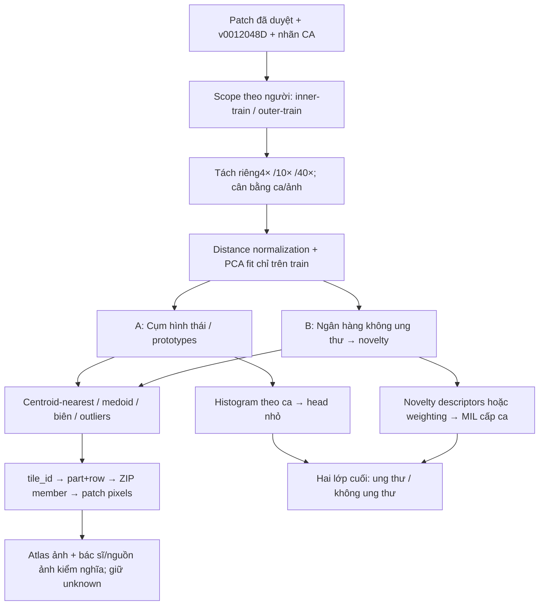

# Chiến lược gom nhóm patch với nhãn yếu — hai hướng phát triển

**11/10/2026 · dữ liệu hiện hữu · chưa train lại.** Mục tiêu cuối vẫn là **ung thư / không ung thư ở cấp ca**. Gom nhóm là tầng khám phá/biểu diễn/chọn điểm cần xem trước khi học classifier/MIL, không tự thay nhãn bác sĩ bằng cluster ID.

**Cập nhật thực thi:** đọc [kế hoạch hai nhánh song song v1.0](CLUSTERING_DUAL_TRACK_EXECUTION.md) cho lần chạy tiếp theo. Kế hoạch mới bổ sung bank–head member exclusion để tránh self-match và thay lịch A trước/B sau bằng hai workers A/B song song. Các mục pilot dưới đây giữ dạng lịch sử; atlas full16 v003 và 30 ảnh truy hồi đã hoàn tất, xem [báo cáo kết quả](../../Results/training_preflight/clustering_comparison_full/BAO_CAO_GOM_NHOM.md). Chưa train classifier từ cluster/novelty mới.

## 1. Ý tưởng áp dụng được đến đâu?

Có thể gom các patch giống nhau dựa trên vector hiện có, đo phân bố cụm theo ca và truy ngược ảnh để kiểm. Nhưng **hai lớp bệnh không đồng nghĩa hai cụm**: không ung thư gồm tăng sản, viêm, mô đệm, tuyến, mạch; ung thư cũng có nhiều hình thái; màu/ánh sáng và artefact có thể tạo cụm riêng.

Thông tin nhãn có tính bất đối xứng:

- **Ca không ung thư:** nếu đúng specimen/ảnh, nhãn âm được xác minh và coverage phù hợp, các patch mô có thể dùng làm **nguồn tham chiếu không ung thư theo giả định negative-bag của MIL**. Không coi mọi patch là cùng một loại mô khỏe mạnh; nền/artefact vẫn có thể nằm trong bag.
- **Ca ung thư:** ảnh/bag cần chứa ít nhất một tumor-witness; những patch còn lại có thể không ung thư. Chúng vẫn là **unlabeled/mixed instances**, không được gán tất cả thành ung thư.
- Cụm chứa patch từ ca lành chỉ cho biết **có hỗ trợ từ nguồn không ung thư**. Điều đó không chứng minh mọi patch gần centroid đều lành; cancer và benign có thể trộn trong cùng feature cluster.
- Xa nguồn không ung thư = **khác/lạ so với những mẫu đã thấy**, không đồng nghĩa ung thư. HDBSCAN noise không đồng nghĩa ảnh hỏng.

Vì đã có frozen CNN vectors, giai đoạn này đặt **sau trích feature và trước train MIL/head**. Nó không đòi train CNN lại. Nếu thay encoder/stain/crop thì phải tạo features mới.

## 2. Khung xử lý chung và truy hồi

Truy hồi là bước bắt buộc để biết cụm thực sự phản ánh gì. Mỗi representative lưu `feature_id`, fold/scope, lens, cluster/bank ID, `tile_id`, `part_id`, `row_index` và hash. Join feature-index/source-manifest để tìm ZIP và member chứa pixels. Nếu có source-photo/x-y thì giữ nguyên cùng trạng thái xác minh; **original crop geometry hiện chưa verify** nên không dựng overlay trên lam gốc hoặc registration đa lens như đã biết chắc.

Không chỉ lấy một ảnh sát centroid: lấy ví dụ gần tâm, vùng biên, điểm xa và ví dụ từ **nhiều ca/ảnh nguồn**. Với mỗi cụm, mục tiêu ban đầu là8–12 patch từ tối thiểu2 ca nếu cụm có đủ ca. Đây là kế hoạch review, không phải kích thước đủ chứng minh độ thuần.

Tạo `cluster_review` với các trường: loại hình thái quan sát, mô không ung thư được xác nhận trên **patch đã xem**, tumor-witness được xác nhận trên **patch đã xem**, artefact nghi ngờ, mixed/unknown, reviewer và phạm vi nhãn. Không lan nhãn một medoid sang toàn cụm. Nếu chưa có review bổ sung, mọi suy luận bệnh học của cụm vẫn là unknown.

## 3. Hướng A — Atlas hình thái → phân bố theo ca → classifier nhỏ

### Mục đích

Xem có bao nhiêu nhóm feature hợp lý và biểu diễn mỗi ca bằng **tỷ lệ các kiểu hình thái**, giúp giảm độ phức tạp so với học attention312.388 tham số từ5–6 ca mỗi inner fit. Không ép K=2 hoặc đặt tên bệnh cho các cụm tự động.

### Các bước

1. Giữ v001/duplicate dispositions và split theo người. Tách lens vì4×/40× có field-of-view khác, chưa có spatial registration.
2. Tạo reservoir lấy mẫu từ **train cases**: cap theo ca/ảnh, kèm sample weights để mỗi ca có đóng góp tương đương. Không để một ảnh hàng nghìn tile chi phối PCA/centroid. Không padding nhân patch để tạo mẫu độc lập giả.
3. Khảo sát L2 normalization + PCA32/64 trên train sample, không whitening mặc định; khóa phép biến đổi trước validation/test. MiniBatchKMeans phù hợp xử lý theo phần. HDBSCAN dùng để khám phá density/outlier, chưa dùng trực tiếp làm predictor trên held-out samples.
4. Atlas khảo sát K=2/4/8/16, seed lặp nhỏ và resample theo **người**, kiểm silhouette, stability/ARI, kích thước cụm và mức tập trung vào một ca/ảnh. Silhouette cao không có nghĩa cụm đúng ung thư/lành.
5. Gán **mọi vector** vào prototypes đã fit theo từng chunk; giữ nguyên toàn bộ vector. Lưu assignments và representative refs, tạo montage để kiểm nghĩa từng cụm.
6. Tạo histogram normalized từng ca×lens. Đối chiếu tile-weighted với photo-balanced histogram nếu source-photo provenance đủ. Có thể bắt đầu K=4/8 →12/24 histogram dimensions cho ba lens, thay vì đưa6144 mean features hoặc head lớn vào bộ ít ca.
7. Thử classifier tuyến tính regularized ở cấp ca; chọn K/regularization trong inner data. Nhãn supervised vẫn là nhãn ca0/1. Sau control mới thử cluster-aware/hierarchical MIL với prototypes; không mặc định CLAM/Transformer lớn tốt hơn.

### Sản phẩm và cách kiểm

- `cluster_models`: normalization/PCA, centers, scope/train-case manifest và hashes.
- `assignments`: lens, tile ref, cluster/distance; không chứa nhãn tumor tự tạo.
- `atlas`: nearest/medoid/boundary/outlier examples + `cluster_review`.
- `case_histograms`: proportions/masks + lineage, không dùng case ID làm predictor.
- Đánh giá classifier: BCE/Brier, AUC/AP từng fold, sensitivity/specificity/counts, baseline prior, variability. Không chọn winner theo outer OOF.

**Thành công ở tầng khám phá:** xác định được các nhóm tái lập qua nhiều người và có hình thái có thể giải thích. **Thành công ở tầng dự đoán:** descriptor giúp dự đoán cấp ca trong protocol đã khóa. Hai điều này khác nhau; một atlas hữu ích vẫn có thể không tăng AUC.

### Nguồn sát hướng A

[HistoEncoder prostate](https://doi.org/10.1016/j.jpi.2026.100715) dùng pathology representations, clustering và cluster fractions để mô tả bệnh nhân; không phải quy tắc hai cluster=tumor/benign. [PMIL](https://www.sciencedirect.com/science/article/pii/S1361841523000099) và [TPMIL](https://proceedings.mlr.press/v227/yang24d.html) là các tiền lệ prototype/histogram trong MIL. Encoder/scale/cohort của papers khác dữ liệu này; v001 ImageNet có thể chủ yếu gom theo texture/màu/nguồn.

## 4. Hướng B — Ngân hàng không ung thư → tìm vùng khác biệt → MIL

### Mục đích

Tận dụng nhãn âm làm anchor để tìm các patch ít giống mô không ung thư đã thấy, giúp tìm tumor-witness hoặc vùng cần xem mà không phải gán ung thư cho mọi patch trong ca dương.

### Các bước

1. Dựng bank riêng từng lens **chỉ từ ca không ung thư của train scope**; nhiều prototypes cho các kiểu không ung thư, gồm tăng sản/viêm. Không gộp thành một centroid “healthy”.
2. Lấy mẫu cân bằng theo ca/ảnh và QC references; dùng medoids/centers/coreset. Khóa preprocessing/bank size trong inner protocol.
3. Tính similarity/distance tới bank cho **tất cả ca truy vấn**. Có thể dùng nearest-prototype distance hoặc k-neighbor robust score; gọi là novelty/dissimilarity, không phải xác suất ung thư.
4. Truy hồi hai phía: patch gần bank + patch xa bank, gồm nhiều nguồn và patch biên. Bác sĩ có thể kiểm loại mô/artefact và tumor-witness khi review được; không cần cung cấp thêm ca mới.
5. Đầu tiên giữ full bags: tạo vài novelty descriptors theo ca/lens, hoặc xem như nhánh phụ. Không xóa patch thấp điểm/algorithmic noise. Histogram/distribution/control theo bag-size phải giúp phát hiện shortcut.
6. Chỉ sau khi bank/retrieval có ý nghĩa mới thử novelty-guided weighting hoặc selected-bag policy. Nếu chọn patch, lưu selected/background/unknown refs riêng và giữ full-bag control. Áp dụng cùng quy tắc lên mọi ca test **không dùng nhãn thật của ca**.

### Các vấn đề cần chốt trước classifier của hướng B

- Ca lành dùng để fit bank dễ tự khớp với mẫu của chính nó. Không train classifier bằng self-distance thấp giả tạo rồi so với ca dương/ca test chưa từng thấy.
- Cần patient-level cross-fitting/leave-one-benign-patient-out cho score của train cases; đồng thời kiểm **bank-size/coverage** ở cả hai nhóm và giữa train/validation/test. Không dùng bank2người cho âm nhưng bank3người cho dương mà coi score là cùng phân phối. Cross-fitting riêng cho âm chưa tự giải quyết vấn đề này.
- Trong primary inner fits đã khóa có3 ca không ung thư; bỏ một ca còn2 anchors. Pilot4ca hiện có2 anchors. Coverage/quantile thresholds vì vậy rất bất ổn. Trước hết dùng B cho retrieval và descriptors khám phá; chỉ chọn pipeline inference/cross-fit thống nhất sau khi control trên development data qua.
- “Top5% patch lạ” không có nghĩa5% xác suất false-positive ở **cấp ca**. Max-score tăng theo số patch; dùng quantiles/robust summaries và đối chứng bag-size-only thay vì mặc định maximum.
- Standard PU/nnPU cần instance positives/assumptions/class prior phù hợp; hiện có known-negative cases và mixed positive bags, chưa có cancer-positive patches. Không biến toàn bộ patch ca ung thư hoặc patch top-anomaly thành P để dùng PU loss.

### Nguồn sát hướng B

[SiiMIL / Attention2Minority2023](https://arxiv.org/abs/2301.07700), [repo tác giả](https://github.com/JoeSu666/SiiMIL), dùng biểu diễn negative/normal WSIs để tìm salient instances rồi phân loại bag. Đây là tiền lệ sát ý tưởng nhất, nhưng thử trên metastasis vú/hạch Camelyon16; keyset/pretrained breast models không được chuyển thẳng sang prostate. V0012048D có thể thử concept dictionary của riêng mình, không phải reproducing toàn bộ SiiMIL. [nnPU2017](https://papers.nips.cc/paper/2017/hash/7cce53cf90577442771720a370c3c723-Abstract.html) chỉ là tham khảo mở rộng khi có đúng instance-label assumptions.

## 5. Thử nghiệm nhỏ đã làm: có nhóm hình học, chưa có nhóm bệnh được xác nhận

Đã dùng fixture thật4ca thuộc train scope của outer0/inner0: **761 vectors**, gồm4×249,10×256,40×256. Một ca có57patch4×, dùng đúng số rows; không padding/truncate. L2→PCA16 fit riêng mỗi lens, MiniBatchKMeans K2/4/8; CPU thread1. Các labels không dùng để fit clusters.

| Lens | Silhouette K2 | K4 | K8 | Điều quan sát |
|---|---:|---:|---:|---|
|4×|0,281|0,175|0,162|K2 cả hai cụm cópatch từ4ca; K8 cócụm chỉ1ca|
|10×|0,197|0,175|0,151|K2 cả hai cụm cópatch từ4ca; K8 cócụm tập trung vào mộtca|
|40×|0,178|0,123|0,128|K2 cả hai cụm cópatch từ4ca; phân nhóm nhỏ chưa có nghĩa bệnh học|

HDBSCAN(min_cluster_size16/min_samples8,EOM) xếp tất cả samples thành noise tại cấu hình đã thử. Không suy ra mọi ảnh hỏng hoặc toàn data không có cấu trúc; đây là kết quả mật độ của mẫu nhỏ/PCA/parameters.

KMeans được **yêu cầu** tạo2/4/8cụm, nên số đó không phải số nhóm tự khám phá hay số bệnh thật. K2 cósilhouette cao nhất trong lưới nhỏ không chứng minh chỉ có hai loại mô, càng không chứng minh tách ung thư/lành. Positive bags có mô không ung thư nên việc chúng chia sẻ cụm với ca âm là điều có thể xảy ra.

Bốn ca còn có code-prefix và class liên quan hoàn toàn trong mẫu này; prefix không phải input nhưng style/batch có thể tương quan. Đây là confound warning, chưa được chứng minh là nhiễu ảnh.

Đã lưu761anonymous assignments và42prototype refs chứa tile/part/row để truy hồi sau. **Chưa tải source pixels, chưa có montage và chưa xác nhận ý nghĩa của cụm.** Root đã join thêm với archived inner-fit config: bốn ca thuộc original inner-train, không thuộc inner-validation, split/labels/patient metadata khớp. Không suy ra số cụm chính của toàn bộ146.506patch từ pilot này.

Bằng chứng local: `Results/training_preflight/clustering_design/pilot/CLUSTERING_PILOT.md`, `clustering_pilot.json`, `INDEPENDENT_MEMBERSHIP_CHECK.json` và private retrieval receipt. Các refs/dữ liệu raw IDs được giữ riêng, không là nhãn patch.

## 6. Quy trình atlas lớn trên Colab, theo từng phần

| Bước | Đầu vào → xử lý | Đầu ra/lưu trữ đề xuất |
|---|---|---|
|C0|V001+governance+folds → xác minh refs/scope/magnification|`histology/clustering/v001/<scope>/<run_id>/config.json` + inputmanifest|
|C1|Stream từng feature part → patient/photo-balanced reservoir train-only|reservoir references/checksums; không copy lại ảnh tất cả ZIP|
|C2|Fit PCA/prototypes bằng train reservoir; HDBSCAN chỉ trên sample cócap|preprocessing/model receipts + diagnostics; scopes khác có model IDs khác|
|C3|Assign full vectors từng part bằng model đã khóa|assignment parquet/CSV shards + progress/commit/checksum, resume từng shard|
|C4|Chọn centroid-nearest, medoid, biên, outlier và examples nhiều người|prototype refs/ranking; audit nguồn/hashes|
|C5|Gom requested members theo ZIP; tải/xử lý một ZIP cần thiết mỗi lần để đọc đúng selected pixels|montages/thumbnails + retrievalmanifest; giữ refs/hình riêng từnglens|
|C6|Review nhóm: mô gì, hỗ trợâm, tumor-witness, artefact,mixed/unknown|`cluster_review.csv`; gánnhãnchỉpatch thực đãreview|
|C7|Tạo histograms/novelty descriptors hoặc bagpolicy mới; trainhead/MIL|newbag/modelidentity+baseline comparisons; v001 khôngđổi|

CPU Colab đủ cho streaming/PCA/MiniBatch trên phần; GPU T4 dành cho MIL hoặc re-encode khi thật sự đổi encoder. HDBSCAN toàn146k×2048 dễ tốn thời gian/RAM nên không dùng làm bước mặc định. 2D PCA/UMAP chỉ phục vụ hình minh họa; không chọn K hay tuyên bố bệnh chỉ vì biểu đồ2D đẹp.

Artifacts phải ghi `feature_id`, `split_id`, train patient manifest, transform/modelhash, lens, K/parameters, seeds, source/part/row/tile refs, checkpoint/progress. Cluster IDs có thể đổi thứ tự giữa folds; classifier luôn đi với đúng cluster model, không ghép centroid khácscope vào weights cũ.

## 7. Cổng kiểm tra và thứ tự ưu tiên với đúng dữ liệu hiện có

1. **A trước:** dựng atlas/assignments cótruy hồi vàhistogram control. Không cần thêm bệnh nhân hoặc labels patch để chạy tầng khám phá. Nếu không reviewđượcảnh, giữ têncụm C0/C1… và nghĩaunknown.
2. Kiểm phân bố theo **ca vàsourcephoto**, không chỉ tổngpatch: đa dạngngười, tập trungnguồn, benign-case support, stability, noise fraction. Nếu clusters chủ yếu phân người/màu/lens, chưa coi là morphology classifier.
3. **B tiếp theo:** dùng negative-case references để rank gần/xa vàtestcoverage cross-patient. Không hard-relabel hoặc xoáunknown/rarepatches để “làm sạch”.
4. Mọi scaler/PCA/clusters/bank/selectionthreshold fit chỉ trong inner-train. Inner-validation chỉ được transform/query. Outer refit fit lại trên outer-train vàáp dụngcùngpolicy lênouter-test; không dùngtestlabelscho selection.
5. Full16-patient atlas cóthể tạo để **mô tả dữliệu**, nhưng không táidùngcentroids/ontology label-informed từatlas này để claimblind CV. Common16/all18 chồnglấp; nghiên cứu tiếptrêncohort đã xemOOF làexploratory.
6. So phương án mới với prior baseline vàE0/E4; reportAUC/APtừngfold, BCE/Brier vàTP/FP/TN/FN, cảfull-bagcontrol. Prototype review/silhouette khôngthay clinicalevaluation.
7. Nếu v001 chỉ gomtexture/stain, xem một pathology encoder trên **chính nhữngảnh đang có** rồiclusterlại vớifeatureversionmới. Không yêu cầu thêmcasemới đểthửhướngnày; khôngcamkếtaccuracycao.

**Đề xuất chốt:** xem đây là pipeline hai tầng: nhiều cụm patch đểhiểu/tổchứcdữliệu → classifier nhãnca hai lớpnguồn. Ưu tiênA để biết đanggomđượcgì; B lànhánhchúýkhi códictionary khôngungthư đủđa dạng, noveltycóý nghĩa vàcrossfitgatesđãchốt.
