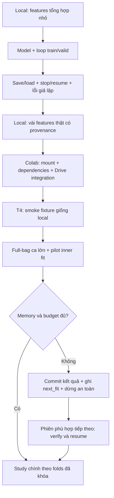

# Bổ sung kế hoạch train: kiểm thử local và phục hồi sự cố Colab Free

> v1.0 · 11/10/2026 · Phụ lục thực thi T1–T3 và cơ chế bảo vệ T4–T7 của [MIL_TRAINING_PLAN.md](MIL_TRAINING_PLAN.md). Người dùng cho phép vòng lặp/train nhẹ trên máy trước khi đưa phần nặng lên Colab. Đây là thiết kế cần triển khai và kiểm thử; chưa có kết quả smoke/training MIL.

## 1. Mục tiêu và phạm vi

Phát hiện lỗi logic, gradient, checkpoint và điều phối trên CPU local với fixture nhỏ; chỉ sử dụng Colab cho tích hợp Drive, GPU, full-bag và training nghiên cứu. Dùng chung model/trainer ở mọi môi trường, khác config/path/device; không viết hai trainer độc lập.

Không tải toàn bộ PNG/features về local, không chạy lại encoder và không thay nhãn, tọa độ hoặc split. Không sửa artifact nguồn để mô phỏng lỗi. Smoke có cập nhật weights nhưng không là fit nghiên cứu, không sinh bằng chứng accuracy ung thư và không mang weights smoke sang study chính.

## 2. Các cấp kiểm thử, đầu vào và điều kiện chuyển môi trường

| Cấp | Môi trường và giới hạn đề xuất | Công việc | Đầu ra / điều kiện qua |
|---|---|---|---|
| L0 · logic | CPU local, features tổng hợp đúng 2.048 chiều, bag nhỏ | E0–E4, shape/mask, reorder invariance eval, loss, gradient, finite, nhãn cấp ca | Unit/contract report; mỗi phép kiểm có assertion thật |
| L1 · vòng lặp | CPU local, 2–4 bags, 16–64 vector/lens, 1–2 epoch, tối đa 20 optimizer steps hoặc 10 phút | Dùng trainer thật: train → validation → checkpoint → resume; thử overfit toy có tín hiệu dễ học bằng test riêng có cap | Weights MIL thay đổi; loss toy giảm theo tiêu chí đã định; không yêu cầu loss từng step luôn giảm; checkpoint/resume qua |
| L2 · dữ liệu thật nhỏ | CPU local, 2–4 ca thuộc inner-train của một outer fold; tối đa 64 vector/lens/ca; không đọc outer-test | Export fixture có provenance từ feature parts đã verify; chạy loader adapter nhỏ, train loop, IDs/order/lens/target, missing-lens fixture | Real-feature smoke report; đúng nguồn/refs/hash; không có nhãn patch; không báo metrics nghiên cứu |
| L3 · sự cố | CPU local, cùng fixture; chỉ subprocess/test directory riêng | Chủ động lỗi ghi file, ngắt process, lock, deadline, NaN, mất file; so sánh resume với chạy liên tục | Fault-injection report; phục hồi từ last committed epoch; không sai dữ liệu/nhân đôi tiến độ |
| C0 · tích hợp | Colab CPU nếu cần, cùng runtime notebook/trainer release | Mount đúng kernel, quyền Drive, paths/shortcuts, dependencies, stage fixture, ghi/đọc checksum/checkpoint | Colab CPU integration report; chỉ mở CPU nếu local không kiểm được, không bắt buộc thêm VM |
| C1 · GPU smoke | Colab T4 thực tế, cùng fixture, một run duy nhất | CPU→CUDA tensors/optimizer, gradients, finite, GPU save/load/resume, đọc GPU/RAM/disk | GPU smoke report; không chạy CNN; xác nhận device thật, không fallback CPU âm thầm |
| C2 · full-bag pilot | Cùng T4 sau C1, ca lớn trong outer-train và một fit train/inner-validation có giới hạn | Full-bag forward/backward, peak memory, I/O, duration, resume với dữ liệu đầy đủ | Benchmark; xác nhận đủ memory/budget; không dùng outer test để chỉnh setting |
| C3 · study chính | Cùng T4 nếu còn đủ budget; nếu không lưu rồi tiếp tục phiên khác | Inner fits → outer refit → test theo plan/folds đã khóa | Checkpoint/OOF/metrics của study, phân biệt rõ smoke |

Local mặc định FP32/CPU, `num_workers=0`, tối đa 2 compute threads, một bag mỗi lần; ngân sách process dự kiến 2 GiB và fixture data ≤256 MiB. Kiểm RAM khả dụng trước run, giảm cap test hoặc đưa test lên Colab khi không đủ; không tăng tải local để cố chạy full study. Watchdog/deadline và kiểm bộ nhớ phải được triển khai; các cap không tự có hiệu lực chỉ vì ghi trong tài liệu.

L2 có thể chạy sau L3 nếu fixture thật chưa có local; tiến hành L0/L1/L3 bằng tổng hợp trước. Export chỉ vài dòng cần dùng từ phần đã xác minh trên Colab CPU hoặc nguồn local đã có, giữ feature/source/tile IDs, row order, checksum và lựa chọn rows. Nếu chọn từ cohort thật, pin outer/inner fold và chỉ chọn inner-train; chọn cả hai lớp nếu fit cho phép. Không đổi nhãn để tạo bài toy. Fixture lens thiếu có thể tổng hợp, không cần đụng các ca outer-test.

Các fixture có `mode=smoke` riêng; production không chấp nhận smoke subset. Loader production tiếp tục xác minh toàn bộ contract/bundle/part theo code đã nghiệm thu; không bỏ integrity checks để làm test nhanh. Nếu cần bounded row reader cho export, phát triển thành công cụ riêng có provenance và kiểm thử, không âm thầm truncate production bag.



## 3. Rủi ro, dấu hiệu và cách xử lý

Các trường hợp sau là dự đoán kỹ thuật, chưa phải lỗi MIL đã xảy ra trong dự án.

| Sự cố | Dấu hiệu / phát hiện | Phòng ngừa và xử lý | Nơi kiểm |
|---|---|---|---|
| Không được cấp T4/hết quota | GPU không có, backend từ chối, CUDA false | Kiểm trước khi fit; ghi `blocked`, giữ checkpoint, chờ hoặc chọn dịch vụ phù hợp. Không giả lập quota còn lại từ Drive 5 TB; không tự tạo trùng VM hoặc đổi tài khoản để vượt giới hạn | Fixture lỗi cấp tài nguyên + GPU preflight thật |
| Runtime bị thu hồi/reset | Kernel biến mất, `/content` mất, CLI session missing | Checkpoint Drive theo epoch; session mới xác minh artifact, restage features và resume last commit. Mất process không có nghĩa checkpoint mới nhất đã bền | L3 abrupt-exit trong test process; resume thật C1/C2 |
| Hết ngân sách giữa fit | Remaining time thấp, epoch/checkpoint dự đoán vượt deadline | Deadline mềm; trước epoch/fit kiểm duration ước tính + stage/sync + dự phòng. Dừng ở epoch boundary; hard loss phục hồi epoch trước. Không tự báo `complete` | L3 deadline ngắn, C2 duration thật |
| Mount sai tài khoản/kernel | Metadata không thấy; web mount có nhưng CLI kernel không đọc được | Trong chính kernel sẽ train, verify root, metadata/bundle IDs và thử ghi–đọc file test; người dùng duyệt quyền trên Chrome của mình. Lỗi auth/path không được diễn giải thành hết GPU hoặc tự đổi profile | C0/C1 |
| Drive chậm, quota I/O, mạng mất | Copy treo, Errno 5, checkpoint timeout | Stage feature parts cần dùng lên SSD, checksum rồi train local VM; giảm tiny reads/writes; retry có giới hạn cho I/O transient. Không move/xóa nguồn. Nếu chưa commit được thì dừng an toàn, giữ last-good | L3 I/O exception + C0/C2 thật |
| Drive còn 5 TB nhưng disk VM đầy | `/content` hết chỗ, file ghi thiếu | Preflight disk/RAM/VRAM; stage features thay PNG, đo byte cần + temp/checkpoint margin; chỉ dọn scratch của run đã verify | L3 giả lập ENOSPC trong test storage; C0/C1 preflight |
| VRAM OOM | CUDA OutOfMemoryError ở ca lớn/backward | Một bag/batch, CNN ngoài training, tránh giữ tensor/graph cũ. Đo peak lớn nhất; nếu cần exact global attention chunk/recompute phải verify tương đương và gradient. Sampling/AMP là setting riêng; không tự đổi control hoặc bỏ patch | L3 controlled OOM exception kiểm handler; C2 full-bag thật |
| RAM tăng theo epoch | Kernel bị kill, RSS tăng liên tục | Không preload cohort; lịch sử lưu scalar/CPU-detached, bounded cache/worker queues; kiểm nhiều epoch fixture để phát hiện tăng vô hạn | L1/L3 trend; C2 RSS thật |
| Dependency không tương thích | Import error, lỗi CUDA/torchvision/sklearn | Ghi environment manifest, chọn bộ phiên bản tương thích đã test; giữ splitter scikit-learn 1.8.0 của bundle, không tự nâng Torch toàn môi trường. Thiếu dependency thì fail preflight, cài đúng rồi kiểm lại | Local isolated env + notebook bootstrap C0/C1 |
| Dtype/device/shape sai | CPU/CUDA mismatch, Linear shape error, BCE broadcasting | Assert đầu vào float32 N×2048, logit/target cùng shape/device; optimizer load rồi đưa state đúng device; missing bag có explicit mask | L0/L1 + C1 |
| NaN/Inf hoặc loss bất thường | Finite check không qua | Dừng trước optimizer.step/checkpoint; log fit/case pseudonym và min/max/shape, giữ last-good. Kiểm features, loss/logit, softmax và LR; không dùng nan_to_num hoặc skip ca để che lỗi | L0/L3 NaN injection, C1 |
| Attention chunk sai | Full-bag/chunk prediction hoặc gradient khác đáng kể | Softmax toàn bag, không normalize riêng từng chunk rồi mean; so với full-bag reference trên fixture trước GPU | L0/L1, C1 nếu triển khai chunk |
| Checkpoint ghi dở/hỏng | File thiếu, SHA sai, load error, commit chưa có | Ghi version bất biến, verify lại trước commit; không ghi đè last-good. Payload hỏng không được promote thành last/best hoặc epoch hoàn tất | L3 partial-write/hash corruption |
| Resume sai fold/config | Checkpoint model load được nhưng IDs khác | So model schema, code/config, cohort/bundle/feature/governance/split/fit IDs; mismatch dừng. Không tái dùng weights giữa folds | L3 mismatch fixtures |
| Notebook Run all hai lần | Hai writer, logs/checkpoints đan xen | Một owner/writer/run, lock có heartbeat/owner/session ID; active lock từ chối runner thứ hai. Stale recovery chỉ khi xác minh owner đã dừng, không chỉ vì TTL hết | L3 duplicate launch/stale lock + C1 |
| Đã kết thúc CLI nhưng GPU vẫn mở | Không còn terminal nhưng server session còn | Sau commit, kiểm writer; flush/unmount Drive và dừng đúng runtime khi được yêu cầu/cho phép; xác minh server không còn session của công việc. Không dừng workload khác | C1 cleanup thật |
| Loss giảm nhưng model học shortcut | Train tốt, validation kém; mask/số ảnh dự báo được nhãn | Study chính common đủ lens; đối chứng E0, lens riêng, mask/count-only ở study all; xem heatmap và metrics cấp ca. Không chữa bằng tuning outer test | Inner validation/đánh giá đã khai báo |
| Fold thiếu lớp/AUC undefined | Target một lớp hoặc metric exception | Verify folds/targets trước fit; báo undefined có lý do/counts, không ghi AUC giả hoặc chia lại patch. Split đã nghiệm thu vẫn phải đối chiếu khi load | L0/L3 negative inputs; T0 |
| CPU và GPU lệch số | Prediction/gradient khác nhỏ; seed giống nhưng kết quả không bit-identical | Record dtype/library/device/seed; dùng tolerance đã chốt cho checks số học. So resume trên cùng môi trường; CPU↔GPU không đòi training trajectory giống tuyệt đối | L1/C1 |

Không cố tình làm đầy RAM/VRAM/disk thật để test handler. Controlled exception kiểm logic phục hồi; C2 mới đo sức chịu tải thật và phải ghi rõ giới hạn bằng chứng.

## 4. Những bài thử lỗi bắt buộc trước production

| ID | Cách thử trong sandbox | Kết quả bắt buộc |
|---|---|---|
| F01 | Chạy toy hai epoch liên tục; chạy epoch 1→checkpoint→process mới→epoch 2 | Trong cùng môi trường deterministic, weights/optimizer/RNG/step/order khớp trong tolerance; không mất/nhân đôi optimizer step |
| F02 | Exit test process giữa epoch, trước commit | Resume checkpoint epoch đã commit và replay epoch dở; không publish epoch dở hoàn tất |
| F03 | Writer lỗi sau khi ghi một phần payload checkpoint mới | Commit không xuất hiện; last-good vẫn load được; state không tiến lên |
| F04 | Sửa byte checkpoint/fixture copy | Checksum gate từ chối, không tiếp tục train |
| F05 | Mô phỏng Drive timeout/permission denied/ENOSPC | Retry chỉ transient theo giới hạn; permission/storage báo blocker; không ghi success; giữ bản tốt |
| F06 | Chạy runner thứ hai cùng run; thử stale lock với owner còn sống | Writer thứ hai bị chặn; không tự chiếm lock còn sống |
| F07 | Đổi feature/bundle/fold/model schema của checkpoint copy | Resume bị từ chối với mismatch cụ thể |
| F08 | Fixture NaN/Inf, nhãn sai shape, thiếu refs, lens rỗng | Input/finite gates chặn; lens thiếu hợp lệ qua mask; không âm thầm skip ca |
| F09 | Deadline ngắn, stop request trong epoch | Không mở epoch mới nếu thiếu budget; checkpoint boundary/next_epoch đúng; stop không bị gọi complete |
| F10 | Controlled OOM exception ở train step | Không publish state dở; log blocker; restart từ last commit trước retry, không đổi sampling âm thầm |
| F11 | Full vs chunk/reorder input trên fixture | Eval predictions tương đương; chunk gradients cũng tương đương nếu dùng train chunk |
| F12 | Hai lần chạy lại notebook/runner khi fit đã committed | Không train lại fit hoàn tất, không thêm OOF trùng; verify trước skip |

Các lỗi đã biết/sửa code phải có script E2E tái hiện trước chỉnh sửa, root cause, fix kiến trúc, chạy lại E2E và regression, lưu PLAYBOOK theo AGENTS.md. Không ghi các rủi ro dự đoán vào PLAYBOOK như thể đã gặp/sửa thành công.

## 5. Checkpoint bền và trạng thái runner

Checkpoint dự kiến giữ: model/optimizer/scheduler/scaler nếu dùng, epoch/global step, best validation loss/epoch, patience, Python/NumPy/Torch CPU/CUDA RNG, sampler state, model schema, source/config/code/fold/fit IDs. `best_val` phục vụ chọn inner epoch; `last` phục vụ resume, không dùng best để giả vờ đã tiếp tục đầy đủ trajectory.

Quy trình publish đề xuất:

1. Chốt toàn bộ epoch train + validation + history + RNG/order; lấy snapshot nhất quán.
2. Ghi payload lên SSD VM, checksum; copy vào version directory mới trên Drive.
3. Đọc lại payload trên Drive, kiểm SHA và khả năng load.
4. Ghi commit receipt chứa version/epoch/fit/hash; chỉ sau receipt hợp lệ mới cập nhật pointer last/best và `status.json`.
5. Giữ bản committed trước; resume không tin mỗi pointer mà xác minh receipt/payload, có fallback bản committed trước khi bản mới chưa commit.

Không coi rename trên Drive mount là đảm bảo transaction hoàn toàn. Nếu pointer lỗi sau commit, cần reconcile từ receipt hợp lệ thay vì train lặp/skip sai epoch. Test F03 phải phủ từng khoảng ngắt này. Không lưu checkpoint/lịch sử từng batch lên Drive; baseline checkpoint mỗi epoch và khi kết thúc fit, đo latency để chốt tần suất. Nếu một epoch quá dài, phải lập phương án checkpoint giữa epoch có sampler/optimizer đầy đủ, kiểm E2E riêng trước dùng.

Trạng thái **đề xuất cho trainer mới**: `preflight`, `running`, `checkpointing`, `paused_budget`, `blocked`, `error`, `complete`. `complete` chỉ khi tất cả fits dự kiến/OOF/artifacts bắt buộc đã verify. Runtime mất không có runner để tự ghi status; phiên mới reconcile committed artifacts trước khi resume. Không gọi partial, quota exhausted hoặc error là hoàn tất.

## 6. Lưu bằng chứng và chuyển lên Colab

```text
Local — fixtures/bằng chứng nhỏ, đường dẫn đề xuất:
  Results/training_preflight/<test_id>/
    fixtures/manifest.json          synthetic hoặc real, provenance/smoke flag
    contract_report.json
    loop_report.json
    fault_injection_report.json
    environment.json
    checkpoints/                   test only, không dùng cho study

Drive — dữ liệu bền/runs:
  histology/training_runs/<run_id>/
    preflight/                     environment, IDs, reports
    smoke/                         local + Colab CPU/T4 evidence
    benchmark/                     I/O/epoch/fit/peak memory/budget
    fits/.../checkpoints/versions/  payload bất biến + commit receipts
    status.json, events.jsonl       heartbeat/fit/epoch/budget/blocker
    evaluation/, reports/          theo kế hoạch train chính

Colab /content — scratch mất khi runtime mất:
  staged_features/                 parts đã verify cần cho run
  runtime/                        trainer release theo hash
  checkpoints_tmp/                chưa được coi là dữ liệu bền
```

Toàn cache raw-vector hiện khoảng **1,14 GiB** (148.991×2.048×4 byte), chưa tính indexes/metadata/temporary copies. Stage feature parts đã có theo checksum; không cần stage lại 53,31 GB PNG hoặc đóng ZIP lại. Preflight quyết định stage đủ parts của run hay từng nhóm theo disk/I/O thực; dữ liệu nằm trên SSD không đồng nghĩa nạp tất cả vào RAM. Case loader hiện có input guard 512 MiB/ca; tổng process/activations/optimizer cần đo riêng.

Khi local L0–L3 qua và trainer release/CI qua, đưa đúng runtime/config/fixture/reports lên Drive. C0/C1/C2 có thể chạy nối tiếp trong một phiên phù hợp để giảm setup; không mở thêm CPU VM nếu T4 hiện tại đủ làm integration nhanh. Mount/dependencies/stage một lần, smoke → pilot → production theo budget. Không mở T4 chỉ để chờ OAuth, cài đặt dài hoặc debug lỗi đã có thể bắt local.

CPU↔GPU smoke dùng cùng payload/model weights ở chế độ eval để kiểm forward với tolerance. Không dùng sự trùng tuyệt đối trajectory CPU/GPU làm tiêu chí; PyTorch không đảm bảo reproducibility giữa môi trường/phần cứng. Chốt tolerance và deterministic settings từ smoke, lưu trong config; không nới tolerance để che lỗi logic.

**Tối ưu sau C2 đo thật:** cache ma trận đầy đủ theo ca trên SSD, dựng từ nguồn đã verify/public loader; kiểm checksum và ràng buộc label/patient/lens/tile order khi đọc. Thử corruption, source mismatch và forgery rehash/truncate; không tin checksum tự khai nếu không khớp source authorization. Chuẩn bị cache không học tham số và không đọc outer labels để chọn model. Source full-verify đầu run, cached immutable snapshot độc lập sau đó; benchmark cache lại trước production. Không coi cache này là dữ liệu mới hoặc augmentation.

## 7. Khi nào tự phục hồi, khi nào dừng?

- **Được retry có giới hạn:** đọc/copy I/O transient, khi checksum/owner/session vẫn đúng; dùng backoff và ghi số lần. Không retry optimizer step trên state đã cập nhật một phần; khởi động lại từ last commit.
- **Cần dừng/báo blocker:** OAuth, quyền Drive, missing/hash mismatch, config/fold mismatch, NaN, quota/capacity, memory không đủ với control, active lock khác. Không tự đổi nhãn/cohort/model hoặc vượt quota.
- **Budget thấp:** checkpoint + `next_fit/next_epoch`, verify Drive rồi ngừng mở công việc mới; không hẹn shutdown máy hoặc tạo VM thay thế tự động.
- **Chuyển môi trường hợp lệ:** dừng writer cũ, verify checkpoint/receipts, ghi handoff; phiên mới kiểm lại identity/path/config trước resume, một writer duy nhất. Không dùng nhiều tài khoản để vượt hạn chế tài nguyên Colab.
- **Hoàn tất:** verify artifacts, kết thúc subprocess/watchdog/SSH client thuộc công việc; flush/unmount Drive khi writer dừng và dừng đúng runtime theo quyền đã có. Máy cá nhân không tự tắt theo phụ lục này.

## 8. Nguồn và checklist nghiệm thu

Nguồn chính thức, đối chiếu 11/10/2026:

- [Colab FAQ](https://research.google.com/colaboratory/faq.html): runtime/GPU không đảm bảo; `/content` tạm; hạn chế Drive I/O; dung lượng Drive không tăng disk VM; managed Free có hạn chế remote-control/SSH. Notebook tương tác là đường chạy mặc định, không dùng keep-alive giả hoặc bypass hạn chế dịch vụ.
- [PyTorch saving/loading](https://docs.pytorch.org/tutorials/beginner/saving_loading_models.html): model state và optimizer state cho resume; transaction/receipt ở phụ lục này là thiết kế của dự án.
- [PyTorch reproducibility](https://docs.pytorch.org/docs/2.9/notes/randomness.html): RNG/determinism và giới hạn giữa CPU/GPU/releases.
- [PyTorch CUDA semantics](https://docs.pytorch.org/docs/2.9/notes/cuda.html): device/memory; giải phóng cache không tự giải phóng tensor đang sống. Kích thước bộ nhớ thực do benchmark dự án quyết định.

- [x] Rủi ro và lộ trình local→Colab đã lưu, liên kết kế hoạch train.
- [ ] L0/L1: contracts và vòng lặp nhẹ qua.
- [ ] L2: fixture thật nhỏ có provenance/inner-train binding qua.
- [ ] L3/F01–F12: failure/resume reports qua các mục áp dụng; mục chưa triển khai phải ghi rõ.
- [ ] Trainer source đi đủ conveyor/CI trước release.
- [ ] C0/C1: kernel/Drive/dependencies và T4 smoke qua.
- [ ] C2: full-bag pilot, memory/time/checkpoint benchmark và budget schedule qua.
- [ ] Chỉ sau đó bắt đầu C3: study chính theo MIL_TRAINING_PLAN.md.
