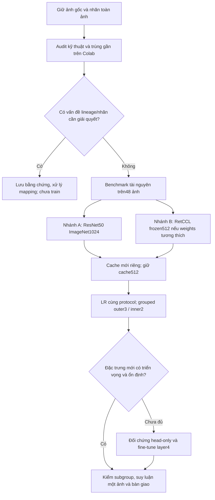

> **Bản lịch sử đã được thay thế.** Dùng [kế hoạch R0–R3 ngày 16/10](IMAGE_CLASSIFICATION_R0_R3_EXECUTION.md) cho thực thi tiếp. Account vận hành được giữ trong receipt private; snapshot gốc nguyên byte vẫn được giữ local.

# Hướng khả thi tiếp theo cho phân loại toàn ảnh

Ngày: 14/10/2026. Trạng thái: **kế hoạch nghiên cứu, chưa tạo runtime hoặc chạy thí nghiệm mới**.

## 1. Quyết định đề xuất

Ưu tiên **hai nhánh có đối chứng rõ ràng**:

1. **Giữ nhiều chi tiết hơn:** toàn ảnh resize/pad 1.024 px, giữ ResNet50 ImageNet đóng băng và LR. So trực tiếp với toàn ảnh512 hiện có.
2. **Đặc trưng phù hợp mô học hơn:** trước tiên thử encoder RetCCL ResNet50 đã pretrained mô học, đóng băng, tại512 px; vẫn giữ toàn khung ảnh và LR. Nếu cache mới không cải thiện đủ, mới thử fine-tune khối cuối với nhãn toàn ảnh.

Nhánh1 kiểm độ phân giải; nhánh2 kiểm kiến thức pretrained của encoder. Đây là **giả thuyết**, chưa chứng minh nguyên nhân lỗi. Không hứa mức AUROC/accuracy sau cải tiến. Cả hai dùng dữ liệu hiện có, không cần quay lại patch/MIL cấp ca.

RetCCL có mã trích đặc trưng ResNet50 và checkpoint do tác giả công bố; đây là ứng viên cùng họ kiến trúc với baseline, thuận tiện cho một đối chứng thay weights. Việc dùng nó cho ảnh trường nhìn nguyên khung của mình vẫn cần thử riêng: nghiên cứu gốc sử dụng các vùng mô và tác vụ khác. [RetCCL, Wang et al., Medical Image Analysis2023 và mã tác giả](https://github.com/Xiyue-Wang/RetCCL), [mã trích đặc trưng](https://github.com/Xiyue-Wang/RetCCL/blob/main/get_feature.py).

## 2. Bằng chứng đã có và điều chưa biết

- 2.802 ảnh gốc của18 người; nhãn mạnh **cho phân loại toàn ảnh**: Glade0→không ung thư,3/4/5→ung thư. Mã ca chỉ dùng grouping. Không suy ra nhãn vùng/patch hoặc tự đổi nghĩa Glade thành ISUP/Gleason.
- Baseline512: AUROC gộp0,729; AP0,398; AUROC4×/10×/40×=0,591/0,687/0,773. Ngưỡng validation: nhạy76,8%, đặc hiệu55,4%.
- Bảy đối chứng head/trọng số/PCA đã hoàn tất: chưa vượt AUROC gộp baseline. Đối chứng patient_lr tái lập điểm, sai lệch xác suất OOF tối đa3,47e-9; chưa có dấu hiệu phép đổi đơn vị trọng số là nguyên nhân.
- PCA32/64 giảm AUROC gộp xuống0,647/0,690. Không tiếp tục ưu tiên nén chiều này.
- Đã đối chiếu metadata/ZIP bằng SHA, kiểm commits/cache,0 chồng lấn người bệnh. Rà ảnh trùng gần **chưa được nghiệm thu**; SHA không phát hiện được mọi ảnh giống nhau nhưng lưu khác bytes.
- 24 ảnh lỗi/đối chứng đã truy ngược đúng TIFF, không tự sửa nhãn hoặc loại ảnh vì mô hình dự đoán sai.

Phân tích bổ sung từ OOF đã verify:

| Vật kính | Glade3: ảnh / người | Ảnh Glade3 bị bỏ sót | Toàn bộ ảnh ung thư bị bỏ sót |
|---|---:|---:|---:|
|4×|7 /2|7 /7|23 /68|
|10×|13 /2|6 /13|36 /170|
|40×|46 /2|6 /46|58 /266|

Đây là quyết định tại **ngưỡng validation từng fold**, không phải0,5. Chỉ có2 người trong nhóm Glade3, không phải66 người độc lập. Không khẳng định cùng người ở khác vật kính là cùng tổn thương đã registration. Nhóm này là điểm cần theo dõi, không phải lý do tự cân lại nhãn hoặc kết luận Glade3 có ý nghĩa mô học cụ thể.

Nguồn dự án: [báo cáo bảy cấu hình](../../Results/image_classification/head_lab_20261014/report/BAO_CAO.md), [CI đối chứng theo lens](../../Results/image_classification/head_lab_20261014/report/ablation_analysis.json), [thống kê Glade và nguồn OOF](../../Results/image_classification/next_direction_20261014/grade_error_summary.json).

Chưa biết:1024 có cải thiện đủ không; nền/màu có chi phối không; pretrained mô học có phù hợp trường nhìn4× không; thời gian/VRAM thực tế cho1024 và fine-tune. Tăng tensor lên1024 giữ nhiều pixel gốc hơn, **không biến4× thành40×** hoặc tạo thêm chi tiết chưa được chụp.

Vật kính không tự cho biết micromet/pixel (MPP): còn phụ thuộc camera và quy trình chụp. Chưa có calibration thì ghi MPP là chưa biết, không tự quy đổi4×/10×/40× thành một scale vật lý. RetCCL đề xuất thử1,0MPP trong hướng dẫn của tác giả; đó không phải scale mình đã xác minh. [Hướng dẫn tác giả](https://github.com/Xiyue-Wang/RetCCL).

## 3. Sơ đồ quyết định



Hai nhánh có thể được chuẩn bị cùng đợt, nhưng **một runtime và một writer**, chạy tuần tự trên T4 để tránh tranh RAM/VRAM. Nếu weights nhánhB chưa truy cập/load được, hoàn tất nhánhA trước; không giữ T4 chờ quyền tải model.

## 4. N0 — Audit có mục tiêu, không duyệt lại y khoa toàn bộ

**Đầu vào:** metadata, ba ZIP gốc, inventory/feature release và OOF đã commit.

**Xử lý trên Colab:**

1. Kiểm đúng source hashes, mã người, basename, lens, Glade và partition; tận dụng manifest đã có.
2. Rà exact-byte và exact-decoded-pixel duplicate; pHash/nearest-neighbor chỉ tạo **danh sách nghi vấn** cho trùng gần. Xem cặp ở cùng và khác mã người, không tự xóa theo cosine/pHash.
3. Lưu kích thước, tỷ lệ mô ước lượng, độ sáng/màu/độ nét như mô tả. Bác sĩ đã duyệt ảnh, nên không tự loại ảnh bằng một ngưỡng blur/brightness mới. Mask mô dùng để audit nền, **chưa crop hoặc bỏ mảnh mô**.
4. Xuất bảng lỗi theo lens/Glade/fold và các cặp nghi vấn. Có thể nhờ bác sĩ xem24 ảnh và nhóm Glade3 để giải thích; chưa có ý kiến mới không cản benchmark tài nguyên, nhưng không được tự diễn giải/sửa nhãn.

**Đầu ra:** `audit/{source_receipt.json,qc_images.parquet,duplicate_candidates.csv,review_disposition.csv,grade_errors.json}`. References riêng tư chứa image_id/source member/SHA/alias; báo cáo chỉ chứa số tổng và alias.

**Gate:** unresolved duplicate/mapping xuyên người hoặc target xung đột phải được giải quyết trước fit. Nếu grouping/cohort cần thay đổi, lập split/cohort version mới và chạy lại đối chứng512 bằng cache tương thích; không so mù với điểm0,729 của cohort cũ.

Nghiên cứu tái lập WSI cho thấy chi tiết preprocessing và chia dữ liệu có thể làm thay đổi kết quả; đây là lý do cần audit/manifest, không phải bằng chứng bộ mình đã leakage. [Fell et al., PLOS Digital Health2022](https://journals.plos.org/digitalhealth/article?id=10.1371/journal.pdig.0000145).

## 5. N1 — Pilot tài nguyên trước full extraction

Chọn48 ảnh đại diện lens, kích thước, Glade và người từ manifest, lưu seed/index. Đây là **pilot kỹ thuật**, không dùng48 ảnh hoặc24 montage để tuyên bố độ chính xác. Không train nặng trên máy cá nhân.

Đo trên đúng runtime T4: decode TIFF, resize/pad, inference, ghi cache và read-back. Đo cả cold start và steady state. Baseline512 và1024 đều FP32 để đối chứng chỉ thay resolution; encoder frozen/eval/inference_mode. Batch khởi đầu512=4,1024=1; tăng dần sau đo, giảm batch khi OOM, giữ precision/preprocessing identity.

Nếu RetCCL sẵn weights, kiểm official architecture, version/revision, SHA, license/model access và strict checkpoint loading; output thực tế phải có đúng chiều đã khai báo và hữu hạn. Adapter riêng, không âm thầm bỏ missing keys hoặc dùng `strict=False` để che mismatch. Official code dùng AdaptiveAvgPool2d và bỏ classifier cho features; không được suy ra torchvision mặc định là checkpoint tương thích. [Kiến trúc tác giả](https://github.com/Xiyue-Wang/RetCCL/blob/main/ResNet.py).

**Đầu ra:** `benchmarks/{selection.json,resource_benchmark.json,smoke_features.*,resume_proof.json}`; số ảnh/giây, seconds/image, peak RAM/VRAM, thời gian I/O, cache bytes và lỗi.

**Gate vận hành:** còn đủ RAM/SSD và dự phòng tối thiểu15 phút; VRAM nên giữ dưới khoảng80% dung lượng GPU quan sát được. Đây là mức dự phòng kỹ thuật đề xuất, không phải ngưỡng của bài báo. Nếu dự toán vượt ngân sách phiên, xử lý tối đa số shard an toàn rồi ghi partial; không giảm1024 âm thầm thành512.

## 6. N2 — Ma trận frozen tối thiểu

| ID | Khung ảnh | Encoder / train | So với | Chỉ thay đổi |
|---|---|---|---|---|
|A0|Toàn ảnh512|ResNet50 ImageNetV1 frozen + LR|Mốc đã có|Dùng cache/OOF hiện có nếu cohort và protocol giữ nguyên|
|A1|Toàn ảnh1024|ResNet50 ImageNetV1 frozen + LR|A0|Resolution|
|B1|Toàn ảnh512|RetCCL ResNet50 frozen + LR|A0|Pretraining/encoder descriptor|

Giữ raw Glade/target, outer patient assignments, seed17, inner2, patient-class weighting, StandardScaler train-only, λ grid và cách chọn ngưỡng của đối chứng. Lưu cả normalization, pooling và kiến trúc thực tế. Nếu official RetCCL cần recipe khác, ghi rõ khác biệt: khi đó không được gọi B1 là chỉ thay weights. **Không PCA, không stain normalization và không thêm model-grid khác trong N2.**

Mỗi ảnh vẫn tạo một vector→một quyết định. Features A1/B1 có cache version riêng; encoder đóng băng pretrained không học labels của bộ mình nên có thể trích trước cho toàn cohort. Scaler, LR và ngưỡng vẫn học riêng trong train/inner validation.

Pipeline full dùng streaming từng ZIP/chunk32 ảnh, không giải nén cả bộ TIFF lên SSD hoặc RAM. Nếu cả hai encoder sẵn sàng, decode một ảnh rồi đưa qua hai recipe/encoder tuần tự để giảm đọc lại ảnh, nhưng commit/cache identity **tách biệt**. Không gọi chunk lưu trữ là patch: mỗi phần chứa các **ảnh nguyên khung** khác nhau.

**Đầu ra:** cache A1/B1, ba fold cho mỗi study, OOF, model/scaler/deploy threshold, source/encoder/geometry/precision/config hashes. Chỉ study đủ2.802 ảnh có lineage hợp lệ mới nghiệm thu full; smoke/partial không vào production fit.

## 7. N3 — Fine-tune có đối chứng, chỉ sau khi N2 có báo cáo

Đây là phần **chưa triển khai trainer**. Phải có code/E2E/CI/smoke checkpoint trước full run. Transfer learning có hai lựa chọn thông dụng: encoder cố định hoặc cập nhật trọng số pretrained; không cần train từ random trên bộ18 người. [PyTorch transfer learning](https://docs.pytorch.org/tutorials/beginner/transfer_learning_tutorial.html).

Giữ geometry512 cho pilot gradient đầu tiên; chỉ chuyển1024 sau benchmark. Chọn encoder/geometry/epoch từ inner validation của từng outer train. Nếu muốn dùng chung một recipe, phải chốt trước khi đọc outer scores mới. Không dùng OOF cũ để chọn một checkpoint như thể đó là validation độc lập.

| ID | Phần đóng băng | Phần cập nhật | Vai trò |
|---|---|---|---|
|F0|Toàn backbone và BatchNorm|Đầu1-logit|Đối chứng Torch cùng loss/augmentation/optimizer|
|F1|Stem/layer1–3 và toàn BatchNorm stats/affine|layer4 + đầu1-logit|Kiểm lợi ích thích nghi encoder|

F0/F1 giữ cùng ảnh, folds, seed, loss, lịch và augment. Nếu F1 hơn LR nhưng không hơn F0, chưa có bằng chứng lợi ích do mở khóa layer4.

Thiết lập pilot đề xuất, không phải giá trị lấy nguyên từ bài báo: batch thực1–2, tích lũy tới effective batch8; AdamW; LR đầu1e-3, layer4=1e-5; warmup đầu tối đa1epoch; tối đa10epoch, early stop3epoch theo inner AUROC; seed17. Chỉ dùng một cách cân bằng loss/sampling có audit, không nhân đôi class balancing. Giữ BN eval để batch nhỏ không cập nhật thống kê; kiểm gradient frozen=0, gradient trainable hữu hạn và weights layer4 có thay đổi đúng.

Augment đầu tiên: flip và quay90° toàn canvas, không random crop/cutout làm mất vùng ung thư. F0/F1 cùng augment hình học. Nếu có bằng chứng màu đáng kiểm, thêm **một** đối chứng F1+màu nhẹ, không đồng thời đổi stain normalization. Nghiên cứu Tellez et al. so màu/chuẩn hóa trên nhiều cơ quan/lab gợi ý màu là hướng đáng thử, nhưng dùng tác vụ patch khác với ảnh nguyên khung của mình. [Tellez et al.2019](https://arxiv.org/abs/1902.06543).

AMP FP16+GradScaler cho gradient trên T4, được benchmark/kiểm NaN trước. Nếu precision recipe khác, lưu vào config. AMP không thay thế kiểm chất lượng và không bảo đảm giữ điểm tuyệt đối. [PyTorch AMP](https://docs.pytorch.org/docs/main/notes/amp_examples.html).

**Không dùng cache vector cũ để backprop vào layer4.** F1 đọc ảnh và forward mỗi lượt; encoder sau fine-tune khác encoder baseline. Mỗi inner/outer fold có weights riêng, chỉ học người thuộc train. Không fine-tune một encoder trên labels toàn18 người rồi dùng features đó đánh giá cross-validation: như vậy labels test đã ảnh hưởng encoder.

Nghiên cứu low-resource fine-tuning mô học cho thấy hướng thích nghi có thể hữu ích; số giờ trong bài không phải dự báo thời lượng trên T4 Free và dữ liệu này. [Roth et al., ISBI2024](https://arxiv.org/abs/2401.04720).

**Gate:** tiny local E2E train/update/save/load; resume bị ngắt tái lập state; Colab smoke gradient/OOM; support đủ lớp trong mọi train/validation. Nested3×2 với một recipe cần6 inner trainings +3 outer refits cho **mỗi** F0/F1; không đánh giá rồi báo chỉ một lượt train. Nếu không đủ một phiên, chia theo fold/epoch và tiếp tục ngày sau.

Epoch dừng của outer refit lấy theo quy tắc chốt trước, ví dụ median best epoch của hai inner runs; outer test không dùng để early stop. Mỗi outer train tự chọn cấu hình/epoch, không dùng labels cả18 người cho quyết định đó.

## 8. Đánh giá và tiêu chí tiếp tục

- Unit dự đoán: ảnh. Unit resampling/grouping: người bệnh. Không biến2.802 ảnh thành2.802 người độc lập.
- Giữ3 outer patient folds cũ khi cohort không đổi; inner2 để chọn λ/epoch/recipe/ngưỡng. Outer của bộ này đã được nghiên cứu xem: kết quả mới vẫn **thăm dò nội bộ**, không test xác nhận mới.
- Báo pooled AUROC/AP, từng lens, macro-average lens AUROC, patient-balanced image AUROC, từng fold, FN/FP; theo dõi riêng raw Glade3 và số người hỗ trợ. Pooled bị ảnh40× nhiều chi phối nên không chỉ nhìn một số gộp.
- Report operating curves: chọn ngưỡng từ inner validation theo balanced accuracy như mốc; có thể thêm mục tiêu sensitivity80%/90% như hai điểm nghiên cứu **chưa phải mục tiêu lâm sàng**, báo actual outer sensitivity/specificity đạt được. Thay ngưỡng không làm tăng AUROC.
- Bootstrap ghép cặp theo người từ OOF đã lưu; ghi rõ có điều kiện/no refit, không bao phủ mọi bất định của train/split. Không chọn model chỉ vì upper CI cao.

**Gate ưu tiên đề xuất, chưa phải chuẩn y tế:** ứng viên được ưu tiên nếu Δ pooled AUROC≥0,02, AP không giảm và không lens nào giảm quá0,02; xem cả từng fold/CI và trade-off FN/FP. Nếu pooled không đạt nhưng một lens tăng rõ, giữ như giả thuyết riêng, không thay model chung. Ngưỡng0,02 là quy tắc sàng lọc công sức do dự án đề xuất, không mức ý nghĩa thống kê hoặc cải tiến tối thiểu lâm sàng đã chứng minh.

Nếu Δ nhỏ/CI rộng hoặc chỉ một fold thắng: chưa tăng độ phức tạp; kiểm split/ảnh lỗi, thử một seed inner khác dùng lại cache, công bố không chắc chắn. Trước triển khai chẩn đoán cần đánh giá người bệnh mới; augmentation không tạo thêm người bệnh độc lập. Với dữ liệu hiện có vẫn có thể hoàn tất nghiên cứu và demo suy luận một ảnh.

## 9. Lưu ở đâu và resume thế nào

```text
MyDrive/NCKH_Duy/                         # ba ZIP + Metadata.xlsx gốc, giữ nguyên
MyDrive/histology/image_classification/v001/
  inventory/<inventory_id>/
  runs/<existing_512_release>/            # baseline và7 head studies đã commit
  ...                                    # tiếp tục đọc, không overwrite
MyDrive/histology/image_classification/improvement_v002/
  protocols/<protocol_id>.json
  audit/<audit_id>/
  benchmarks/<benchmark_id>/
  features/<encoder_geometry_id>/part-*/  # vectors + refs + QC + commit
  studies/<study_id>/folds/fold-01..03/
  fine_tune/<protocol_id>/outer-*/inner-*/
    last.pt / best.pt / metrics.jsonl / checkpoint.commit.json
  reports/<report_id>/                    # aggregate figures/metrics; private refs riêng
  handoff/<handoff_id>/                   # code ZIP, model backup, guide, verified receipt
```

Frozen cache identity gồm source SHA, encoder weights/revision, whole-frame geometry, pooling, normalization, precision và code/environment versions. Identity khác tạo cache khác. Nếu standardizer/normalizer học từ train, artifacts phải có partition identity; không tái dùng transform học từ người test.

Checkpoint CNN lưu model, optimizer, scheduler, AMP scaler, epoch/global step, RNG Python/NumPy/Torch/CUDA, sampler/shuffle cursor, best metric, patience, config/fold/source identities. Ghi temp trên SSD→bản version trên Drive→read-back SHA→commit; giữ tối thiểu2 checkpoint hợp lệ. Không báo saved chỉ vì file đã xuất hiện.

Lưu sau mỗi epoch và định kỳ tối đa50 optimizer updates hoặc5 phút, tại ranh giới gradient accumulation an toàn. Nếu mất VM đột ngột thì rollback về checkpoint đã commit, có thể phải chạy lại phần nhỏ chưa lưu. Không tuyên bố resume chính xác giữa microbatch khi chưa lưu gradient buffers/cursor; kiểm E2E chứng minh giới hạn rollback.

V1 LR hiện resume theo fold; N3 checkpoint epoch/batch đầy đủ **là hạng mục phải phát triển mới**, không nói đã được bảo vệ chỉ vì cache vectors có resume. Pilot ép ngắt và restore phải chứng minh optimizer/sampler/epoch state, không chỉ weights.

## 10. Phiên Colab Free và ngân sách

Không tạo T4 trong lượt lập kế hoạch này. Khi thực thi, chuẩn bị code/weights/protocol và người dùng sẵn sàng mount rồi mới cấp GPU. Một phiên gom: mount→verify/stage→audit/pilot→A1/B1 extraction tuần tự→head/report→backup→flush→stop. Nếu weightsB1 chưa sẵn, bỏ nhánhB khỏi lượt đó bằng ghi trạng thái pending, không bỏ lỗi hoặc chờ trên GPU.

Lượt CPU vừa rồi: journal ghi cache/source preflight hoàn tất lúc03:56:06, bảy study từ03:56:07 đến03:58:02 (~1phút55), review tới03:59:09; job bắt đầu khoảng03:42:34. Đây là phép đo riêng của lượt đó. T4 mới/1024/fine-tune chưa benchmark, **chưa có dự báo số giờ chắc chắn**.

Budget theo giới hạn người dùng330 phút/ngày và phần đã dùng trong tracking local; Colab không cam kết quota sống tới deadline. Bộ đếm gần nhất của [profile private] ngày14/10 ghi53,1 phút T4: còn276,9 phút **ước tính**, không phải xác nhận provider. Khi chạy phải kiểm lại.

Công thức sau pilot: `T_next = T_stage/QC + Σ(N_remaining × measured_s/image) + T_head/train + T_write/readback + reserve`. Dự báo cả cold I/O; hệ số1024≈4 lần pixel chỉ là kích thước tensor, **không tự suy ra đúng4 lần thời gian hay VRAM**.

Không cố gộp toàn N3 vào một phiên nếu dự toán vượt ngân sách. Chia theo recipe/fold, resume checkpoint; không keepalive giả, không tự luân phiên tài khoản, không chạy encoder/training writer thứ hai. Dừng runtime sau khi writers đã ngừng, dữ liệu bền và receipt đã về local; không shutdown máyNa.

## 11. Phần ưu tiên thấp và lý do

| Hướng | Vị trí trong kế hoạch |
|---|---|
|PCA32/64, thêm head riêng|Đã có đối chứng; không ưu tiên thử lại cùng cấu hình|
|MLP/head-grid lớn|Có thể thử cache-only sau nếu cần; chưa trực tiếp giải quyết loss of detail/domain mismatch|
|Train CNN random/full backbone ngay|Chi phí/overfit cao với18 người; chưa ưu tiên|
|UNI/UNI2 hoặc model lớn|Nguồn bằng chứng cho pathology pretraining, chưa là nhánh chạy đầu: cần access/VRAM/recipe riêng|
|Crop tâm/random patch|Không đưa vào kế hoạch chính vì có thể bỏ tổn thương và không có nhãn patch|
|Hộp bao toàn mô|Chỉ nhánh sau nếu muốn nghiên cứu riêng: thay framing/effective scale, cần giữ mọi mảnh mô và QC; hiện giữ nguyên whole-frame contract|
|Chuẩn hóa màu toàn dataset|Không làm trước split/không dùng template từ test; chỉ thử sau audit với đối chứng riêng|
|Clustering→tự gán lại nhãn|Không thay nhãn bác sĩ bằng cluster; chỉ dùng truy hồi/kiểm tra nếu có giả thuyết cụ thể|
|Pruning/quantization|Sau khi có mô hình đạt chất lượng và benchmark; không xử lý gốc hạn chế hiện nay|

UNI là pretrained encoder mô học; checkpoint gốc yêu cầu xin access, nên không đặt nó làm phụ thuộc bắt buộc cho bước nhanh nhất. Không lấy điểm benchmark của UNI/RetCCL để hứa điểm bộ18 người. [UNI paper](https://arxiv.org/abs/2308.15474), [hướng dẫn access gốc](https://github.com/mahmoodlab/UNI/blob/main/README_old.md).

## 12. Hạng mục triển khai và điều kiện bàn giao

1. Chốt protocol/two-branch descriptors và mở rộng audit duplicate/QC có resume; fixture nhỏ local, dữ liệu thật trên Colab.
2. Tận dụng `--max-long-edge 1024` / `FeatureExtractionConfig.max_long_edge` đã có; bổ sung benchmark và E2E tài nguyên/resume cho1024. Phát triển encoder adapter riêng với strict identities; không đổi recipe baseline. Metadata/source cache không đổi target.
3. Conveyor critique→E2E/AST→docs→lint→PR→CI. Nếu có bug: tái hiện E2E trước sửa, root cause, verification và PLAYBOOK.
4. Colab48-image smoke, đo tài nguyên, chuẩn bị cache resume; budget thiếu ghi partial.
5. Full A1/B1 đủ dữ liệu nếu feasible; LR cùng patient folds; audit OOF và source order; report các trade-off.
6. Nếu chọn N3: phát triển riêng trainer/F0–F1/checkpoints/gradient tests; local tiny trước T4 smoke, rồi mới full nested fits.
7. Bàn giao1 ảnh đầu vào→đúng preprocessing/encoder/head→score và ngưỡng; biết lens nếu recipe cần. Load weights đúng nguồn, không dùng nhãn/filename/case_id làm input.
8. Models/cache/source/OOF/config/commits/guide/report/checkpoint verify, backupread-back; dừng toàn tác vụ thuộc job. Không gọi partial/error là hoàn tất.

Liên kết điều hành: [kế hoạch chính](IMAGE_CLASSIFICATION_NEXT_STEPS.md), [biên bản dừng CPU](../../Results/image_classification/head_lab_20261014/runtime_stop_receipt.json). Bản này bổ sung hướng phát triển; không thay đổi nghiên cứu cũ hay khởi chạy thí nghiệm.
