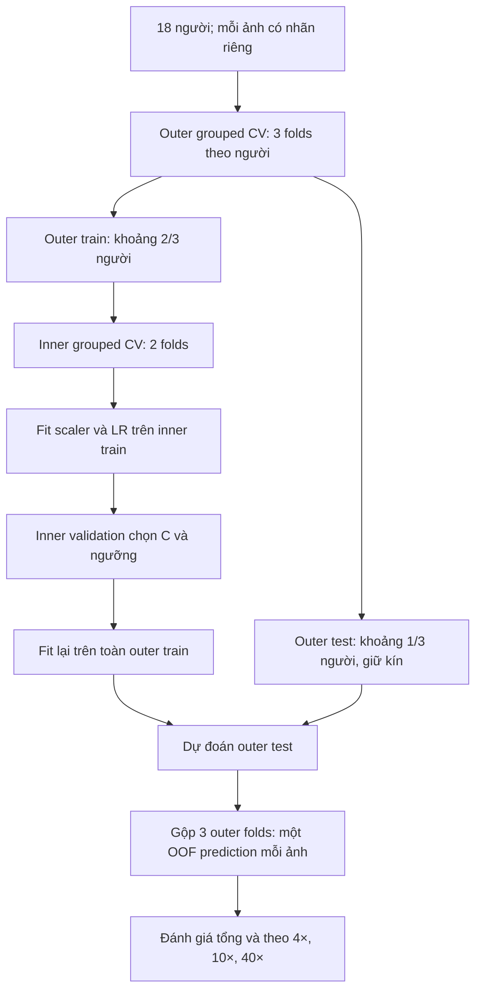

> **Bản lịch sử đã được thay thế.** Dùng [kế hoạch R0–R3 ngày 16/10](IMAGE_CLASSIFICATION_R0_R3_EXECUTION.md) cho thực thi tiếp. Account vận hành được giữ trong receipt private; snapshot gốc nguyên byte vẫn được giữ local.

# Kế hoạch tiếp tục phân loại ảnh gốc

Ngày cập nhật: **13/10/2026**. Đây là kế hoạch chính cho công việc tiếp theo; các kế hoạch MIL cấp ca và clustering patch là lịch sử tham chiếu. Lượt cập nhật này chỉ lập kế hoạch, không tạo runtime hoặc chạy dữ liệu.

## 1. Yêu cầu đã chốt

| Nội dung | Hợp đồng hiện tại |
|---|---|
| Đầu vào sử dụng | Một ảnh gốc 4×, 10× **hoặc** 40×; không cần đủ ba vật kính hay nhiều ảnh cùng người |
| Đầu ra | Xác suất ảnh có ung thư; nhãn có/không ung thư theo ngưỡng đã chọn bằng validation |
| Nhãn | Bác sĩ chấm `Glade` cho **từng ảnh gốc**; 0 → không ung thư; 3/4/5 → có ung thư |
| Loại giám sát | Nhãn mạnh cho **phân loại toàn ảnh**; chưa có nhãn vị trí, phân đoạn hoặc từng patch |
| Vai trò người bệnh | Chỉ quản lý nguồn và chia train/validation/test; không dùng kết luận cấp ca để thay nhãn ảnh |
| Xử lý ảnh | Giữ toàn khung, resize giữ tỉ lệ rồi padding; vòng đầu không cắt patch |
| Môi trường | Tác vụ lớn/trích features/train trên Colab; local chỉ thử nhỏ, tài liệu và kết quả nhẹ |
| Lưu trữ | Drive giữ nguồn, trọng số, cache, models, checksum và tiến độ; SSD Colab chỉ là vùng tạm |
| Tiếp tục sau ngắt | Kiểm artifacts đã commit rồi chỉ làm phần thiếu; không trích lại tất cả |
| Tài khoản đã chọn | `profile người dùng đã chọn; xem receipt private`; không tự đổi profile |
| Giới hạn phiên | Ngân sách vận hành 5 giờ 30 phút do người dùng đặt; Colab không bảo đảm phiên sống đủ thời gian này |

Mục tiêu là thử một baseline đáng tin cậy trước. Chưa có bằng chứng độ chính xác cho mô hình ảnh mới; kết quả MIL cấp ca trước đây không phải kết quả của mô hình này.

## 2. Hiện trạng và phần còn thiếu

Inventory ảnh gốc đã được đối chiếu metadata với ba ZIP trong `MyDrive/NCKH_Duy/`: **2.802 TIFF, 18 người**, gồm **2.298 ảnh không ung thư / 504 ảnh có ung thư**. Không thiếu filename trong inventory đã kiểm. `Metadata.xlsx` khớp byte với bản metadata người dùng cung cấp.

| Vật kính | Tổng ảnh | Vector đã kiểm lúc dừng | Phần còn thiếu theo snapshot |
|---|---:|---:|---:|
| 4× | 364 | 364 | 0 |
| 10× | 830 | 830 | 0 |
| 40× | 1.608 | 1.376 | 232 |
| Tổng | **2.802** | **2.570** | **232** |

- 81 shard đã kiểm checksum trong VM trước lúc mất phiên, mỗi vector 2.048 chiều. Cache này vẫn phải được đọc lại trên Drive trong lần tiếp tục; chưa xác nhận độ bền sau mất VM.
- Worker cũ đã dừng theo yêu cầu và giải phóng lock. Bước flush/unmount cuối của phiên cũ chưa được xác nhận.
- Lần tạo T4 tiếp theo ngày 12/10 đã kiểm môi trường khớp, nhưng phiên mất trước mount Drive. Không trích hoặc train thêm trong phiên đó. Server xác nhận không còn phiên tại lần kiểm ngày 12/10; cần kiểm mới khi thực thi.
- **Chưa train Logistic Regression và chưa có AUROC/accuracy mới.**
- Code đã qua 402 tests, 1 test encoder tùy chọn skipped, 12/12 CI checks; smoke 6 ảnh thật đã qua. Đây là kiểm phần mềm, không phải đánh giá chất lượng phân loại.

Bằng chứng: [báo cáo tạm dừng](../../Results/image_classification/execution_bop_20261012/BAO_CAO_TAM_DUNG.md), [trạng thái lần khôi phục](../../Results/image_classification/resume_bop_20261012/status.json). Mã triển khai nằm trong worktree `.worktrees/image-classification`, commit `c57399a`, PR #8 đang draft.

## 3. Mô hình và cách làm vòng đầu

```mermaid
flowchart LR
    A["Một ảnh TIFF gốc và nhãn Glade"] --> B["Decode; kiểm ảnh và checksum"]
    B --> C["Resize giữ tỉ lệ; pad thành 512×512"]
    C --> D["ResNet50 ImageNet V1; frozen, eval"]
    D --> E["Global average pooling: vector 2.048 chiều"]
    E --> F["Cache vector + truy xuất ảnh trên Drive"]
    F --> G["StandardScaler + Logistic Regression"]
    G --> H["Xác suất và quyết định có/không ung thư"]
```



ResNet50 đã có trọng số pretrained từ ImageNet. Bỏ head 1.000 lớp, dùng đặc trưng global average pooling. Vòng đầu **đóng băng toàn bộ CNN**, không cập nhật CNN bằng backprop. Chỉ fit scaler và bộ phân loại Logistic Regression bằng nhãn ảnh của mình.

Lý do chọn: tận dụng cache đã có, head nhẹ, train lại/thử C không cần đọc toàn bộ ảnh hoặc chạy CNN lần nữa. Đây là CNN trích đặc trưng pretrained kết hợp bộ phân loại tuyến tính, **không phải fine-tuning end-to-end**.

512×512 là cấu hình baseline có giảm độ phân giải. Nó giữ toàn khung nhưng có thể mất chi tiết mô; không gọi là train nguyên độ phân giải TIFF. Ví dụ 3840×2160 được resize rồi pad, không đưa nguyên hàng triệu pixel vào CNN.

Vòng đầu dùng chuẩn hóa đầu vào theo encoder ImageNet; **chưa dùng chuẩn hóa màu nhuộm**. Chuẩn hóa tensor ImageNet không phải đồng bộ nhuộm H&E. Không thay xử lý màu giữa chừng vì sẽ làm cache hiện tại không tương thích.

## 4. Thực thi theo tám bước có điều kiện nghiệm thu

| Bước | Đầu vào và công việc | Đầu ra/lưu ở đâu | Điều kiện được đi tiếp |
|---|---|---|---|
| **S0 — Sẵn sàng kết nối** | Người dùng sẵn sàng duyệt Google trên Chrome bop; kiểm server sessions và CLI identity. Tạo đúng một T4 khi được yêu cầu thực thi; nếu đã có phiên phù hợp thì tái dùng. Mount qua CLI tương tác rồi probe trong chính kernel chạy việc | Session name/receipt và trạng thái mount; local `Results/image_classification/`, Drive khi đã mount | Kernel thấy Tesla T4, đọc được nguồn và cache. Consent thành công trên web chưa đủ chứng minh mount |
| **S1 — Kiểm cache cũ** | Runtime ZIP đúng hash, đúng phiên bản encoder/preprocessing. Kiểm inventory/release identity, mọi shard commit, checksum, thứ tự vector–ảnh, ID trùng/ngoài manifest và lock | `resume_audit.json` trên Drive, bản receipt nhỏ local; xác định số ảnh còn thiếu thực tế | Cache phù hợp; 4×/10× đủ. Nếu thấp hơn snapshot 2.570, kiểm nguyên nhân trước khi quyết định trích lại |
| **S2 — Stage nguồn cần dùng** | Chỉ chép `data_40x.zip` từ Drive sang SSD Colab; tính SHA256 và đối chiếu inventory. Không giải nén cả bộ hoặc copy lại 4×/10× | `/content/image-originals/data_40x.zip` tạm; `staging_receipt.json` bền trên Drive | ZIP đúng hash, đủ SSD; nguồn không đổi khi copy |
| **S3 — Trích phần còn thiếu** | Giữ ResNet50 V1, FP32, 512, batch 2, shard tối đa 32. Resume cùng release; decode/forward chỉ ảnh chưa có commit hợp lệ | Các `features/part-*` mới: `features.npy`, `rows.jsonl`, `qc.json`, `commit.json`; status/events | Đủ **2.802 ảnh duy nhất**, vector 2.048D hữu hạn, đúng nhãn/lens/refs; `complete` và `training_ready=true` |
| **S4 — Gate trước train** | Loader đọc lại toàn bộ cache; kiểm content SHA trùng/xung đột nhãn; lập outer/inner folds theo người; thống kê lớp và lens mỗi partition | Duplicate audit; cấu hình study; split/lineage audits trong từng fold khi chạy | Không leakage; train/validation/test có hai lớp khi protocol yêu cầu. Duplicate cần quyết định có chứng cứ, không tự bỏ âm thầm |
| **S5 — Train baseline** | Features hoàn tất. Outer 3 folds, inner 2 folds; scaler fit chỉ train, thử C 0.01/0.1/1/10; max_iter 1.000; trọng số cân bằng người/lớp. Chọn C và ngưỡng từ inner validation | `training/<study_id>/folds/`, models/scalers, audits, commit; sau đủ folds có OOF CSV, study, deployment model, báo cáo | Mỗi ảnh có đúng một dự đoán outer-test; study/models checksum hợp lệ; không báo hoàn tất từ fold partial |
| **S6 — Đánh giá và suy luận** | Chỉ dùng OOF cho báo cáo; đọc kết quả theo fold/lens. Kiểm một ảnh qua encoder + model, load lại cho cùng output | ROC, PR, confusion matrices; bảng metrics, báo cáo tiếng Việt; prediction/save-load receipt trên Drive và bản nhỏ local | Báo rõ lỗi âm giả/dương giả, chênh lệch lens/fold, giới hạn 18 người. Phân biệt OOF và mô hình refit để dùng thử |
| **S7 — Bàn giao/kết thúc** | Verify artifacts trên Drive; lưu receipt cuối; dừng writers, official flush/unmount; dừng đúng runtime công việc | Báo cáo cuối, checksum/read-back receipts, chỉ dẫn dùng một ảnh và resume | Dữ liệu bền đã xác nhận, không còn writer/runtime công việc. Nếu error/partial thì ghi đúng trạng thái và giữ phần đã commit |

Nếu cả 2.802 vector thực tế đã có trên Drive, bỏ S2/S3 và chuyển thẳng S4. Nếu integrity gate thất bại, giữ bằng chứng, không train từ dữ liệu chưa xác minh.

## 5. Train, validation và test được dùng như thế nào



Các tỉ lệ trên chỉ minh họa. Số người/ảnh/lớp thực tế của từng fold phải được xuất từ splitter. Mọi ảnh và mọi vật kính của một người luôn cùng partition.

- **Train:** học scaler và tham số LR.
- **Validation:** chọn độ regularization C và ngưỡng quyết định trong phần train của mỗi outer fold.
- **Test:** outer fold không tham gia học/chọn C/ngưỡng. Đây là kiểm chéo nội bộ theo người, chưa phải một bộ test độc lập từ bệnh viện khác.
- **OOF:** dự đoán mỗi ảnh bằng model chưa học từ người của ảnh đó; đây là nguồn tính metrics báo cáo.
- **Deployment refit:** sau đánh giá, tune theo grouped validation và fit toàn bộ dữ liệu để dùng thử. Không đo accuracy bằng dự đoán lại chính dữ liệu đã refit.

Head baseline dùng chung ba lens, nhưng báo riêng từng lens. Chưa triển khai ba model riêng; đó là thí nghiệm tiếp nếu kết quả cho thấy cần. Không đổi target về cấp ca.

Đánh giá gồm AUROC, AUPRC, sensitivity, specificity, confusion matrix, ngưỡng validation và ngưỡng 0,5. Báo số ảnh dương/âm mỗi lens/fold. Nếu dùng khoảng tin cậy bootstrap, resample theo người; khoảng này phản ánh bất định có điều kiện trên OOF, không thay thế kiểm ngoài dữ liệu. Calibration là phân tích bổ sung, chưa phải chức năng đã nghiệm thu.

## 6. Lưu ở đâu và dùng lại những gì

```text
MyDrive/
├── NCKH_Duy/                           # Nguồn gốc, giữ nguyên
│   ├── Metadata.xlsx
│   ├── data_4x.zip
│   ├── data_10x.zip
│   └── data_40x.zip
└── histology/image_classification/
    ├── weights/                        # ResNet50 pretrained + identity
    └── v001/
        ├── inventory/<inventory_id>/   # Manifest + inventory commit
        ├── execution_bop_20261012/     # Receipts của lần đầu
        ├── resume_bop_20261012/        # Receipts lần khôi phục đã chuẩn bị
        ├── <execution_id_mới>/         # Ngày/session thực tế của lượt tiếp
        └── runs/<release_id>/
            ├── release.json           # Nguồn/encoder/preprocessing identity
            ├── status.json
            ├── source_bindings/
            ├── features/part-*/       # Vector + ảnh/nhãn/nguồn + QC + commit
            └── training/<study_id>/   # Chỉ xuất hiện khi train thực sự
                ├── training_config.json
                ├── folds/fold-*/      # Scaler/model, predictions, audit, commit
                ├── training_status.json
                ├── oof_predictions.csv
                ├── study.json
                ├── deployment_model.joblib
                ├── deployment_model.commit.json
                ├── study.commit.json
                └── report.json
```

Giữ nguyên cache production hiện tại:

- `inventory_id`: `808970a69a65fc96607d5ebc5e745ea51e469827b2e117b22ed54ac402d2d0bf`.
- `release_id`: `96993cac266079a81ed03d5135d71b8c423641d9152b1450d42ca879099ee0ef`.
- Runtime ZIP SHA256: `12883c304524272e6939ef0160e7b5a9d8e918654b4a447f3da857ca71ded047`.
- Môi trường cache: torch 2.11.0+cu130, torchvision 0.26.0+cu130; numpy 2.1.3; pandas 2.2.3; Pillow 11.3.0; openpyxl 3.1.5; sklearn 1.8.0.

Thay C hoặc head mà giữ encoder/preprocessing có thể tái dùng vectors; study/config mới phải tách riêng. Đổi encoder/weights, độ phân giải, precision hoặc xử lý màu ảnh cần **feature release mới**. Local giữ docs, code, receipts và báo cáo nhẹ; không tải lại hàng chục GB ảnh.

## 7. Quản lý phiên, ngân sách và ngắt kết nối

Phương án mặc định là **một phiên T4**: mount → verify → copy ZIP 40× → trích thiếu → train head bằng CPU của cùng VM → báo cáo → lưu và dừng. LR không dùng GPU, nên phần head kết thúc ngay khi đủ bằng chứng; không giữ T4 nhàn rỗi để đợi người dùng đọc báo cáo. Không tạo thêm phiên CPU mặc định vì phát sinh mount/khởi tạo lần nữa.

Chỉ tạo T4 khi người dùng đã sẵn sàng duyệt quyền. Nếu có công cụ kiểm Drive phù hợp trước cấp GPU thì dùng; hiện quy trình mount đã kiểm của dự án cần runtime. Không hứa mount sẽ tồn tại giữa hai VM.

| Tình huống | Cách xử lý |
|---|---|
| `Session not found` | Kiểm server sessions + identity. Nếu VM thật sự mất, không lặp mount vô hạn, không coi là lỗi consent; chỉ tạo phiên thay thế khi được cho phép |
| Đã duyệt Google nhưng CLI không thấy Drive | Probe trong chính kernel; retry official mount trên cùng VM nếu còn. Không dùng trạng thái web làm bằng chứng filesystem |
| Môi trường encoder khác | Dừng trước ghi cache; khôi phục môi trường đã pin hoặc lập migration được review; không âm thầm trích lại hết |
| Shard thiếu/hỏng | Phân biệt chưa commit và commit hỏng; giữ bằng chứng, không bỏ qua checksum. Chỉ phục hồi phần có căn cứ |
| Lock đang tồn tại | Xác minh writer/host/runtime; không xóa theo TTL. Code hiện chỉ recover same-host khi PID đã chết; cross-host cần bàn giao có chứng cứ |
| ZIP thay đổi/thiếu/SSD không đủ | Không công bố bản stage partial; kiểm hash và dung lượng, giữ cache cũ |
| Decode lỗi/ảnh trùng/nhãn xung đột | Xuất attention report, quyết định disposition minh bạch; không tự đổi nhãn hoặc coi snapshot toàn bộ đã sạch |
| OOM GPU | Batch nhỏ và cơ chế giảm batch đã có; giữ cấu hình feature identity. Không đổi độ phân giải/precision giữa release |
| Colab ngắt/quota/budget stop | Giữ commits, ghi partial; phiên mới kiểm lại rồi chỉ xử lý thiếu. Không keepalive giả hoặc tự xoay tài khoản |
| Head không hội tụ/đánh giá thiếu lớp | Giữ lỗi/log; chưa nghiệm thu. Xem scaling, số vòng lặp và split; đổi config tạo study riêng |

**Khả năng resume hiện có:** extraction theo shard; trainer theo outer fold đã commit. Logistic Regression không train bằng epoch, nên không có checkpoint epoch/optimizer để load. Nếu ngắt giữa một fold, có thể phải fit lại phần fold chưa commit, nhưng không cần trích lại vectors. Checkpoint epoch/model/optimizer/scheduler/AMP/RNG sẽ là yêu cầu của giai đoạn fine-tune CNN sau này, chưa có trong baseline LR.

Trích phần còn lại dùng budget tối đa 180 phút, reserve 15 phút; head dùng tối đa 60 phút, reserve 10 phút như cấu hình đã chuẩn bị. Các con số là giới hạn vận hành, **không phải dự báo thời lượng** và không bảo đảm Colab sống tới deadline. Tính thời gian copy/mount/verify/report vào ngân sách phiên 330 phút; điều chỉnh xuống theo thời gian đã dùng. CLI timeout phải dài hơn job budget; timeout client không đồng nghĩa job đã dừng.

Trước đây copy cả bộ ~29,27 GB mất 10 phút 34 giây trong một phiên cụ thể. Chỉ copy ZIP 40× ~18,05 GB trong lần tiếp; đo lại throughput và ước tính thời gian còn lại từ tốc độ thực tế. Không quy đổi bộ đếm local bị kéo dài qua mất phiên thành số giờ GPU thực tế hoặc giờ Free còn lại.

## 8. Sau baseline: quyết định cải tiến từ bằng chứng

Chỉ làm sau S6, mỗi thay đổi là thí nghiệm/config riêng; không tự chạy ngay trong lượt resume baseline.

1. **Phân tích lỗi trước:** xem ảnh âm giả/dương giả, phân bố theo lens/người/Glade, mất chi tiết do resize, màu/ánh sáng và chất lượng ảnh. Không kết luận do dữ liệu hay mô hình chỉ từ một AUROC thấp.
2. **Độ phân giải:** so 512 với 1024 nếu ảnh lỗi cho thấy mất chi tiết; benchmark batch/RAM/VRAM/time trước full run. Cache 1024 mới, giữ 512 làm đối chứng.
3. **Mô hình:** thử MLP từ cùng cache hoặc CNN fine-tune khối cuối nếu đặc trưng frozen chưa đủ. CNN fine-tune cần pipeline gradients/augmentation/checkpoint riêng và tests/CI trước tác vụ lớn.
4. **Vật kính/màu:** nếu sai lệch lens lớn, thử head riêng từng lens hoặc model nhận lens; nếu nhuộm/ánh sáng chi phối, thử augmentation/chuẩn hóa nhuộm với template chỉ từ train. Kiểm đối chứng, không thay nhãn ảnh.
5. **Nén/tăng tốc:** chưa ưu tiên pruning/quantization trước khi có chất lượng baseline. Các thay đổi ảnh hưởng vectors cần version mới và so chất lượng lẫn thời gian.

Mọi lựa chọn C/ngưỡng/cấu hình trong một study phải dùng train/validation. Nếu xem outer OOF rồi quyết định thí nghiệm mới, ghi đó là nghiên cứu thăm dò; không gọi tập outer cũ là test độc lập chưa từng dùng để quyết định phát triển.

## 9. Điều kiện bàn giao và giám sát

- Features đủ 2.802 ảnh đúng thứ tự/nhãn/lens, commits và SHA hợp lệ.
- Đủ 3 outer folds đã verify, mỗi ảnh có đúng một OOF prediction; zero patient overlap.
- Model/scaler/ngưỡng/config/encoder identity load được; suy luận một ảnh không cần dữ liệu cấp ca.
- Báo cáo metrics tổng và mỗi vật kính, biểu đồ, lỗi điển hình, giới hạn và đề xuất tiếp có chứng cứ.
- Artifact Drive được read-back verify, log/receipt nhỏ về local, writer dừng, flush và runtime stop được xác nhận.
- Partial/error/attention không gọi complete. Không shutdown máy Na hoặc khởi động lại lịch tắt máy cũ.

Ở các mốc mount thành công, cache verified, extraction complete, từng fold hoàn tất, study complete hoặc lỗi cần xử lý: cập nhật trạng thái có số lượng thực và artifact tương ứng. `status.json` phục vụ theo dõi; nghiệm thu dùng commit/checksum và audit.

Khi sửa chức năng mới: E2E reproduction trước sửa lỗi, root cause, architectural fix, E2E/regression và PLAYBOOK; code qua conveyor + PR/CI. Lượt lập kế hoạch này không thay đổi mã mô hình hay chạy lại test nặng.

## 10. Tài liệu điều hành

- [Kế hoạch thực thi ban đầu](IMAGE_STRONG_LABEL_COLAB_EXECUTION.md): lịch sử I0–I4 và cấu hình đầu.
- [Hướng dẫn cache/resume](../../Results/image_classification/execution_bop_20261012/HUONG_DAN_CACHE_VA_TRAIN.md): đường dẫn, identity và entrypoint đã chuẩn bị.
- [Kiểm nhãn ảnh](../../Results/label_audit_20261012/PHAN_LOAI_MOT_ANH_VA_CAP_NHAN.md): metadata và xác nhận cấp nhãn.
- [Skill phân loại ảnh](../../.worktrees/image-classification/.agents/skills/image-classification/SKILL.md): các ràng buộc kỹ thuật của pipeline hiện có.

**Thứ tự thực hiện tiếp:** người dùng sẵn sàng mount → S0 → S1 → S2/S3 nếu cần → S4 → S5 → S6 → S7. Chưa tạo T4 trong lượt cập nhật kế hoạch này.


## Nghiệm thu lượt thực thi ngày 14/10/2026

S0–S7 đã hoàn tất cho baseline: Drive cache đã đọc lại/verify; thêm232 ảnh40×, đủ2.802 vectors; giữ nguyên81 shard cũ; train3×2 grouped; kiểm OOF, hai ảnh suy luận kỹ thuật, save/load; kiểm29 artifact files, official Drive flush/unmount và dừng T4 được xác nhận. Hai study (baseline và mở miền C) được lưu riêng trên Drive; report/figures/receipts và backup model nhẹ có ở local.

Baseline AUROC0,729/AP0,398; theo lens4×0,591/10×0,687/40×0,773. Ở ngưỡng validation: sensitivity76,8%, specificity55,4%;117 FN/504 ảnh dương,1.026 FP/2.298 ảnh âm. Mở C tới100/1.000 không cải thiện AUROC (0,707), nên giữ baseline làm mốc; chưa có kết luận độ chính xác lâm sàng. Local409 passed/1 skipped, CI12/12 qua cho sửa báo cáo, PR#8 vẫn draft.

Lượt tiếp theo là review FN/FP theo lens, benchmark độ phân giải512/1024 rồi cân nhắc head riêng/MLP/fine-tune khối cuối; các hướng đó chưa chạy full. Tham chiếu [báo cáo kết quả](../../Results/image_classification/execution_bop_20261014/BAO_CAO_KET_QUA.md), [hướng dẫn một ảnh](../../Results/image_classification/execution_bop_20261014/HUONG_DAN_SU_DUNG.md), [receipt checksum cuối](../../Results/image_classification/execution_bop_20261014/final_receipt.json), [receipt dừng runtime](../../Results/image_classification/execution_bop_20261014/runtime_stop_receipt.json). Không có runtime đang chạy của công việc này; không shutdown máy Na.

## Nghiệm thu cải tiến từ cache — 14/10/2026

Đã chạy đủ bảy cấu hình trên Colab **CPU**, giữ nguyên2.802 ảnh/18 người bệnh, feature release và các outer patient folds của baseline. Metadata và cả ba ZIP nguồn khớp SHA; scaler/PCA fit train-only; tham số/ngưỡng chọn trong inner validation. Không trích lại features, không dùng T4, không fine-tune CNN.

| Cấu hình | AUROC gộp |
|---|---:|
| Baseline/đối chứng patient_lr |0,729|
| Trọng số theo lớp ảnh |0,727|
| Không trọng số |0,726|
| PCA32 |0,647|
| PCA64 |0,690|
| Head riêng vật kính |0,678|
| Head riêng + PCA32 |0,662|

Chưa có cải tiến AUROC gộp. PCA tăng điểm4× nhưng giảm10×/40×; giữ vector2.048 chiều và baseline làm mốc. Đổi trọng số làm thay đổi đánh đổi bỏ sót/báo nhầm, không giải quyết giới hạn tổng thể. Đây là so sánh thăm dò nội bộ trên outer folds đã được xem, không phải test độc lập mới.

Đã tạo24 ảnh lỗi/đối chứng truy ngược đúng TIFF gốc, ba montage theo vật kính; full originals giữ trên Drive. Đã verify graph commit/checksum,21 lượt kiểm kỹ thuật vector→head save/load, và khôi phục đủ7 study từ backup cả các fold trên SSD Colab. Bản ZIP bàn giao18.658.380 bytes đã tải về local và kiểm SHA; không chứa full TIFF, full feature shards hay encoder weights vì các phần đó đã lưu bền trên Drive. Bảy mô hình deploy/fold, OOF, config và audit có trong backup riêng tư.

- [Báo cáo và bảng metrics chi tiết](../../Results/image_classification/head_lab_20261014/report/BAO_CAO.md).
- [Biểu đồ AUROC theo vật kính](../../Results/image_classification/head_lab_20261014/report/auroc_comparison.png).
- [Đối chứng cặp và CI theo vật kính](../../Results/image_classification/head_lab_20261014/report/ablation_analysis.json).
- [Biên bản xác minh](../../Results/image_classification/head_lab_20261014/report/verification.json).
- [Biên bản flush/unmount](../../Results/image_classification/head_lab_20261014/final_flush.json).

**Việc tiếp theo chưa chạy:** bác sĩ xem ảnh lỗi; benchmark nguyên ảnh512/1024 và ảnh hưởng nền/chi tiết trên cùng nhóm người bệnh; tạo cache1024 riêng nếu benchmark khả thi; sau đó cân nhắc fine-tune khối cuối với checkpoint đầy đủ. Không tự đổi nhãn hoặc xóa ảnh vì dự đoán sai. Không cần chạy lại bảy study đã commit. Mã nguồn:425 tests passed/1optional skipped, CI12/12green, PR#8draft.
