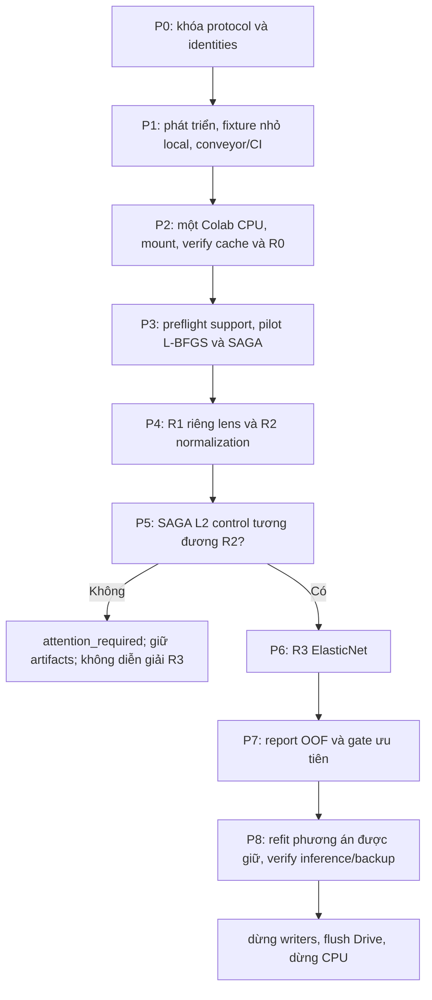

# Kế hoạch hiện hành — thử nghiệm head R0–R3 trên RetCCL512

Ngày: **16/10/2026** · phiên bản **1.4** · trạng thái **v5 giữ115fit sau timeout; warm retry với conditioning ở lượt cuối đã qua scope yếu, đang kiểm hồi quy và scope khó**.

Tài liệu này thay kế hoạch thực thi tiếp theo trong `IMAGE_CLASSIFICATION_NEXT_STEPS.md` và `IMAGE_CLASSIFICATION_FEASIBLE_DIRECTIONS.md`. Các bản ngày 13–14/10 được giữ làm lịch sử, không còn là hàng đợi công việc. Phạm vi lượt hiện tại là cập nhật kế hoạch; không tạo Colab runtime từ việc lưu tài liệu này.

## 1. Mục tiêu và phạm vi

Một **ảnh gốc** 4×, 10× hoặc 40× → score và quyết định có/không ung thư. Nhãn bác sĩ cho từng ảnh: `Glade0→0`, `Glade3/4/5→1`; giữ raw Glade, không tự diễn giải ISUP/Gleason. Patient ID chỉ dùng cho grouping/lineage. Đây là nhãn mạnh cho phân loại ảnh, không có nhãn cho mọi vùng/patch.

So sánh bốn phương án dưới cùng protocol để trả lời: routing theo vật kính, chuẩn hóa độ lớn vector và sparsity có cải thiện so với B1 không? Không mặc định bất kỳ phương án nào sẽ tăng điểm.

**Cố định:** nguồn/nhãn, RetCCL weights và preprocessing toàn khung 512, raw cache 2.048D, cohort, thứ tự vector–ảnh, outer/inner patient assignments và quy tắc weights/metrics. Không đọc lại ZIP ảnh, trích encoder, crop, PCA, stain normalization, đổi encoder hoặc fine-tune CNN trong lượt R0–R3.

## 2. Dữ kiện và điểm xuất phát

- 2.802 ảnh/18 người; 2.298 âm và 504 dương. 4×: 364, 10×: 830, 40×: 1.608.
- 8 người có ảnh dương, 12 người có ảnh âm; 2 người thuộc cả hai nhóm. Mỗi người có 13–383 ảnh. Không coi 2.802 ảnh là 2.802 quan sát độc lập.
- B1 hoàn tất: AUROC 0,869803; AP 0,624167; tại 0,5: accuracy 84,9%, độ nhạy 71,4%, độ đặc hiệu 87,9%. Đây là OOF thăm dò, chưa phải external test.
- Độ nhạy trung bình đều theo 8 người có ảnh dương là 64,2%; giữa các người dao động 7,7–95,2% tại 0,5. B1 tốt nhất theo điểm ước lượng, chưa được xác nhận tổng quát hóa ngoài cohort.
- Đã thử per-lens trên **ImageNet512**: pooled AUROC 0,729 → 0,678. Kết quả này không thay cho thử nghiệm RetCCL.
- R0 không cần train lại. T4 lần trước đã flush/unmount và dừng; không có runner thuộc lượt R0–R3 được khởi tạo.

Nguồn công khai trong repo: [kết quả frozen đã hoàn tất](../reports/IMAGE_FROZEN_COMPARISON_20261015.md). Bằng chứng riêng tư local: `Results/image_classification/improvement_resume4_20261015/`; phân tích bổ sung: `Results/image_classification/research_validation_20261016/`.

## 3. Ma trận thử nghiệm khóa trước khi chạy

| Mã | Dữ liệu và head | Đối chứng chính | Yếu tố thay đổi | Cần GPU |
|---|---|---|---|---|
| **R0** | B1 hiện có: raw RetCCL512 → StandardScaler → global L2 LR | Mốc bất biến | Không thay; đọc model/OOF/commit đã lưu | Không |
| **R1** | Cùng cache; ba scaler + L2 LR riêng cho 4×/10×/40× | R0 | Routing; từng head có tuning/ngưỡng riêng | Không |
| **R2** | SampleL2Normalizer → StandardScaler → global L2 LR | R0 | Bỏ độ lớn vector trước khi fit scaler | Không |
| **R3** | Cùng preprocessing R2 → global ElasticNet LR/SAGA | R2 và solver control | Penalty sparsity; chọn lambda và l1_ratio cùng nhau | Không |

**Solver control bắt buộc, không là nhánh chính thứ năm:** `R2_SAGA_CONTROL` dùng preprocessing, weights và từng lambda giống R2, nhưng dùng solver SAGA với `l1_ratio=0`. Không chọn lambda riêng; outer refit dùng lambda R2 đã chọn. Chỉ diễn giải R3−R2 là ảnh hưởng của penalty sau khi control tương đương số học với R2.

R3 chỉ chọn trong `l1_ratio∈{0.3,0.7}`; ratio 0 thuộc control riêng. Không ép phải còn 50–100 hệ số, không gọi hệ số embedding là đặc trưng sinh học đã xác nhận. Nếu mọi hệ số bằng 0 nhưng đã hội tụ, đó là kết quả hợp lệ cần báo cáo.

R1 yêu cầu biết vật kính khi suy luận; chỉ nhận 4/10/40, không đoán lens từ filename và không âm thầm fallback global khi lens thiếu hoặc không hợp lệ.

## 4. R0 và nguồn đầu vào bất biến

Drive project root: `MyDrive/histology/image_classification/`.

| Identity | Giá trị khóa |
|---|---|
| Inventory | `808970a69a65fc96607d5ebc5e745ea51e469827b2e117b22ed54ac402d2d0bf` |
| B1 feature release | `c294914d1c5d00d3da82e40007988ad65170338af19914a1489aa76611d9f955` |
| B1 head study | `16d92369288182d8cf5165bbad27f7f582e33ddbc985f043c4628a1db7622b5b` |
| Outer assignment SHA | `68fff2310fbd0772f92caa21144c75b73ac5ce46b008aab607a303d0e2a077df` |
| B1 OOF CSV SHA | `f8382939399496ed6a5743f14e1bf11a41231938a7faca4f0154fc4a0ba16771` |
| Portable handoff SHA | `0e244bdd3db024ea186b21109ee780c6d9f5fd183670fa2d090859652c88a540` |

B1 release ở `improvement_v002/features/B1/runs/<release_id>/`; study ở `head_studies/<study_id>/`. Portable handoff đã verify nằm trong execution ngày 15/10 và có bản local; giữ nguyên, không ghi kết quả mới vào đó.

**G0 phải đọc/verify:** inventory/source identities, toàn bộ feature shard commits/hash/order, study/fold commits, predictions và deployment model; đủ 2.802 × 2.048, hữu hạn, không lặp/mất image_id, nhãn/lens khớp. Không tin riêng `status.json` hoặc một SHA container thay cho kiểm tra liên kết bên trong.

R0 mới chỉ lưu receipt tham chiếu/hash, không tạo OOF khác hoặc sửa baseline để khớp code mới. Tính lại metrics từ cùng OOF phải khớp trong sai số 1e−12 cho AUROC/AP; các quyết định/nhãn/fold phải trùng chính xác. Nếu không khớp, dừng điều tra trước khi fit R1–R3.

## 5. Chia dữ liệu và chọn tham số

### 5.1. Giữ đúng assignment đã ghi, không chỉ giữ seed

- Ba outer folds của B1 được giữ nguyên; outer train lần lượt có 12, 13, 11 người. Mọi ảnh/vật kính cùng người chỉ ở một partition.
- Nạp trực tiếp `folds[*].heads.all.tuning.inner_splits` của B1 và kiểm tra patient assignment; **không tạo seed mới**.
- R2/R3/control dùng đúng inner records của R0. R1 lấy cùng inner patient assignment rồi giới hạn ảnh theo lens. Không dùng cơ chế hiện tại sinh seed riêng theo lens, vì sẽ thay cả routing lẫn cách chia validation.
- Khi fit-all sau đánh giá, dùng inner assignment đã ghi ở `deployment.all.tuning.inner_splits` của B1, giới hạn theo lens cho R1 tương tự.
- Preflight phải kiểm tra mỗi head/train/validation/test có đủ hai lớp; không bỏ fold, đổi seed, gộp lens hoặc fallback để cứu điểm.

Audit nhẹ trên hồ sơ lưu ngày 16/10: **48 tổ hợp** outer/deployment × inner × train/validation × lens đều có hai lớp, tối thiểu 2 người mỗi lớp trong từng tổ hợp. Đây là kiểm tra tính khả thi của assignment, không phải kết quả train hoặc xác nhận sample size đủ. Khi chạy phải verify lại artifacts trên Drive.

### 5.2. Weights và objective

Trong mỗi **training scope** đang fit, đặt N là số ảnh, P_y là số người có ảnh nhãn y, n_p,y là số ảnh nhãn y của người p:

`w_i = N / (2 × P_y × n_p,y)`; tổng weights = N, mỗi lớp có khối lượng N/2. Cân người **trong từng lớp**, không bảo đảm tổng khối lượng của mọi người bằng nhau; người có cả hai nhãn đóng góp trong cả hai nhóm.

Giữ `class_weight=None`, scaler train-only **không weighted**, `C=1/(lambda×sum_weights)`. Tính weights lại trong inner-train, outer-train và fit-all; không lấy thống kê class/patient từ validation/test. Không thay bằng raw C-grid hoặc thêm class_weight balanced.

### 5.3. Lưới và quy tắc chọn

| Nội dung | Quy tắc khóa |
|---|---|
| Lambda R1/R2/control/R3 | `{50,5,0.5,0.05}` |
| R3 l1_ratio | `{0.3,0.7}`; joint search 8 candidates |
| Chọn lambda/cặp tham số | Pooled inner OOF AUROC lớn nhất; tie số học ≤ 1e−12 ưu tiên lambda lớn hơn; R3 tie tiếp ưu tiên ratio nhỏ hơn |
| Chọn threshold | Chỉ từ inner OOF của candidate đã chọn, tối đa balanced accuracy bằng cùng thuật toán/tie rule đang dùng ở B1 |
| Outer test | Chỉ predict/đánh giá sau khi fit theo tham số đã chọn; không chỉnh preprocessing, lambda, ratio hoặc threshold bằng outer results |
| Fit scaler/Normalizer | Đúng thứ tự R2/R3; scaler chỉ fit inner/outer train tương ứng. Normalizer là biến đổi từng mẫu, không học phân phối toàn cohort |
| Seed/runtime | Seed 17 và seed solver được ghi rõ trong descriptor; scikit-learn 1.8.0, các phiên bản còn lại theo runtime đã pin; không nâng thư viện giữa study |

L2 Normalizer → StandardScaler không giữ unit-norm ở đầu ra cuối. Phải dùng cùng thứ tự/dtype ở train, resume và inference. Không sửa raw feature cache; preprocessing này thuộc head-study identity mới.

### 5.4. Hội tụ và solver control

- R1 L-BFGS giữ `tol=1e−4` như B1. R2 L-BFGS dùng `tol=1e−8`; SAGA control/R3 dùng `tol=1e−8`. Sau preprocessing, cả hai solver nhận cùng ma trận float64; raw cache và hình học preprocessing giữ nguyên. Không sử dụng `n_jobs=-1` làm lời hứa tăng tốc SAGA.
- Mỗi fit bắt đầu với max_iter 2.000; nếu chưa hội tụ, retry giới hạn 10.000 rồi 50.000, cùng dữ liệu/seed/objective. Ghi mọi attempt. Nếu vẫn lỗi hoặc hết budget: `attention_required`/`partial`, không bỏ candidate hoặc trả điểm như đã hội tụ.
- Lưu warnings, n_iter, thời gian, finite coefficients/scores và objective cho từng fit. Xác minh dtypes/precision nhất quán bằng fixture; đổi dtype phải vào descriptor, không âm thầm đổi khi resume.
- Với cùng lambda/train/validation, control SAGA so với R2 L-BFGS: max chênh score ≤ 1e−3 và chênh relative objective ≤ 1e−4. Objective là weighted mean log loss + lambda/2 × ||w||², intercept không penalty; relative denominator = max(1, |objective R2|).
- Nếu control không đạt, không kết luận ElasticNet tốt/xấu do sparsity. Lưu lỗi số học và xử lý convergence/implementation, không thay tolerance theo outer AUROC. B1 R0 vẫn giữ nguyên.
- Chạy từng fit trong worker có thể hủy và join; timeout toàn bộ worker của mỗi fit (gồm retry) = min(15 phút, thời gian còn lại trước hard deadline trừ reserve). Hết giờ thì dừng worker của job, không publish artifact dở; parent lưu receipt và cleanup. Không chỉ kiểm deadline trước khi gọi một fit SAGA dài. Nếu cùng đơn vị timeout hai lần, đánh dấu attention_required thay vì retry vô hạn.

## 6. Luồng thực thi, đầu vào và đầu ra từng bước



| Bước | Đầu vào / việc cần làm | Đầu ra phải lưu | Điều kiện đi tiếp |
|---|---|---|---|
| **P0 Thiết kế** | Kế hoạch này, baseline identities, existing artifacts | Protocol snapshot, registry R0–R3/control, hash config/source | Không còn tham số/mapping tùy chọn mơ hồ; chưa chạy data |
| **P1 Phát triển** | Existing study runner, loaders, small synthetic fixtures | Versioned config/schema; shared-inner routing; Normalizer/ElasticNet/control; resume/report support; test proof và CI | G1 phần mềm đạt trước khi chạy dữ liệu thật |
| **P2 Kết nối/nguồn** | Một CPU trên profile người dùng đã chọn và cache B1 trên Drive; người dùng hoàn tất Google khi cần | Runtime receipt private; R0 receipt; cache/source/OOF verification; memory estimate | G0 integrity đạt; không có writer khác cùng study |
| **P3 Preflight/pilot** | Shared assignments và cả 3 lens; pilot L-BFGS R2 và SAGA R3 trên inner split đầu outer1, lambda 0,05, R3 ratio 0,7 | support.json; resource_benchmark.json; dự toán riêng theo solver/scope; commit fit pilot nếu đúng identity | Hai lớp, không overlap; budget đủ cho đơn vị tiếp theo |
| **P4 R1/R2** | Raw cache; đúng partition và weights | Per-candidate inner OOF; selection; model + scaler; outer predictions; fit receipts | Từng fit hội tụ và checksum hợp lệ; đủ coverage |
| **P5 Control** | R2 transforms, từng lambda, cùng scope và selection | solver_control.json; prediction/objective deltas; failure receipts | Control đạt tolerance trước khi diễn giải R3 |
| **P6 R3** | R2 preprocessing; joint grid 8 candidates | Như P4 + ratio, sparsity và convergence | Không chọn số chiều bằng outer test; không bỏ candidate |
| **P7 Đánh giá** | R0 OOF và OOF mới đã commit | comparison.json; paired CI; subgroup/fold tables; plot; report; gate_decision.json | G2 nghiệm thu kỹ thuật; gate chất lượng chỉ ưu tiên |
| **P8 Bàn giao** | Kết quả và phương án được giữ trong development | Model refit nếu cần, deployment threshold, guide, save/load proof, handoff/restore/stop receipts | Dữ liệu bền vững, không còn writer, official flush/stop |

P4/P5/P6 có thể xếp lịch tuần tự trên một CPU runner. Không tạo nhiều Colab VM để chạy song song. Subagents chỉ hỗ trợ code/review/QA; một bên điều khiển runtime và publication.

## 7. Khối lượng tính toán và ngân sách

| Phần | Inner fits | Outer refits | Tổng trước fit-all |
|---|---:|---:|---:|
| R0 | 0 | 0 | **0** |
| R1: 3 heads × 3 outer × (4 lambda × 2 inner + 1) | 72 | 9 | **81** |
| R2: 3 outer × (4 lambda × 2 inner + 1) | 24 | 3 | **27** |
| R2 SAGA control, cùng mọi lambda và scope R2 | 24 | 3 | **27** |
| R3: 3 outer × (8 candidates × 2 inner + 1) | 48 | 3 | **51** |
| **Tổng** | **168** | **18** | **186** |

Nếu refit tất cả R1/R2/control/R3 trên 18 người sau đánh giá, tối đa thêm 62 fits, tổng 248 fits trước retry. Ưu tiên chỉ refit phương án cần bàn giao; R0 model đã có. Không dùng điểm fit-all làm đánh giá chất lượng mới.

- **GPU dự kiến: 0 giờ.** Thời gian CPU chưa đo; không hứa số giờ hoàn tất trước pilot. Nhiều candidate SAGA có thể chậm hoặc không hội tụ.
- Raw features float32 khoảng 21,9 MiB; bản float64 khoảng 43,8 MiB, chưa gồm transforms/models/framework. Không stage ba ZIP ảnh hoặc load CNN weights cho head studies.
- Giới hạn vận hành mặc định của lượt CPU: 180 phút, reserve 20 phút; đây là chính sách dừng để bảo toàn tiến độ, không là hạn mức provider. Sau pilot, dự toán còn lại = Σ fits còn lại × thời gian đo + I/O/refit/verify + reserve. Nếu không đủ, chia phiên và resume.
- Pilot phải đo cả L-BFGS và SAGA; không ngoại suy thời gian SAGA 50.000 vòng từ một fit L-BFGS. Pilot trùng candidate/scope/identity được commit và dùng lại trong 186 đơn vị, không fit lại chỉ vì chuyển từ pilot sang study.
- Local chỉ dùng fixture nhỏ, tài liệu, kiểm tra thống kê/receipts; fit dữ liệu thật 2.802 ảnh trên Colab CPU. Không giữ T4 chờ mount/CPU head.

## 8. Lưu trữ, checkpoint và resume

Root mới dự kiến trên Drive: `histology/image_classification/head_ablation_r0_r3_v001/`. Thư mục này chưa được tạo từ việc lập kế hoạch.

```text
head_ablation_r0_r3_v001/
  protocols/<protocol_id>/
    protocol.json, registry.csv, source_receipt.json, assignments.json
  studies/<study_id>/
    config.json, R0_reference.json, support.json
    arms/R1|R2|R2_SAGA_CONTROL|R3/
      outer/fold-01|02|03/
        heads/<all|4|10|40>/
          inner/split-01|02/<candidate_id>/
            validation_predictions.npz, fit_receipt.json, commit.json
          selected.json, model.joblib, predictions.csv, commit.json
        fold.commit.json
      deployment/heads/<all|4|10|40>/  # nếu được tạo sau đánh giá
    report/                       # OOF, so sánh, CI, plots và gate
    handoff/                      # manifest, checksums, restore proof
    status.json, events.jsonl
```

Local chỉ giữ receipt/report tại `Results/image_classification/r0_r3_20261016/`; báo cáo tổng hợp không có patient ID có thể vào `docs/reports/`.

Identity bắt buộc chứa B1 release/study/OOF hash, image order, outer + inner assignment hash, head scope, Normalizer/scaler/penalty, weights/lambda, solver/tolerance/retry, seed, precision, versions và code commit. Budget/session ID là metadata vận hành, không thay đổi scientific identity.

Commit atomically từng candidate/inner prediction và outer fold; resume chỉ reuse khi hash + identity + coverage khớp. Không checkpoint bằng `status.json` đơn lẻ. Candidate đang fit bị ngắt thì fit lại candidate đó; không chạy lại các candidate/outer fold đã commit. Không ghi đè B1 hoặc study khác config. Không chiếm lại lock chỉ theo TTL; phải xác minh writer cũ đã chết theo hợp đồng recovery.

Giữ R0 receipt, labels/lens/image IDs/score order, selected params/threshold, model/scaler, convergence, metric definitions, seeds, versions, checksum và log failure. Backup phải đọc lại/restore được trước khi dừng phiên.

## 9. Đánh giá và quy tắc ra quyết định

**Bắt buộc cho cả 4 phương án:** pooled và per-lens/per-fold AUROC, AP; macro lens AUROC = (AUC4 + AUC10 + AUC40)/3; accuracy/balanced accuracy/sensitivity/specificity/confusion counts tại 0,5 và inner-selected threshold. Nêu rõ AP là `average_precision_score`, không gọi một phép tích phân PR khác cùng tên.

Bổ sung độ nhạy trung bình đều theo người có ảnh dương, độ đặc hiệu theo người có ảnh âm; patient-class-weighted image AUROC với w_i ∝ 1/(P_y × n_p,y). Đây vẫn là phân loại ảnh, không gộp thành chẩn đoán ca. Báo raw Glade/lens support; subgroup thiếu lớp thì metric không xác định, không điền bằng 0. Chỉ 2 người ở Glade3 nên không suy rộng nhóm này.

So sánh cặp: R1−R0, R2−R0, R3−R2 và mỗi nhánh−R0. Bootstrap paired 2.000 lần theo người, seed 17016, giữ mọi ảnh của người cùng nhau; lưu valid replicates, report CI 95%. Đây là CI có điều kiện trên OOF đã lưu, không refit, không bao quát bất định lựa chọn mô hình. Không dùng folds như quan sát độc lập hoặc thử đến khi CI đẹp.

Dùng chung 2.000 lượt rút 18 người có hoàn lại cho mọi nhánh. CI là percentile 2,5%–97,5% của paired differences. Khi một người được rút nhiều lần, giữ nguyên multiplicity; macro/patient-weighted metrics phải dùng ID từng bản sao bootstrap, không regroup theo patient ID gốc rồi làm mất số lần rút. Mỗi metric/lens ghi số replicate hợp lệ và lý do loại (ví dụ thiếu lớp); không biến metric không xác định thành 0 hoặc rút thêm đến khi CI đẹp. Nếu dưới 1.000 replicate hợp lệ, không công bố CI đó và ghi attention về độ ổn định; không gộp các subgroup để che thiếu hỗ trợ.

Score của ba head R1 có thể khác scale: bắt buộc xem per-lens/macro; không lấy pooled AUROC riêng để giải thích chất lượng mỗi vật kính. Không calibrate bằng outer labels.

**Gate ưu tiên giữ từ kế hoạch trước:** Δpooled AUROC so với R0 ≥ 0,02; AP không giảm; không lens nào giảm AUROC > 0,02; đủ mọi integrity/convergence/coverage check. Với R3, solver control phải đạt và báo thêm Δ so với R2. Gate là quy tắc ưu tiên nghiên cứu, không là ngưỡng ý nghĩa thống kê hoặc chứng nhận lâm sàng.

Không nhánh nào qua Gate thì giữ R0, vẫn bàn giao đầy đủ kết quả âm. Nhiều nhánh qua Gate thì ưu tiên pooled AUROC lớn nhất, tie ≤ 1e−12 theo AP, tie tiếp ưu tiên R2 → R1 → R3; giữ cả CI/trade-offs và không gọi winner là đã được xác nhận. Không thêm lambda/ratio/seed sau khi xem outer results để cứu Gate; mở nghiên cứu phiên bản mới nếu có câu hỏi mới.

Đầu ra R3: thêm số/tỷ lệ hệ số khác 0 tại mỗi outer/deployment refit, lambda/ratio đã chọn và overlap mô tả giữa các fold. Không diễn giải hệ số sparse như vùng ung thư hoặc biomarker.

## 10. Các gate nghiệm thu và lỗi phải chặn

| Gate | Bằng chứng cần có |
|---|---|
| **G0 Nguồn** | Đúng identities/coverage/order; R0 bất biến; không leak; không có writer khác |
| **G1 Phần mềm** | Fixture có mô phỏng 18 người/3 lens, same-inner restriction, train-only scaler, weights/C, Normalizer order, joint selection, solver control, class ordering, threshold, save/load, resume failure; conveyor + CI |
| **G2 Study** | Mỗi ảnh đúng 1 OOF; mọi head/candidate/fold hội tụ; hashes/audits đầy đủ; report khớp công thức; partial không được coi là complete |
| **G3 Bàn giao** | Model đúng schema; một vector + known lens nếu R1 → score/ngưỡng khớp saved pipeline; restore/hash readback; writer/runtime đã dừng |

Code hiện có per-lens LR nhưng chưa đáp ứng shared-inner policy; chưa có Normalizer/ElasticNet/schema tương ứng trong loader. P1 phải phiên bản hóa protocol/config và strict loader, không nới lỏng kiểm tra step names/identities để nhận model mới. R0 loader và artifacts cũ vẫn giữ tương thích read-only.

Mã chức năng mới đi đủ 6 trạm; nếu phát hiện bug thì E2E reproduction → root cause → architectural fix → E2E/regression và PLAYBOOK. Local E2E dùng fixture nhỏ; dữ liệu thật chỉ ở Colab. GPU encoder test không cần cho head-only recipe.

## 11. Ranh giới với kiểm định độc lập và công việc sau

Toàn bộ 18 người đã tham gia phát triển; R0–R3 là **exploratory internal OOF**, không tạo test độc lập mới. Chia ảnh/random seed lại không xóa quá trình chọn mô hình trước đó.

Sau R0–R3 mới cân nhắc một thử nghiệm extraction riêng: RetCCL1024 toàn khung. Crop pooling, Macenko, foundation model khác, fine-tune hoặc ensemble không tự kích hoạt từ Gate này.

External test công khai như SICAPv2/TMA là hướng chuẩn bị riêng: audit version, patient linkage, nhãn NC/mixed/unannotated, FOV/MPP, provenance/pretraining overlap; khóa một model chính, preprocessing và threshold trước khi xem test. Không fit/calibrate chung trên final test, không đặt AUROC > 0,80 thành chứng minh không overfit. Nếu chỉnh sau test, cần cohort test tiếp theo.

## 12. Tài liệu và trạng thái điều phối

- [Mục lục](README.md), [đường dẫn kế hoạch chính](IMAGE_CLASSIFICATION_NEXT_STEPS.md), [đường dẫn hướng nghiên cứu](IMAGE_CLASSIFICATION_FEASIBLE_DIRECTIONS.md).
- [Scikit-learn 1.8 LogisticRegression](https://scikit-learn.org/1.8/modules/generated/sklearn.linear_model.LogisticRegression.html), [Normalizer](https://scikit-learn.org/stable/modules/generated/sklearn.preprocessing.Normalizer.html), [ElasticNet — Zou & Hastie](https://doi.org/10.1111/j.1467-9868.2005.00503.x).
- [RetCCL mã tác giả](https://github.com/Xiyue-Wang/RetCCL), [thiên lệch lựa chọn mô hình](https://jmlr.org/papers/v11/cawley10a.html), [CLAIM 2024](https://pubs.rsna.org/doi/10.1148/ryai.240300).

**Việc kế tiếp khi được yêu cầu thực thi: P1 phát triển và kiểm thử head studies, chưa phải tạo T4 hoặc chạy CNN.** Không shutdown máy Na. Sau phiên CPU thực tế phải ngừng writers, verify backup, official flush/unmount Drive và dừng runtime dự án.

## 13. Cập nhật precision ngày16/10 — không đổi tiêu chí chất lượng

Lượt v2 giữ114fit đã commit rồi dừng tại control lambda0,5/inner1: maxscore delta0,002045 >0,001. Dữ liệu và preprocessing giữa hai solver giống hệt (maxdifference0); L-BFGS gradient còn7,89e−5, SAGA float32 còn1,63e−5. Đối chứng cùng dữ liệu ở float64 và L-BFGS tolerance1e−8 hạ chênh validation còn0,000108, không dùng nhãn hoặc metric outer để chọn sửa.

Bản v3 ghi precision/tolerances vào scientific identity mới; không nới score/objective gate, không đổi folds, weights, grids hay nhãn. R0 và cacheB1 tiếp tục bất biến. Lượt114fit cũ giữ nguyên để audit; không gộp điểm của hai phiên bản số học. Đây là sửa độ chính xác tối ưu hóa cùng objective, không là bằng chứng đã khắc phục overfitting.

## 14. Conditioning SAGA và tái sử dụng fit L-BFGS ngày16/10

V3 dừng an toàn sau121fit tại SAGA-control fold02/inner02/lambda5 vì vượt deadline900giây. Fold01 control đã đạt, maxscore delta2,10e−5. Đây là lỗi hội tụ/số học, chưa là kết luận chất lượng R3. Không thay tolerance gate, labels, folds hoặc grids.

Chỉ SAGA dùng weighted centering z′=z−μ với μ tính trên train, và chia toàn bộ sample weights cho a=max(1,max(wᵢ(‖z′ᵢ‖²+1))/max(‖z′ᵢ‖²+1)); Csolver=C×a. Tích C×weight giữ nguyên; dịch intercept ngược b=b′−μ·β trước lưu model. Đây là tiền điều kiện tối ưu cùng objective, không thay preprocessing hay tăng độ chính xác bằng thiết kế. Receipt lưu logical/solver C, tổng weights, divisor, center norm, iterations và objective gốc.

Tái hiện đúng scope trên Colab: conditioning hội tụ3809iterations/120,84giây, khôngwarning; maxvalidation score delta5,07e−6, relativeobjective delta1,45e−11 so với R2 L-BFGS. Không dùng outer labels/metrics để chọn sửa. Lần chạy conditioning có scientific identity riêng.

Được nhập lại108fit R1/R2 từ v3 chỉ khi implementation nằm allowlist đã review, source/versions/config/actual splits/core hashes khớp, source không lock và từng unit đúng binding/checksum. Copy nguyên payload/commit, ghi provenance vào reused_units.json và report commit; tuyệt đối không nhập fit SAGA cũ. Kết quả v2/v3partial giữ nguyên để audit. Sau đó chạy lại SAGA-control/R3 và nghiệm thu cùng gate đã khóa.

## 15. Conditioning dự phòng — không áp dụng mù quáng

Pilot conditioning phổ quát R3/fold01/inner01/lambda0,05/ratio0,7 chạy hơn600giây vẫn chưa hoàn tất; cùng scope bản unconditioned đã hội tụ1809iterations/63,68giây. Worker đang dùng CPU thật, RSS khoảng260MB; không phải treo Drive. Pilot dừng có kiểm soát, giữ checkpoint; không xem outer quality metrics để chọn sửa.

Mỗi fit SAGA thử unconditioned ở giới hạn đầu2000iterations. Nếu hội tụ, chấp nhận ngay. Nếu có ConvergenceWarning, lượt sau dùng weighted centering/bound ở10000 rồi50000iterations; deadline toànfit900giây giữ nguyên. Mọi lượt cùng logical weights/C/objective; luôn kiểm control gate, không chấp nhận mô hình chưa hội tụ. Receipt ghi conditioning riêng từng attempt và trạng thái thực tế của mô hình cuối. Đây là chiến lược numerical fallback, không đổi ma trận R0–R3 hoặc tiêu chí chọn mô hình.

Operator tạo subprocess trong process group riêng. Khi người dùng/điều phối ngắt notebook, dừng parent có kiểm soát, rồi TERM đúng group công việc nếu cần; xác minh không còn worker trước lần chạy khác. Không ngắt hoặc dừng workload khác.

Cleanup runner tạm bỏ qua SIGINT lặp lại trong finally, TERM/reap worker rồi khôi phục handler. Bài E2E tiến trình thật tái hiện chính xác hai SIGINT đã fail trước sửa và pass sau sửa; lỗi này được kiểm hồi quy riêng.

## 16. Giữ hệ số giữa retry và conditioning ở lượt cuối

V5 giữ115fit rồi timeout900s tại control fold01/inner01/lambda0,05. Scope này trước đây hội tụ khi chạy unconditioned2000(warning) rồi10000(actual6624), tổng231,66giây. Conditioning ngay retry thứ hai làm chậm scope vốn có thể hội tụ bằng cách thông thường; khởi tạo lại mỗi retry cũng bỏ tiến độ đã tính.

Bản mới dùng SAGA warm_start trong cùng một fit: 2000 rồi10000 unconditioned, chỉ conditioning ở retry cuối50000 nếu vẫn chưa hội tụ. Giữ nguyên beta; khi đổi offset từμold sangμnew, đổi intercept bnew=bold+(μnew−μold)·beta trước fit, đảm bảo mọi logit không đổi tại thời điểm chuyển tọa độ. C×weights vẫn bất biến; khi lưu, khôi phục intercept về tọa độ scaler gốc. L-BFGS R1/R2 không đổi và được tái sử dụng theo hợp đồng checksum/binding cũ.

Bài E2E worker thật fail trước sửa vì retry tạo model mới; pass sau sửa, kiểm trực tiếp prediction continuity và C×weight qua cả ba lượt. Chẩn đoán inner trên Colab cho scope vừa timeout:2000+4608iterations,176,72giây, khôngwarning ở lượt cuối; maxvalidationdelta8,18e−6, traindelta1,98e−6, objective delta3,84e−12, đạt control gate cũ. Không dùng outer metrics. Scope khó fold02/inner02/lambda5 tiếp tục được kiểm tra riêng trước full production.

Mỗi attempt ghi initialization zero/previous_attempt, conditioning có dùng hay không, iterations và convergence; request/source hash phân biệt recipe mới. Các study partial cũ giữ nguyên, không nhập SAGA khác recipe. Deadline900s/tol1e−8,scoregate1e−3/objectivegate1e−4,folds/labels/grids/weights không đổi.
