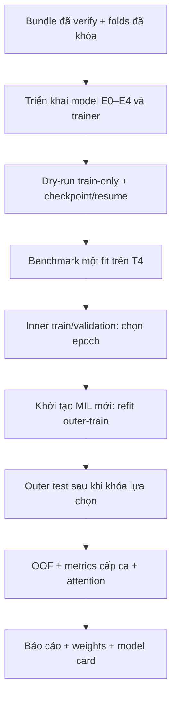

# Kế hoạch train MIL đa vật kính

> v1.1 · 11/10/2026 · Asia/Ho_Chi_Minh. Kế hoạch thực thi giai đoạn G6–G8 của [kế hoạch tổng quát](MIL_MULTISCALE_REFERENCE.md). Nội dung kiến trúc, nguyên lý, đóng băng, custom và nguồn bài báo được lưu đầy đủ trong [MIL_MODEL_EXPLAINED.md](MIL_MODEL_EXPLAINED.md). [Phụ lục kiểm thử local và phục hồi Colab Free](COLAB_TRAINING_RELIABILITY.md) bổ sung lộ trình L0–L3 → C0–C3, bảng rủi ro và test ngắt/resume cho kế hoạch này.

**Trạng thái:** dữ liệu trước train đã nghiệm thu; chưa triển khai/nghiệm thu trainer MIL, chưa huấn luyện MIL, chưa có checkpoint hoặc metrics MIL. Việc lưu kế hoạch không khởi tạo phiên Colab hoặc chạy training.

## 1. Mục tiêu và đầu vào đã xác nhận

- Phân loại **lành/ung thư ở cấp ca**: có CARCINÔM → 1; chỉ tăng sản lành tính/kèm viêm → 0. Giữ `Glade` gốc, không dùng làm nhãn patch hoặc suy ra ISUP.
- Mỗi ca release tương ứng một người khác nhau theo xác nhận của người dùng.
- Study chính `common`: 16 ca/người, 9 lành/7 ung thư, 146.506 instance; đủ 4×/10×/40×.
- Study bổ sung `all`: 18 ca/người, 10 lành/8 ung thư, 148.990 instance; có mask lens thiếu. Hai cohort có overlap, không phải hai test sets độc lập.
- Feature cache nguồn giữ nguyên: 148.991 vector float32 × 2.048 chiều, ResNet50 ImageNet V1 frozen. Duplicate đã được xử lý ở tham chiếu bundle.
- Đã verify hai bundle và loader 34/34 lượt ca. Bằng chứng: [báo cáo nghiệm thu](../../Results/planning_20261010/pretrain/final_verified_20261011/BAO_CAO_HOAN_TAT.md).

| Định danh phải pin trong run config/checkpoint | Giá trị |
|---|---|
| Feature ID | `7301faeb7b193fb077451a9f2da44bbb609b69d3d7647261df73c351590cbe04` |
| Governance ID | `7665c85d068e73ba29202e1920f061029d52dc8c2d9393f9fe744a80d14d22af` |
| common bundle | `6e412d65e429ad19c3bcec645a19d7ee06fe75e560ef67149233f14d4175b0ff` |
| all bundle | `3dcf6aa5092118a1d654998e670680fdfff27f94780700fff533cb39a111647a` |

Không trích lại features, chỉnh màu hoặc đổi split âm thầm. Trước run thật phải kiểm lại manifest/checksum/readiness của bundle trên Drive.

## 2. Kiến trúc vòng đầu

**Frozen ResNet50 ImageNet V1 → projection dùng chung 2.048→128 → gated Attention-MIL riêng từng lens → concat ba vector 128 và ba mask → linear 387→1.**

Encoder đã pretrained, bỏ classifier ImageNet và đóng băng; train chỉ cập nhật projection, attention và classifier mới khởi tạo ngẫu nhiên. Mỗi mẫu supervised là một ca gồm ba ma trận `N_lens × 2048` và nhãn ca; N có thể khác nhau. Case/patient ID, filename, tọa độ và `Glade` không là feature của classifier baseline.

Lens thiếu dùng vector zero/mask 0; không tạo patch giả, không softmax bag rỗng. Fusion cấp ca vì chưa xác minh registration giữa lens. Attention không là xác suất ung thư patch. Chi tiết công thức, luồng gradient và suy luận: [phụ lục nguyên lý](MIL_MODEL_EXPLAINED.md).



## 3. Protocol huấn luyện và đối chứng

Giữ nguyên nested CV **3 outer × 2 inner**, seed 42, patient-grouped, splits đã nằm trong bundle. Không chia theo patch/ảnh/ZIP.

1. Giữ riêng outer test của lượt hiện tại.
2. Train hai inner fits trong outer-train; chọn checkpoint bằng inner validation BCE.
3. Lấy median hai best epochs, làm tròn lên và ít nhất 1.
4. Khởi tạo MIL/optimizer mới; refit toàn outer-train đúng số epoch đã chốt.
5. Dự đoán outer test sau khi đã khóa cấu hình, weights và threshold.
6. Lặp ba outer folds; mỗi ca có một dự đoán OOF từ model không học người đó.

Không chuyển MIL weights đã học giữa folds. Outer test không dùng chọn model, epoch, preprocessing, calibration hoặc threshold.

| Mã | Biến thể trên cùng common cohort/folds | Trọng số học |
|---|---|---|
| E0 | Mean riêng từng lens + linear fusion 6.147→1 | Linear head |
| E1 | Attention-MIL chỉ 4× | Projection, attention, head |
| E2 | Attention-MIL chỉ 10× | Projection, attention, head |
| E3 | Attention-MIL chỉ 40× | Projection, attention, head |
| E4 | Attention-MIL fusion ba lens | Shared projection, ba attention, head |

Primary contrast dự kiến: **E4 so với E2**. Báo đầy đủ cả năm biến thể. Một setting/seed: **5 × 3 × (2 inner fits + 1 refit) = 45 fits**, chưa gồm study all hoặc cải tiến. Không chọn winner bằng outer score rồi dùng lại chính score đó như đánh giá độc lập của winner; nếu chọn thuật toán, việc chọn phải nằm trong inner loop.

| Cấu hình khởi đầu, chưa tối ưu | Giá trị |
|---|---|
| Encoder/preprocess | Giữ cache ImageNet V1 hiện tại; không chạy CNN trong MIL fit |
| Projection / gated hidden | 128 / 64 |
| Dropout | 0,25; pin vị trí đặt khi triển khai |
| Loss | BCEWithLogitsLoss trực tiếp trên logit và nhãn ca |
| Optimizer | AdamW |
| LR attention / mean-linear | `1e-4` / `1e-3` |
| Weight decay | `1e-3` |
| Epoch / patience | Tối đa 30 / 5, chỉ inner validation BCE |
| Batch / precision | Một ca, head FP32 |
| Threshold control | 0,5; nếu tối ưu/calibration thì fit trong inner data |

Full bag là control. Chỉ mở sampling sau benchmark OOM/budget với policy/version công khai; không tự cắt bớt patch giữa các fits. Validation/test dùng đầy đủ features hợp lệ. Nếu chunk attention, softmax phải chuẩn hóa toàn bag.

## 4. Các bước thực thi và tiêu chí nghiệm thu

| Bước | Đầu vào → công việc | Đầu ra lưu | Điều kiện qua |
|---|---|---|---|
| T0 · pin protocol | Bundle/folds đã verify → xác minh readiness, hashes, release code, run config | preflight, resolved config, fingerprints | Nhãn/cohort/split/cache đúng; không writer xung đột |
| T1 · phát triển | Thiết kế E0–E4 → model, trainer, dataset adapter, evaluator, notebook | Source, tests, docs, runtime code, PR/CI | Băng chuyền 6 trạm AGENTS.md qua; lỗi theo E2E protocol |
| T2 · dry-run | Local L0–L3: toy + vài features thật thuộc inner-train, vòng train/valid/checkpoint và lỗi giả lập → Colab integration/GPU smoke C0–C1 | Contract/loop/fault reports, smoke checkpoint, environment, logs | Loss/gradient hữu hạn; đúng shape/mask; chỉ khối MIL học; reorder eval; save/load/resume; không dùng outer-test; xem phụ lục reliability |
| T3 · benchmark | C2: trainer qua local/GPU smoke → full-bag ca lớn trong outer-train và pilot train/inner-validation | Duration, peak RAM/VRAM, I/O, checkpoint latency, budget estimate | Đủ RAM/VRAM; lập lịch số fits theo số đo; không xem outer test để chỉnh study |
| T4 · inner fits | common/folds + config đã khóa → train/validate hai lượt mỗi outer | last/best checkpoints, history, best epochs | Không patient leakage; validation không update; checkpoint bền và resume được |
| T5 · outer refit/test | Epoch chốt từ inner → MIL mới, refit rồi test | final_refit weights, predictions theo outer | Không test-driven tuning; mỗi test case đúng model/fold; mọi phiên bản truy vết được |
| T6 · tổng hợp | Predictions cả outer folds → metrics/OOF/maps | OOF CSV, metrics/counts, uncertainty, attention maps | Đủ ca không trùng/thiếu; chỉ báo metrics cấp ca; map không diễn giải thành patch truth |
| T7 · bàn giao | Runs/metrics/weights → báo cáo/model card/config inference | Final report, weights/checksums, model card | Phân biệt OOF của fold models và model refit demo; ghi mọi run lỗi; dừng tasks/runtime của công việc an toàn |

Heavy processing/training nghiên cứu chạy Colab; local được chạy vòng lặp/train CPU nhẹ có cap dữ liệu/thời gian theo yêu cầu mới của người dùng. Không chạy full cohort/fine-tune local. Trước khi dùng T4 cần release trainer, notebook và runtime mới: runtime pretrain hiện có không phải trainer MIL. Chi tiết giới hạn, lỗi dự đoán, F01–F12 và điều kiện chuyển môi trường trong [COLAB_TRAINING_RELIABILITY.md](COLAB_TRAINING_RELIABILITY.md).

## 5. Lưu trữ và resume trên Colab

Cấu trúc **đề xuất cho giai đoạn train**, chưa được tạo bởi việc lưu kế hoạch:

```text
MyDrive/histology/
  features/v001/                    cache đã có, giữ nguyên
  bundles/<bundle_id>/              cases/bags/refs/splits đã verify
  runtime/                          runtime trainer và notebook theo version/hash
  training_runs/<run_id>/
    resolved_config.json            model/cohort/split/cache/code/seed
    status.json                     tiến độ, fit hiện tại, blocker, next_fit
    events.jsonl                    sự kiện có timestamp
    fits/E0..E4/outer_<k>/inner_<j>/
      history.csv
      checkpoints/last.pt
      checkpoints/best_val.pt
    fits/E0..E4/outer_<k>/refit/
      checkpoints/final_refit.pt
      predictions.csv
    evaluation/                     oof_predictions.csv, metrics, counts, maps
    reports/                        report, model card, checksums
```

`/content` là scratch: stage features cần dùng lên SSD Colab, chỉ đưa bag hiện tại lên GPU. Không nạp toàn PNG/cohort vào RAM. Notebook mount/config một lần mỗi phiên.

**Bổ sung sau benchmark 11/10/2026:** public loader mất9,437 giây cho một ca19.736 instances, GPU step0,028 giây; full-bag pilot khoảng57 giây/epoch. Chuẩn bị cache bag đầy đủ từng ca trên SSD qua public verified loader một lần, bound source hashes/IDs và tile order. Training đọc cache có checksum từng ca, vẫn full-verify nguồn đầu run; không sampling/re-encode hoặc fit preprocessing trên test. So byte-equivalence, adversarial gates, CI và benchmark T4 lại trước C3. Xem [hướng dẫn cache](../MIL_TRAINING.md).

Checkpoint giữ model, optimizer, epoch, best metric/patience, RNG, scaler/scheduler nếu dùng và fingerprints. Resume cùng fit ở ranh giới epoch; ngắt giữa epoch replay từ snapshot an toàn. Ghi qua temp/commit, checksum và xác minh trên Drive; file tồn tại chưa đủ. Không ghi đè checkpoint hợp lệ trước khi bản mới được xác minh.

Ngân sách lập lịch của dự án: **330 phút T4/ngày**, dành **30 phút dự phòng**, tối đa 300 phút công việc theo budget còn lại. Đây không là cam kết quota Google. Đo thời gian fit trước khi chọn số fit trong phiên; không cam kết 45 fits xong một phiên. Khi thiếu budget, lưu trạng thái/checkpoint rồi resume; không giảm cohort/patch/fold âm thầm. Không tạo phiên hoặc chuyển profile tự động chỉ vì kế hoạch có ghi.

## 6. Đánh giá và cải tiến sau control

Metrics cấp ca: AUROC, AP, sensitivity, specificity, balanced accuracy, TP/FP/TN/FN, log loss/Brier. Lưu target, score, threshold, prediction, patient/case, outer fold, model variant và run ID. Báo từng fold và pooled OOF, mẫu số thật và bất định theo người; không xem 16 người là bộ xác nhận lớn. Không báo accuracy patch/Dice khi không có ground truth tương ứng.

Attention maps dựng trên từng ảnh nguồn bằng tile ID/x/y; không overlay khác lens khi chưa registration và không gọi attention là xác suất ung thư pixel.

Sau baseline: encoder pathology vẫn frozen, giữ toàn patch thay center crop, stain normalization/augmentation train, CLAM, fine-tune block cuối CNN. Mỗi thay đổi tách run/cache version, chọn bằng inner data, không tự coi là cải thiện trước thực nghiệm. ImageNet normalization không là stain normalization; fine-tuning CNN cần RGB và graph CNN, không cập nhật qua cache cố định.

Model refit demo trên toàn development cohort chỉ thực hiện theo cấu hình đã chọn và được ghi riêng; OOF của fold models không là test độc lập cho model demo. Xác nhận tiếp theo cần người mới ngoài cohort.

## 7. Nguồn tham chiếu và quan hệ tài liệu

- [Giải thích đầy đủ kiến trúc/nguyên lý và custom](MIL_MODEL_EXPLAINED.md).
- [Kế hoạch kiểm thử local → Colab Free và phục hồi sự cố](COLAB_TRAINING_RELIABILITY.md).
- [Kế hoạch tổng quát G0–G8](MIL_MULTISCALE_REFERENCE.md).
- [Kế hoạch trước train đã nghiệm thu](PRETRAIN_FINALIZATION.md) và [bằng chứng kết quả](../../Results/planning_20261010/pretrain/final_verified_20261011/BAO_CAO_HOAN_TAT.md).
- [Attention-MIL — Ilse et al., ICML 2018](https://proceedings.mlr.press/v80/ilse18a.html): gated pooling; [mã tác giả](https://github.com/AMLab-Amsterdam/AttentionDeepMIL).
- [MRMIL — Li et al., 2021](https://arxiv.org/html/2011.02679): tuyến tiền liệt, nhãn yếu, đa độ phóng đại; không tái lập registration/zoom nguyên bản trên dữ liệu này.
- [CLAM — Lu et al., 2021, nguồn chính thức](https://github.com/mahmoodlab/CLAM): feature/provenance và MIL pipeline; baseline không có clustering loss CLAM.
- [Torchvision ResNet50](https://docs.pytorch.org/vision/stable/models/generated/torchvision.models.resnet50.html): ImageNet V1 weights/transforms.
- [Varma & Simon, 2006](https://link.springer.com/article/10.1186/1471-2105-7-91): nested model selection và evaluation.

## 8. Checklist giám sát

- [x] Nội dung kế hoạch và phụ lục nguyên lý đã lưu; liên kết từ mục lục/tổng quát.
- [x] Dữ liệu trước train đã nghiệm thu, folds và hai bundle đã verify.
- [ ] T0: preflight lại artifact trước run.
- [ ] T1: triển khai/release model, trainer, evaluator, notebook; CI qua.
- [x] Bổ sung kế hoạch local→Colab, rủi ro/failure tests và checkpoint commit; chưa thực thi các tests MIL.
- [ ] T2: local L0–L3 và Colab C0–C1, dry-run/failure tests/checkpoint-resume qua.
- [ ] T3: C2 full-bag benchmark T4, checkpoint latency và phân bổ budget theo số đo.
- [ ] T4–T5: inner fits, outer refits/test theo protocol đã khóa.
- [ ] T6–T7: OOF, metrics, báo cáo, weights, model card và cleanup.

## 9. Lịch sử thay đổi

| Phiên bản | Ngày | Nội dung |
|---|---|---|
| 1.0 | 11/10/2026 | Lưu thiết kế train E0–E4, nested protocol, T0–T7 và phụ lục nguyên lý. |
| 1.1 | 11/10/2026 | Bổ sung train loop nhẹ local trước Colab, risk register, fault-injection/resume, giới hạn tài nguyên và gates local/CPU/T4; không tạo VM hoặc chạy training. |
