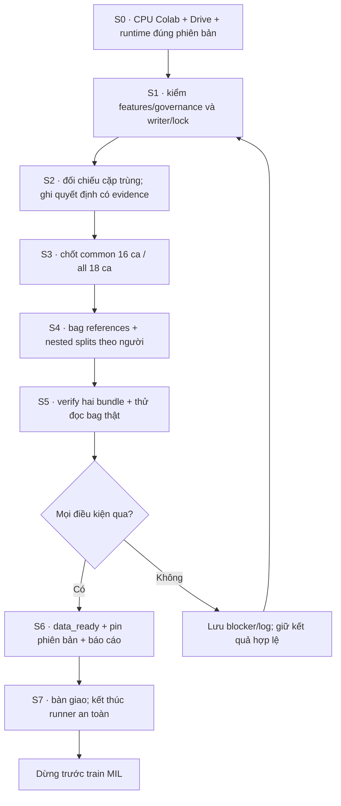

# Kế hoạch thực thi phần còn lại trước train MIL

> v1.1 · 11/10/2026 · Asia/Ho_Chi_Minh. Nối tiếp [kế hoạch tham chiếu](MIL_MULTISCALE_REFERENCE.md). Kết thúc khi hai bundle `common` và `all` đã được tạo, kiểm chứng trên dữ liệu thật và bàn giao; chưa huấn luyện MIL.

## Cập nhật thực thi 11/10/2026 — dữ liệu đã nghiệm thu

- Chuyển an toàn sang `thiha060174@gmail.com`; CLI xác minh đúng tài khoản, CPU mới đọc/ghi cùng thư mục Drive qua shortcut. Không tải lại ZIP hoặc trích lại features.
- Đã phân xử một cặp duplicate: loại một reference, giữ nguyên 148.991 vector và ảnh gốc. Runtime khóa scikit-learn 1.8.0; lỗi shuffle 1.6.1 đã được tái hiện E2E và sửa, giữ seed 42/protocol 3×2.
- Run `pretrain-20261010T182928-ae5ebc9039` đã build/verify hai bundle và báo `data_ready` lúc 01:35:21 ngày 11/10/2026.
- `common`: 16 ca/người, 9 lành/7 ung thư, 146.506 instance, 48 bag hiện diện. Bundle ID `6e412d65e429ad19c3bcec645a19d7ee06fe75e560ef67149233f14d4175b0ff`.
- `all`: 18 ca/người, 10 lành/8 ung thư, 148.990 instance, 51 bag hiện diện/3 mask thiếu. Bundle ID `3dcf6aa5092118a1d654998e670680fdfff27f94780700fff533cb39a111647a`.
- Loader đã kiểm toàn bộ 34/34 lượt ca lúc 01:47:01: shape/dtype/finite, vector–tile order, nhãn ca, bag IDs và masks đều qua. Đây là 18 người bệnh, hai cohort có overlap, không phải 34 người hoặc hai test sets độc lập.
- Bằng chứng tải trực tiếp từ Drive và đối chiếu SHA ở [báo cáo hoàn tất](../../Results/planning_20261010/pretrain/final_verified_20261011/BAO_CAO_HOAN_TAT.md), cùng `status.json`, `loader_smoke_report.json`, `FINAL_REPORT.md`, `resolved_config.json`.
- Runtime mới SHA `79b41a0da1e0cae64d20d28cb71d38deab3acdb5a38a704de4f64a808fa4a60e` đã lưu Drive, giữ bản cũ theo hash. Code commit `5a50673`, PR #5 chưa merge; 214 tests local qua/1 optional skipped và 6 checks CI qua.
- Chưa train MIL hoặc tạo metrics/checkpoint training. Lịch tự tắt máy vẫn đã hủy; trạng thái kết thúc CPU được ghi trong receipt bàn giao.

Các bảng “điểm xuất phát” dưới đây là snapshot lịch sử; ưu tiên trạng thái nghiệm thu ở trên. S0–S7 đã PASS: báo cáo có checksum, không còn writer, Drive đã flush/unmount và CPU đã dừng. Máy Na không tự tắt.

**Giai đoạn kế tiếp:** [kế hoạch train MIL T0–T7](MIL_TRAINING_PLAN.md), kèm [phụ lục nguyên lý mô hình](MIL_MODEL_EXPLAINED.md). Việc chuẩn bị dữ liệu hoàn tất không đồng nghĩa MIL đã được huấn luyện.

## Điểm xuất phát

| Hạng mục | Bằng chứng gần nhất | Trạng thái |
|---|---|---|
| Nguồn | 25 ZIP, 1.812 ảnh nguồn, 148.991 patch; metadata khớp release | Hoàn tất |
| Encoder | ResNet50 pretrained ImageNet V1, frozen/eval; float32, 2.048 chiều | Đã chạy thật |
| Features | 25 part, 148.991 vector; source/feature/global audit qua | Hoàn tất |
| Governance | 18 ca = 18 người; 10 lành, 8 ung thư; có evidence | Hoàn tất |
| Duplicate | Một cặp hai patch cùng ca/người, phát hiện bằng cả hash PNG và hash pixel | Chờ phân xử |
| Bags/splits | Runner dừng tại `attention_required`; chưa có bundle verify | Chưa hoàn tất |
| Runtime | T4 cũ đã kết thúc; cần kiểm phiên hiện tại trước khi chạy | Cần Colab CPU |

Đây là snapshot bằng chứng, không phải một lần đọc Drive mới khi viết kế hoạch. Khi thực thi phải xác minh lại artifact trên Drive.

- Feature ID: `7301faeb7b193fb077451a9f2da44bbb609b69d3d7647261df73c351590cbe04`.
- Governance ID: `7665c85d068e73ba29202e1920f061029d52dc8c2d9393f9fe744a80d14d22af`.
- Run bị chặn: `pretrain-20261010T122452-f6ca4d9d75`.
- Metadata SHA-256: `165325a2baf51f86ed05849d7ed60f6d98b452f747a43bb0349b7c29cf5fe580`.
- Runtime pretrain SHA-256: `be5e62b12018b2cdace3020e81ed2537c9595e7112a49f47121ba18546d0db87`.

Quy tắc người dùng đã xác nhận: mỗi ca release là một người khác nhau; kết luận có CARCINÔM → nhãn ca 1, kể cả có vùng lành; chỉ tăng sản lành/kèm viêm → nhãn ca 0. Giữ `Glade` gốc, không suy ISUP/Grade Group, không biến nhãn ca thành nhãn ung thư cho mọi patch.

## Thứ tự thực thi



Một phiên CPU chạy tuần tự; chỉ một runner/writer pretrain. Local chuẩn bị code/config và đọc bằng chứng nhỏ. Hash toàn release, kiểm vector và xây bundle chạy trên Colab. Không cần tải lại ZIP từ máy hoặc trích vector trên T4 lần nữa.

## S0 — Chuẩn bị CPU và Drive

- **Đầu vào:** profile `ad8410552`, Drive chứa `MyDrive/histology`, notebook/runtime ZIP bàn giao.
- **Làm:** kiểm phiên còn tồn tại; dùng CPU; mount đúng Drive; kiểm runtime SHA trước khi giải nén vào `/content/histology-pretrain-runtime`. Chỉ cài dependency thiếu, không upgrade môi trường encoder.
- **Config:** root `/content/drive/MyDrive/histology`; cohorts `common/all`; expected nguồn/vector `25/148991`; seed 42; `allow_training=false`. Kiểm và chọn `governance/reviews/user_confirmation_v002.json`, phiên bản đã binding đúng schema.
- **Đầu ra:** config run mới và CPU truy cập được nguồn/cache/governance.
- **Đạt:** đúng root, checksum/version, không tạo runtime trùng. VM mới cần yêu cầu/xác nhận rõ; nếu Google hỏi quyền Drive, người dùng tự chấp thuận trên Chrome của họ.

## S1 — Preflight artifact hiện có

- **Đầu vào:** feature status/release, audits/commits, governance và config.
- **Làm:** kiểm checksum, 25 nguồn/part, 148.991 vector, complete flags, audit và mapping 18 người/10–8 nhãn. Kiểm writer/locks trước ghi.
- **Đầu ra:** evidence preflight và config thực tế trong `pretrain_runs/<run_id>/`; events ghi tiến độ.
- **Đạt:** cache `148991 × 2048`, float32, không NaN/Inf; các artifact cùng snapshot; không có writer sống. Chỉ recover lock stale sau khi xác minh phiên cũ đã dừng, không tự xóa lock để vượt kiểm tra.

## S2 — Phân xử cặp patch trùng

- **Đầu vào:** duplicate groups mà audit tham chiếu, template hai dòng của run bị chặn và tile index hai member.
- **Làm:** so `tile_id`, ca/người, ảnh nguồn, lens, tọa độ, kích thước và hai hash. Không kết luận chỉ từ tên file có hậu tố `(1)`.
- **Quyết định:** nếu cùng ảnh/vị trí và nội dung giống hoàn toàn, giữ một canonical tile trong bag, loại tham chiếu bản sao. Hai dòng PNG-hash/pixel-hash phải nhất quán. Ghi reviewer thực tế, thời điểm và evidence; không giả chữ ký bác sĩ.
- **Đầu ra:** `governance/reviews/duplicate_dispositions.csv`; hồ sơ đối chiếu bổ sung `pretrain_runs/<run_id>/duplicate_review_evidence.json`.
- **CSV:** `kind,sha256,keep_tile_ids_json,exclude_tile_ids_json,canonical_tile_id,reviewer,reviewed_at,evidence`.
- **Đạt:** tất cả group/member có quyết định; canonical thuộc nhóm giữ; quyết định giữa hai hash group không mâu thuẫn. Nếu provenance khác hoặc có nhóm mới, ghi blocker và xem xét riêng.
- **Bảo toàn:** giữ toàn bộ ZIP/PNG/cache 148.991 vector. Chỉ số instance được chọn trong bundle có thể giảm; công cụ tính số thực tế sau review.

## S3 — Chốt hai cohort

| Bundle | Phạm vi dự kiến | Nhãn ca | Lens |
|---|---|---|---|
| `common` | 16 ca/người đủ 4×/10×/40× | 9 lành / 7 ung thư | Cohort chính, dùng cùng folds để so sánh E0–E4 |
| `all` | 18 ca/người | 10 lành / 8 ung thư | Cohort bổ sung, mask 3 vị trí lens thiếu |

- **Đầu vào:** governance, coverage thật trong index, duplicate dispositions.
- **Làm:** tính lại ca/lens/instance sau loại tham chiếu duplicate. `all` có một ca chỉ 40× và một ca 10×/40×; không thêm vector trắng.
- **Đầu ra:** `cases.csv`, exclusions và số instance trong `cohort_exclusions.csv`/manifest.
- **Đạt:** số ca/lớp/lens đúng; mỗi loại trừ có lý do; dữ liệu ca gốc vẫn truy được qua governance.

## S4 — Tạo bags và nested splits

- **Đầu vào:** features/tile indices, governance, cohort policy và duplicate decisions.
- **Bag:** mỗi `case_id × lens` lưu references `feature_id/part_id/row_index/tile_id`, ảnh nguồn, lens và tọa độ. Không sao chép toàn bộ ma trận feature.
- **Số bag dự kiến:** `common` có 48 ca-lens hiện diện; `all` có 54 vị trí, 51 hiện diện và 3 thiếu. Lens thiếu: `present=false`, `instance_count=0`.
- **Split:** `StratifiedGroupKFold`, seed 42; 3 outer folds, mỗi outer-train có 2 inner folds. Outer-test giữ riêng; inner-train/validation chỉ lấy từ outer-train. Một người luôn ở một phía trong mỗi split; đổi vai trò giữa các lượt cross-validation là đúng protocol.
- **Leakage:** kiểm patient, ca, ảnh nguồn và duplicate content được giữ. E0–E4 dùng chung split của `common`. `all` chia sẻ người bệnh với `common`, không phải một test set độc lập.
- **Đầu ra:** hai bundle ID với bags/references/cases/splits/exclusions/manifest/readiness.
- **Đạt:** reference đúng part/hàng/tile; partition cần dùng đủ hai lớp; không giao người/nội dung. Nếu 3×2 không khả thi, dừng và trình bày thay đổi protocol trước train.

## S5 — Verify và thử loader thật

- **Đầu vào:** hai bundle cùng feature cache bất biến.
- **Làm:** verify cả hai; kiểm checksum/version/counts/splits/masks/thứ tự vector–reference. Thử loader lần lượt từng ca/lens: ma trận `N × 2048`, finite, tile order và nhãn ca đúng.
- **RAM:** đọc theo part/chunk và từng ca, giải phóng trước ca tiếp; không nạp mọi ca-lens đồng thời. Kiểm RAM/dung lượng trước khi chọn scratch.
- **Đầu ra:** `training_readiness.json` mỗi bundle, events và báo cáo nghiệm thu bổ sung `loader_smoke_report.json`.
- **Đạt:** cả hai verifier `status=ready`, `training_ready=true`; loader qua; không blocker. Test local/CI không thay nghiệm thu dữ liệu thật.

## S6 — Chốt phiên bản và bàn giao

- **Đầu vào:** hai bundle verify và loader S5.
- **Làm:** ghi run ID, hai bundle ID, feature/governance ID, checksum code/runtime/config/review, seed; số vector gốc/instance được chọn/duplicate loại/ca-lens thiếu mỗi cohort.
- **Đầu ra bổ sung:** `pretrain_runs/<run_id>/FINAL_REPORT.md`; bản báo cáo/bằng chứng nhỏ tại local `Results/planning_20261010/pretrain/`. Không tải toàn bộ features về máy để viết báo cáo.
- **Đạt:** runner `status=data_ready`, `data_ready=true`, đủ hai cohort verify. Runner thành công nhưng loader bổ sung chưa qua thì chưa nghiệm thu toàn kế hoạch.
- **Đầu vào MIL sau này:** mỗi ca gồm ba ma trận feature theo lens, mask thiếu, nhãn ca 0/1 và fold tương ứng. Encoder đã pretrained/frozen; chưa có trọng số MIL được train.

## S7 — Kết thúc an toàn

- Kiểm writer đã kết thúc, Drive đã lưu bền; kết thúc tác vụ nền thuộc công việc này. Chỉ flush/unmount khi không còn writer. Dừng runtime theo yêu cầu/xác nhận hiện hành.
- Ghi trạng thái kết thúc vào báo cáo. Không dừng workload khác.
- Lịch giám sát/tự tắt máy đã bị hủy theo người dùng; kế hoạch này không khôi phục automation hoặc tự shutdown máy Na.

## Cấu trúc lưu trữ

```text
MyDrive/histology/                       # bền giữa các phiên
  source/Metadata.xlsx                   # giữ nguyên
  source/archives/                       # 25 ZIP, giữ nguyên
  runtime/histology-pretrain-runtime.zip
  governance/reviews/
    user_confirmation_v002.json
    case_review.csv
    duplicate_dispositions.csv           # mới sau S2
  governance/<governance_id>/             # nhãn ca/patient provenance
  features/v001/<feature_id>/             # giữ cache đầy đủ
  bundles/<common_bundle_id>/             # mới: 16 ca
  bundles/<all_bundle_id>/                # mới: 18 ca + mask
    bags.jsonl, instance_refs.jsonl
    cases.csv, cohort_exclusions.csv
    splits.json, bundle.json
    training_readiness.json
  pretrain_runs/<new_run_id>/
    status.json, events.jsonl, resolved_config.json
    duplicate_review_evidence.json        # nghiệm thu bổ sung
    loader_smoke_report.json              # nghiệm thu bổ sung
    FINAL_REPORT.md                       # bàn giao bổ sung
/content/histology-pretrain-runtime/      # code tạm, mất khi xóa runtime
Results/planning_20261010/pretrain/        # bằng chứng/báo cáo nhỏ local
```

Các file “bổ sung” do bước nghiệm thu/bàn giao ghi; không phải tất cả được runner tự sinh. Runner hiện tự tạo status/events/config, governance, bundles và readiness.

## Vận hành một phiên và tiếp tục sau ngắt

1. S0–S2: mount, preflight, review duplicate; lưu quyết định trên Drive ngay.
2. S3–S6: runner `build` tạo/verify `common` và `all`; thử loader, lưu báo cáo.
3. S7: kiểm lưu bền và kết thúc. Đo thời gian từng phase thực tế, không suy thời gian từ smoke nhỏ.

Lệnh sau dùng khi S0–S2 qua; config đã chọn confirmation v002. Đặt biến `PRETRAIN_DEADLINE_UTC` thành deadline ISO-8601 có múi giờ phù hợp CPU hiện tại; không dùng cutoff T4 cũ đã hết:

```bash
python /content/histology-pretrain-runtime/scripts/run_pretrain_colab.py \
  --config /content/histology-pretrain-run-config.json \
  --mode build \
  --deadline-utc "$PRETRAIN_DEADLINE_UTC" \
  --duplicate-dispositions /content/drive/MyDrive/histology/governance/reviews/duplicate_dispositions.csv
```

Deadline là giới hạn an toàn nội bộ runner, không phải lịch tắt máy/automation. Phần còn lại không dùng GPU; 5 giờ 30 phút T4/ngày không phải một ngân sách CPU mới. Drive/hash verification vẫn có thể chậm và Colab vẫn có thể ngắt.

| Trạng thái | Hành động |
|---|---|
| `attention_required` | Đọc blocker, bổ sung review/config; không báo hoàn tất |
| `error` | Giữ artifacts/log; lỗi code phải tái hiện E2E trước sửa, rồi regression/CI |
| `interrupted`/hết deadline | Kiểm writer cũ dừng; mount lại; verify artifacts đã commit; chạy lại |
| `data_ready` | Kiểm cả hai bundle và loader bổ sung trước bàn giao |

Resume giữ source/feature/governance/config. Có thể hash/audit lại cache và tạo run ID mới, nhưng không chạy lại encoder. Không publish bundle dở dang là ready, không recover lock khi writer còn sống.

## Checklist nghiệm thu trước train

- [ ] S0: CPU/Drive/runtime/config đúng; tạo phiên mới có xác nhận.
- [ ] S1: release 25 part/148.991 vector và governance 18 người/10–8 nhãn qua.
- [ ] S2: duplicate evidence/CSV đầy đủ, nhất quán.
- [ ] S3–S4: cohort 16/18, bags/masks và nested splits được tạo.
- [ ] S5: hai verifier và loader thật qua; patient/content leakage bằng 0.
- [ ] S6: `data_ready`, bundle IDs/checksums/báo cáo lưu Drive/local.
- [ ] S7: không còn writer công việc; kết thúc theo yêu cầu; không tự tắt máy.

Kết quả cuối: hai bộ đầu vào MIL có truy xuất ngược, nhãn ca, mask và splits; chưa có checkpoint training, prediction, accuracy/AUC hoặc kết quả outer-test.

## Bằng chứng và tài liệu triển khai

- `Results/planning_20261010/pretrain/monitors/pretrain.json`: quan sát Colab thật cuối 20:21:54 ngày 10/10/2026, full audit qua, terminal duplicate-review blocker.
- `Results/planning_20261010/pretrain/shutdown_heartbeat_status.json`: snapshot sau hủy lịch.
- `Results/planning_20261010/pretrain/user_confirmation.json`: bằng chứng xác nhận người/nhãn.
- [Hướng dẫn bàn giao](../../dist/HUONG_DAN_PRETRAIN.md), [Notebook CPU](../../dist/Colab_PreTrain_Readiness.ipynb).
- Toolkit đã có trong PR [#5](https://github.com/hongphuoc6104/De-tai-xuat-sac/pull/5), chưa merge; code có trong runtime bàn giao. Test/CI đã qua; bundle thật chưa nghiệm thu.
