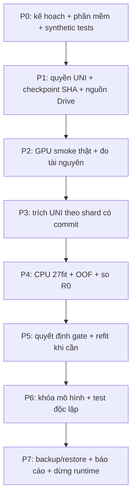

# Phương án chốt: phân loại một ảnh bằng frozen UNI

Ngày chốt: **21/10/2026**, Asia/Ho_Chi_Minh. Phạm vi được phép hiện tại: **chuẩn bị phần mềm, tài liệu và kiểm thử bằng fixture giả nhỏ**. Chưa tạo Colab, tải UNI, trích features thật hoặc train dữ liệu thật.

## 1. Quyết định và bằng chứng

- Một ảnh gốc 4×/10×/40× → score và quyết định nhị phân. Bác sĩ chấm ảnh: Glade0→0, Glade3/4/5→1. Giữ raw Glade; không gán nhãn ung thư cho từng vùng.
- Dữ liệu đã audit trước: 2.802 ảnh, 18 người; 2.298 âm/504 dương; 4×364, 10×830, 40×1.608. Phải xác minh lại nguồn Drive trước chạy.
- Phương án mới duy nhất: UNI v1 ViT-L/16 đóng băng → toàn cảnh + vùng512 → global/mean/max → 3.072D → Normalizer → train-only scaler → global L2 Logistic Regression.
- R0/RetCCL512 là đối chứng bất biến; R0–R3 đã hoàn tất, không train lại. Không đổi ngưỡng/gate sau khi xem kết quả UNI.
- UNI mới chưa được đo chất lượng hoặc VRAM trên cohort này. Phần ghép global/mean/max là thiết kế dự án, không phải recipe đã được tác giả chứng minh tối ưu.
- Không mở thêm LoRA, fine-tuning, clustering, encoder khác hay ensemble trong lượt chốt. T4/Pro dành cho extraction; head dùng CPU.

## 2. Trạng thái từng điều kiện

| Điều kiện | Trạng thái khi lập kế hoạch |
|---|---|
| R0, nguồn, folds, weights, bounded worker và checksum | Đã có; đọc lại qua loader chính thức |
| UNI adapter, views, cache, head và inference | Đang chuẩn bị và kiểm thử synthetic |
| Quyền Hugging Face UNI của người dùng | Chưa xác minh; yêu cầu access chính thức |
| Trọng số UNI và SHA256 | Chưa được cung cấp; không tải trong lượt chuẩn bị |
| Mount Drive đúng kernel/profile | Chưa kiểm tra trong lượt này |
| GPU smoke với UNI thật | Chưa chạy |
| Features UNI của 2.802 ảnh và kết quả train | Chưa có |
| SICAPv2 hoặc bệnh nhân mới cho test độc lập | Chưa chuẩn bị/verify |

Không chuyển từ “synthetic passed” sang “UNI train-ready” chỉ nhờ số lượng tests hoặc Colab Pro. Chỉ ghi ready sau khi quyền, checkpoint, dữ liệu và GPU input/output được xác minh.

## 3. Hợp đồng xử lý ảnh

1. Đọc từng ảnh trực tiếp từ ZIP, không giải nén toàn bộ. Verify ZIP SHA, member CRC/size và SHA ảnh theo baseline.
2. Dùng decoder đã có: giới hạn 512MiB/member, tối đa178M pixels, sửa hướng EXIF và chuyển RGB. Tọa độ thuộc ảnh RGB sau sửa hướng.
3. Global: bilinear resize trọn ảnh, giữ tỷ lệ, pad trắng về224×224. Đây là geometry của dự án, khác centre-crop; khóa trong descriptor.
4. Local: lưới512×512 không overlap trong tọa độ ảnh gốc; giữ phần cuối bằng pad trắng phía phải/dưới. Sau đó resize224×224. Không lọc vùng theo nhãn/score/màu trong protocol này.
5. Thứ tự global trước, local theo hàng từ trên xuống/trái sang phải. Mỗi record gồm kind,x,y,width,height phần ảnh thật; không có patch target.
6. Chuẩn hóa kênh theo UNI; model.eval, requires_grad=False, inference_mode. Precision float16 trên CUDA; lưu features float32. Không âm thầm đổi precision hoặc chuyển sang CPU.
7. Từ raw embeddings: lấy global; mean local bằng float64 accumulator; max local theo từng chiều. L2-normalize từng block, ghép theo global/mean/max thành3072D. Từ chối NaN/Inf/zero-block.
8. Worker head thêm Normalizer L2 của vector ghép trước scaler, giữ recipe normalization đã kiểm chứng của worker. Tất cả input preprocessing phải giống hệt khi suy luận.

Ví dụ4000×3800 →1global+64local=65 lượt forward, không phải65 mẫu có nhãn. Kích thước512pixel không đồng nghĩa cùng µm/pixel giữa4×/10×/40×. Mean/max có thể chịu nhiễu nền và số vùng; phải báo cáo tile count và lỗi theo vật kính, không gọi max feature là bản đồ ung thư.

## 4. Chia dữ liệu, train và quyết định

- Nạp đúng B1 original feature release và study, verify nguồn và OOF; không suy ra folds bằng seed mới.
- UNI source phải trùng từng image_id, patient_id, lens, raw Glade, target, original SHA/dimensions và ZIP lineage. Ánh xạ thứ tự bằng image_id, không theo thứ tự glob.
- Giữ3outer/2inner assignments đã lưu, kể cả deployment inner assignments; mọi vật kính của một người cùng partition. Kiểm đủ hai lớp và coverage trước fit.
- Một global head cho cả3lens. Patient-class weights tính riêng trong training scope: `N/(2*P_y*n_patient,y)`; không thêm class_weight balanced. Scaler không weighted, chỉ fit inner-train/outer-train tương ứng.
- L2 LR: `lambda={50,5,0.5,0.05}`, `C=1/(lambda*sum_weights)`, tol1e-8, iteration escalation2000/10000/50000; warning không hội tụ là lỗi, không publish model đó.
- Chọn lambda từ pooled inner OOF AUROC; tie≤1e-12 ưu tiên lambda lớn hơn. Threshold tối đa balanced accuracy bằng quy tắc baseline, chỉ chọn từ inner OOF.
- 3outer×(4lambda×2inner+1refit)=**27fits**. Fit-all tùy chọn thêm9fits, là model nghiên cứu; không là phép validation mới và không mặc định được chọn triển khai.
- Báo AUROC, AP, sensitivity/specificity/BA/accuracy, macro theo người và từng vật kính; paired patient bootstrap2000draws với R0. CI điều kiện trên OOF đã lưu, không bao phủ toàn bộ bất định fit/model-selection.
- Gate ưu tiên giữ nguyên: ΔAUROC≥0,02; AP không giảm; không lens giảmAUROC>0,02. Không qua thì giữ R0, vẫn báo cáo UNI trung thực.
- Các folds đã được xem nhiều lần: mọi kết quả nội bộ mới là thăm dò, không được gọi independent test. Phương án chốt là quyết định kỹ thuật, không là lời hứa đạtAUROC cụ thể.

## 5. Luồng thực thi và bằng chứng phải lưu



| Bước | Việc / đầu vào | Đầu ra và điều kiện đi tiếp |
|---|---|---|
| P0 hiện tại | Code, tài liệu, fixture giả; không dữ liệu bệnh nhân | Tests views/ZIP/resume/tamper/leakage/model reload; lint/AST/CI; runtime code-only |
| P1 tương lai | HF access, checkpoint local trên Drive, B1 artifacts,3ZIP gốc | Weight checksum; descriptor; data/source receipts; đúng mount; không có writer khác |
| P2 tương lai | Một runtimeGPU do người dùng cung cấp; ảnh phủ3lens và kích thước lớn | Nạp model thật; đủ1024D/view và3072D/image; peakVRAM/thời gian/cached-inference parity. Không dùng score để sửa recipe |
| P3 tương lai | Nguồn đã verify; UNI frozen | Shards đã commit; đủ2802image vectors; metadata/coords/view features; hash và statuscomplete |
| P4 tương lai | Verified UNI cache + shared folds |27fits, OOF đủ ảnh, metric/subgroup/CI/gate; không còn worker fit |
| P5 tương lai | Báo cáo và quy tắc đã khóa | ChọnR0/UNI; nếu refit UNI, thêm9fits và kiểm save/load; không báo training accuracy làm kết quả |
| P6 tương lai | Model/preprocess/threshold đã khóa, SICAPv2 được audit riêng | External manifest/label map/scale/provenance và metrics; không refit bằng test |
| P7 tương lai | Artifacts hoàn tất | Local+Drive checksum, restore receipt; writers dừng; officialDriveflush và stop runtime; không tắt máyNa |

P0 hoàn tất không tự kích hoạt P1–P7. Smoke kỹ thuật tương lai là điều kiện vận hành, không mở thêm thử nghiệm chọn mô hình.

## 6. Lưu trữ và resume

Root mới: `MyDrive/histology/image_classification/final_uni_v001/`. Không ghi vào B1 hoặc R0–R3 cũ.

```text
final_uni_v001/
  protocol/                         # bản chốt, source/weight receipts
  features/<cache_id>/
    config.json
    shards/00000/{features.npz,rows.json,commit.json}
    release.json,commit.json,status.json
  studies/<study_id>/
    config.json,status.json,events.jsonl
    arms/UNI/fold-01..03/...         # fit model/predictions/receipt/commit
    arms/UNI/deployment/...          # nếu yêu cầu research fit-all
    report/{comparison.json,oof.json,unit_manifest.json,commit.json}
  external_test/                    # chỉ tạo sau audit nguồn ngoài
  handoff/                          # manifests/checksums/restore evidence
```

- Mặc định32ảnh/shard: khoảng88shards cho2802ảnh. Một shard gồm raw view features, offsets, vector3072, rows và view coords; không tạo từng file patch trên Drive.
- Descriptor có weights, source hashes, geometry, precision, batch size, code và versions. Đổi recipe tạo cache/study khác, không tái dùng nhầm.
- Commit cuối cùng chỉ sau payload được fsync/hash. Resume verify toàn graph, không tin riêng status.json. Ngắt giữa shard thì làm lại shard đó; shard đã commit không trích lại.
- Mỗi fit có worker timeout tối đa900s và giới hạn theo budget còn lại; worker được thu hồi. Hết budget làpartial, không phảicomplete. Bản chưa commit không được dùng.
- Lock không tự cướp theo tuổi. Recovery cùng host chỉ sau khi chứng minh PID cũ chết; cross-host cần quy trình recovery với bằng chứng runtime cũ đã dừng. Không tự xóa lock để chạy tiếp.
- Mặc định mỗi lượt240phút, reserve30phút; đây là chính sách vận hành, không là quota Colab. Chưa hứa số giờ tổng; suy ra sau resource smoke thật.
- Sau extraction dừngGPU khi không còn writer; head chạyCPU. Không dùng thao tác giả giữ kết nối và không chạy encoder thứ hai.

## 7. Điều kiện công bố kết quả

- Không quảng bá UNI tốt hơn R0 chỉ dựa vào tên model/bài báo hoặc số tests passed.
- Test ngoài ưu tiên bệnh nhân mới cùng cách chụp nếu có; SICAPv2 là đánh giá chuyển miền, không xác nhận đủ3vật kính. Audit nhãn/MPP/trường nhìn và contamination trước.
- Không dùng SICAPv2 để tune rồi vẫn gọi toàn bộ nó là independent test. Không đổi ngưỡng/scaler/weights bằng test.
- Chỉ phát hành code/report tổng hợp và hướng dẫn tải UNI hợp lệ; không đưa weights UNI, token hoặc patient-level records lên GitHub.
- Nếu chưa có external data, báo `internal_complete / external_pending`, không ghi đề tài đã được kiểm định độc lập.

## 8. Nguồn và ranh giới áp dụng

- [UNI paper, Nature Medicine2024](https://www.nature.com/articles/s41591-024-02857-3): cơ sở pathology pretraining/frozen transfer, không chứng minh pooling riêng của dự án.
- [UNI v1 hướng dẫn gốc](https://github.com/mahmoodlab/UNI/blob/main/README_old.md): architecture,1024D, preprocessing và linear probing.
- [UNI access/modelcard](https://huggingface.co/MahmoodLab/UNI): access có điều kiện, email cơ quan/trường và điều kiện sử dụng nghiên cứu; quyền chưa được xác nhận.
- [Benchmark độc lập](https://www.nature.com/articles/s41551-025-01516-3): mô hình mạnh phụ thuộc nhiệm vụ; không suy điểm của cohort khác sang18người.
- [Cawley/Talbot2010](https://www.jmlr.org/papers/v11/cawley10a.html): selection bias khi dùng phép đánh giá để phát triển lặp lại.
- [SICAPv2 tác giả](https://data.mendeley.com/datasets/9xxm58dvs3/1): nguồn dự kiến cho test chuyển miền, chưa tải/audit.

[Kết quả R0–R3 đã hoàn tất](../reports/R0_R3_RESULTS_20261016.md) · [Hướng dẫn vận hành](../UNI_RUN_GUIDE.md)
