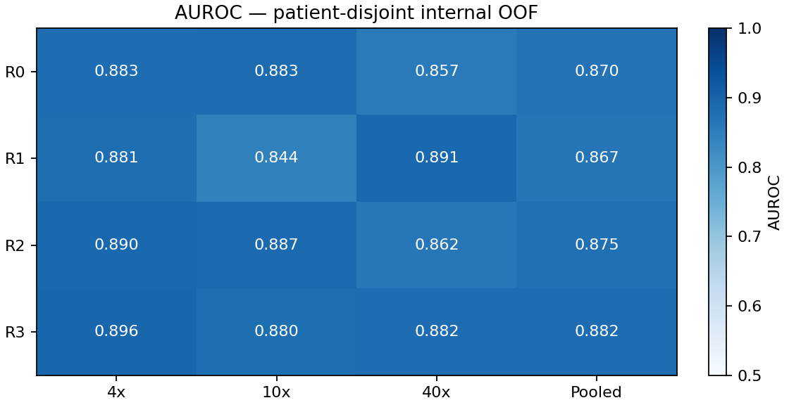

# Kết quả R0–R3 — phân loại ảnh gốc, 16/10/2026

**Quyết định: giữ R0/B1.** Đã hoàn tất 186 lượt fit và kiểm tra 204 commit (186 fit  + 18 lựa chọn head). Cả ba nhánh mới đều không đạt gate đã khóa; không chạy thêm 62 fit cho bước refit-all vì R0 đã có deployment model hợp lệ. Đây là kết quả OOF thăm dò nội bộ, chưa phải kiểm định độc lập.

## Dữ liệu và phép so sánh

- 2.802 ảnh gốc từ 18 người bệnh; 2.298 âm/504 dương. 4×: 364 ảnh; 10×: 830 ảnh; 40×: 1.608 ảnh.
- Nhãn mạnh ở cấp ảnh: bác sĩ chấm ảnh gốc, `Glade0→0`, `Glade3/4/5→1`; giữ raw Glade. Không coi mọi vùng nhỏ trong ảnh dương là ung thư.
- Giữ nguyên frozen RetCCL512 cache 2.048 chiều, trọng số backbone, metadata và R0. Không trích lại vector, crop, tăng độ phân giải hay fine-tune CNN.
- Nested grouped CV: 3 outer folds/2 inner folds, cùng assignments B1, không trộn ảnh cùng người giữa train/validation/test; λ/ratio/ngưỡng chỉ chọn bằng inner folds.
- R1/R2 dùng 108 fit đã kiểm chứng; control/R3 tạo 78 fit mới bằng backend full-batch được chứng nhận hội tụ. Không dùng outer quality để sửa optimizer.

## Kết quả chính tại ngưỡng 0,5

AUROC đo khả năng xếp hạng; cột Accuracy mới là tỷ lệ dự đoán đúng tại ngưỡng ghi rõ. AP là average precision, đánh giá thứ hạng precision–recall.

| Nhánh | Phương pháp | AUROC gộp | AP | Accuracy | Nhạy | Đặc hiệu |
|---|---|---:|---:|---:|---:|---:|
| R0 | B1: scaler → global L2 LR | 0.8698 | 0.6242 | 84.94% | 71.43% | 87.90% |
| R1 | Scaler + L2 LR riêng 4×/10×/40× | 0.8669 | 0.6448 | 87.04% | 68.45% | 91.12% |
| R2 | L2 Normalizer → scaler → global L2 LR | 0.8750 | 0.6301 | 85.30% | 73.61% | 87.86% |
| R3 | Preprocessing R2 → ElasticNet LR | 0.8819 | 0.5788 | 84.12% | 77.98% | 85.47% |

| Nhánh | AUROC 4× | AUROC 10× | AUROC 40× | AUROC cân bằng người–nhãn* |
|---|---:|---:|---:|---:|
| R0 | 0.8827 | 0.8831 | 0.8567 | 0.8361 |
| R1 | 0.8806 | 0.8435 | 0.8906 | 0.8328 |
| R2 | 0.8898 | 0.8866 | 0.8624 | 0.8391 |
| R3 | 0.8963 | 0.8801 | 0.8824 | 0.8638 |

*Đây vẫn là AUROC phân loại **ảnh**, có trọng số đều theo từng nhóm người–nhãn; không phải AUROC chẩn đoán người bệnh.

## Diễn giải và gate đã khóa

- **R1:** pooled AUROC giảm0,0029, AP tăng0,0206. 40× tăng0,0339 nhưng10× giảm0,0396, vượt mức giảm tối đa0,02. Routing tạo trade-off giữa vật kính; chưa nên thay global head.
- **R2:** AUROC tăng0,0052, AP tăng0,0059, cả3 vật kính đều tăng nhẹ. Đây là tín hiệu nội bộ nhất quán nhưng nhỏ hơn mức tăng thực dụng0,02 đã khóa; chưa đủ tiêu chí thay R0.
- **R3:** AUROC tăng0,0121 nhưng AP giảm0,0453; độ nhạy@0,5 tăng và độ đặc hiệu giảm. Sparsity chưa bảo toàn toàn bộ chất lượng; không chọn chỉ vì AUROC cao nhất.
- Gate yêu cầu Δpooled AUROC≥0,02, AP không giảm và không vật kính nào giảm AUROC>0,02. Không nhánh mới nào đạt. Không sửa gate sau khi nhìn kết quả.

## Khoảng tin cậy của chênh lệch OOF

2.000 paired bootstrap draws theo người bệnh, seed 17016, giữ số lần lặp lại của người được lấy mẫu. Các CI dưới đây điều kiện trên OOF/model đã lưu; không refit, không bao quát toàn bộ bất định fit/chọn mô hình và không thay cho external test.

| So sánh | ΔAUROC | CI 95% ΔAUROC | ΔAP | CI 95% ΔAP |
|---|---:|---|---:|---|
| R1-R0 | -0.0029 | [-0.0271; +0.0207] | +0.0206 | [-0.0666; +0.1069] |
| R2-R0 | +0.0052 | [+0.0007; +0.0118] | +0.0059 | [-0.0026; +0.0149] |
| R3-R0 | +0.0121 | [-0.0127; +0.0471] | -0.0453 | [-0.1268; +0.0210] |
| R3-R2 | +0.0069 | [-0.0164; +0.0388] | -0.0513 | [-0.1321; +0.0135] |

CI ΔAUROC của R2–R0 dương trong phép bootstrap này; mức tăng vẫn nhỏ và CI ΔAP còn chứa0. Không diễn giải thành bằng chứng mô hình sẽ tốt hơn ở bệnh viện mới.

| Nhánh | AUROC outer1 | AUROC outer2 | AUROC outer3 |
|---|---:|---:|---:|
| R0 | 0.8473 | 0.8548 | 0.9168 |
| R1 | 0.8445 | 0.8973 | 0.8989 |
| R2 | 0.8568 | 0.8629 | 0.9184 |
| R3 | 0.8715 | 0.8456 | 0.9262 |

## Ngưỡng và độ nhạy theo người

Ngưỡng được chọn riêng từ inner OOF, giữ nguyên khi dự đoán outer test. Dùng chúng không tạo ra một test độc lập mới. Weighted LR scores chưa được chứng minh là xác suất ung thư đã hiệu chuẩn.

| Nhánh | Nhạy@ngưỡng inner | Đặc hiệu@ngưỡng inner | BA@ngưỡng inner | Nhạy macro theo người@0,5 |
|---|---:|---:|---:|---:|
| R0 | 80.16% | 76.94% | 78.55% | 64.22% |
| R1 | 82.94% | 81.03% | 81.98% | 60.77% |
| R2 | 81.55% | 77.76% | 79.66% | 65.82% |
| R3 | 83.93% | 74.67% | 79.30% | 70.78% |

Macro sensitivity lấy trung bình đều trong 8 người có ảnh dương; khác với sensitivity gộp 504 ảnh dương. Không tự chỉnh ngưỡng bằng outer labels để nâng bảng điểm.

## Sparsity R3

| Fold | Lambda | L1 ratio | Hệ số khác0/2.048 | Tỷ lệ |
|---|---:|---:|---:|---:|
| fold-01 | 0.05 | 0.3 | 162 | 7.91% |
| fold-02 | 0.05 | 0.3 | 165 | 8.06% |
| fold-03 | 0.05 | 0.3 | 166 | 8.11% |

Chỉ số Jaccard giữa tập chiều khác0 của các fold: fold-01__fold-02=0.287, fold-01__fold-03=0.201, fold-02__fold-03=0.293.
Các chiều embedding không phải biomarker mô học đã xác nhận. Giảm số hệ số khác0 chưa giảm chi phí RetCCL CNN; head vẫn lưu ma trận dense. Cả3 fold chọn λ nhỏ nhất trong grid; không mở rộng grid sau khi nhìn outer score.

## Kiểm chứng và lưu trữ

- 522 kiểm thử local passed,1 optional skipped;433 test methods có active assertion;12 CI checks qua trên executable commit `a9e9bf2d491f`.
- 27 matched L2 control checks qua: max score delta 2,84×10⁻⁶ (gate 10⁻³), max relative objective delta 7,12 × 10⁻¹⁴ (gate 10⁻⁴).
- Full-batch estimator có certificate primal-dual/KKT riêng từng fit; objective/folds/weights/grids không đổi. SAGA partial cũ giữ nguyên, không trộn vào kết quả mới.
- Graph, checksum, feature source/R0 bất biến được kiểm lại. Nạp mô hình từ bundle khôi phục và dự đoán 3 vector thật 4×/10×/40× khớp score/decision; đây là smoke phần mềm, không phải đánh giá chất lượng mới.
- Kết quả Drive: `MyDrive/histology/image_classification/head_ablation_r0_r3_v001/`; xem `LATEST_COMPLETED_STUDY.json` và `BAO_CAO_R0_R3_MOI_NHAT.md`.
- Bản local riêng tư: `Results/image_classification/r0_r3_20261016/execution/final_v7/`; có report, CSV OOF, archive và receipts. Không công khai patient-level CSV trên GitHub.
- Study ID: `ebb7873f2a1363bcdbd47dd7fa9527033b6b1efb6b0370a93829ad8d5471fcc2`.
- Archive SHA256: `8d3a2f3e7377401a7a5ddd7c62a0c32f18d7fe5ddd5eb87f6047db3c8cc7d3f8`; 828 members đã kiểm tra tại Drive và local.

## Việc tiếp theo

Giữ R0 làm mốc chính đã khóa. Ưu tiên kiểm định ngoài hoặc một tập người bệnh mới chưa từng dùng để phát triển; phải kiểm metadata, nhãn ảnh, scale/MPP và preprocessing phù hợp trước. Giữ nguyên scaler/head/ngưỡng khi external test. Nếu đánh giá thêm R2, đăng ký nó như một ứng viên phụ và khóa quy trình refit trước khi nhìn kết quả ngoài. R3 tiếp tục là nhánh thăm dò; chưa có bằng chứng giảm overfitting hay bảo toàn độ chính xác.

Không kết luận nguyên nhân khác biệt là dữ liệu hay mô hình chỉ từ bảng này. 18 người bệnh vẫn là giới hạn chính về độ tin cậy; nested CV ngăn patient leakage nhưng không bảo đảm tổng quát hóa sang trung tâm khác.

Tham chiếu: [kế hoạch hiện hành](../plans/IMAGE_CLASSIFICATION_R0_R3_EXECUTION.md) và [triển khai, kiểm thử](R0_R3_IMPLEMENTATION_20261016.md).
